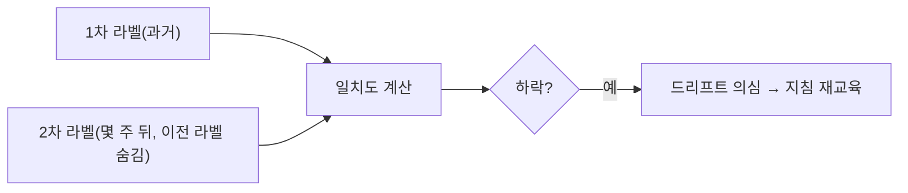
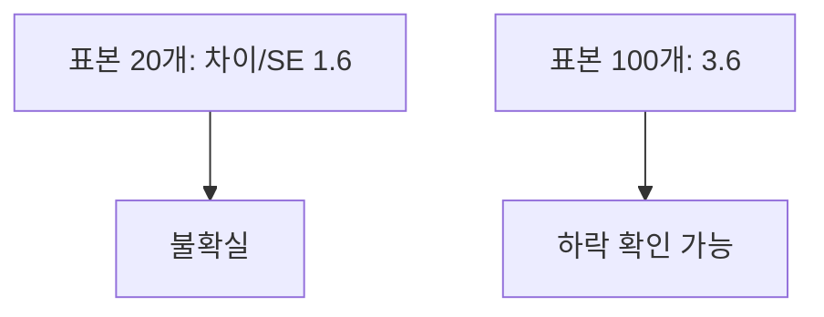

# 자기 일관성 점검

> 자기 일관성 점검은 같은 라벨러에게 시간 간격을 두고 같은 항목을 다시 라벨링시켜 과거 자신의 라벨과 얼마나 일치하는지 재는 방법이다. 라벨러의 기준이 시간에 따라 흔들리는지(드리프트)를 정답 없이 확인할 수 있다.

## 쉽게 말하면
같은 선생님이 한 달 전에 채점한 답안지를 다시 채점해 점수가 얼마나 같은지 보는 것이다. 자기 자신과도 일치하지 않는 기준은 다른 사람과 일치하기 어렵다.

## 자세히
- **재현성 관점(Artstein & Poesio, 2008, 논문 4.1.1절)**: 주석 데이터는 독립적인 코딩 작업에서 같은 결과가 재현될 때 믿을 만하다는 Krippendorff의 관점을 소개한다. 일치도로 재현성을 재려면 ① 명확한 코딩 체계와 단계별 지침 ② 코더 선택 기준의 명시 ③ 코더들이 서로 독립적으로 작업해야 한다고 한다. 지침을 데이터 생성 중에 계속 늘리는 관행, 장기 협업 전문가를 코더로 쓰는 관행, 코더끼리 논의해 다수결로 정하는 관행은 재현성 측정용 데이터를 쓸 수 없게 만든다고 지적한다. 자기 일관성 점검은 "같은 코더가 시간을 두고 독립적으로 다시 한다"는 점에서 이 요건에 맞게 설계해야 한다(해석).
- **직접 계산(이진, 한 번 판정 정확도 a가 독립이라고 가정, 두 번의 판정이 일치할 확률 = a²+(1−a)²)**: a=0.95면 0.905, a=0.9면 0.82, a=0.8이면 0.68이다. 자기 일관성이 0.82에서 0.68로 떨어졌다면 정확도가 약 0.9에서 0.8로 내려갔다는 신호다(독립 가정 하의 근사).
- **필요 표본(직접 계산, 기준 자기 일치도 0.82와 하락한 0.68의 차이를 표준오차로 나눈 값)**:

| 재라벨 항목 수 | 표준오차 | 차이/표준오차 |
| --- | --- | --- |
| 20 | 0.086 | 1.6 |
| 50 | 0.054 | 2.6 |
| 100 | 0.038 | 3.6 |
| 200 | 0.027 | 5.2 |

  차이가 표준오차의 3배 이상이면 우연이 아닐 가능성이 높으므로 100개 안팎이 현실적이다(근사 계산).
- **설계(해석)**: ① 이전 판정을 기억하지 못하도록 시간 간격(예: 2주 이상)과 섞인 순서 ② 이전 라벨을 보여 주지 않는다([라벨링 앵커링](#anchoring-in-labeling)) ③ 항목은 무작위로 뽑되 쉬운 것과 어려운 것을 섞는다 ④ 결과는 [주간 일치도 대시보드](#weekly-agreement-dashboard)와 함께 본다.
- **주의(해석)**: 자기 일관성이 높다고 정확한 것은 아니다. 일관되게 틀릴 수 있다([주석자 공통 편향](#shared-annotator-bias)).

## 그림으로 보기

## 예시
- 라벨러 C의 한 달 전 라벨 100개를 섞어 다시 주고, 자기 일치율이 0.88에서 0.70으로 떨어지면 최근 지침 변경을 점검하고 재교육한다.
- 교육 활용: 학습자가 같은 문장을 한 주 간격으로 두 번 라벨링해 자기 일치도를 계산한다.

## 헷갈리는 것과 비교
| 개념 | 차이 |
| --- | --- |
| 자기 일관성(intra) | 같은 사람의 시간 간 일치 |
| 평가자 간 일치도(inter) | 다른 사람끼리의 일치 |
| [라벨링 앵커링](#anchoring-in-labeling) | 과거 라벨을 보여 주면 생기는 편향 |
| [평가자 간 일치도](#inter-annotator-agreement) | 평가자 간 지표 |

## 더 읽을거리
- [Inter-Coder Agreement for Computational Linguistics (Artstein & Poesio, 2008)](https://aclanthology.org/J08-4004.pdf) — 재현성 측정의 요건(독립성·명시적 지침)
