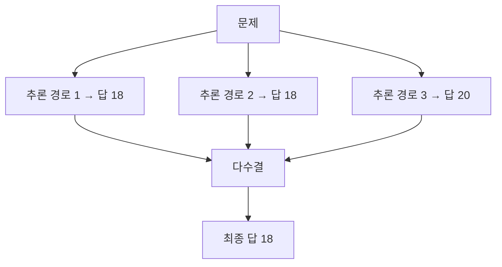
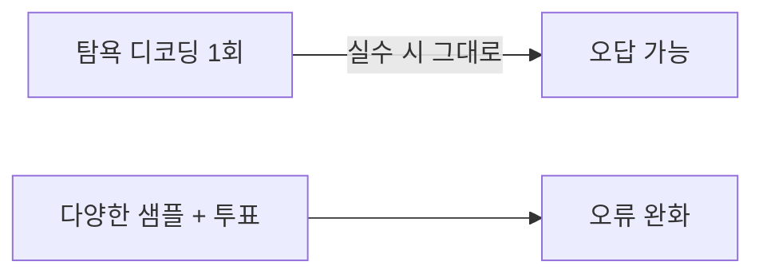

# 자기 일관성 투표

> **자기 일관성(self-consistency)** 은 한 번만 풀지 않고 **여러 추론 경로를 다양하게 뽑은 뒤 가장 많이 나온(일관된) 답을 고르는** 방법이다. 사고의 연쇄 프롬프트의 정확도를 높인다.

## 쉽게 말하면
수학 문제를 서로 다른 방법으로 다섯 번 풀어 보고, 네 번 같은 답이 나오면 그 답을 믿는 것이다. 한 번의 실수는 다수결에서 묻힌다.

## 자세히
(Wang 외, arXiv 2203.11171, ICLR 2023 초록 확인)
- **방법**: 탐욕 디코딩 대신 **다양한 추론 경로를 샘플링**하고, 샘플된 경로들에 대해 **가장 일관된 답**을 선택(경로를 주변화).
- **보고된 향상**(사고의 연쇄 대비): GSM8K **+17.9%**, SVAMP **+11.0%**, AQuA **+12.2%**, StrategyQA **+6.4%**, ARC-challenge **+3.9%**. 절대/상대 여부는 초록에 명시되지 않았다.
- **비용**(일반 지식): 호출이 N배 늘어 비용·지연이 커진다. 최종 답이 선택지·숫자처럼 비교 가능할 때 쓰기 쉽다.
- **실무**: 중요한 계산·분류에서 같은 프롬프트를 temperature를 올려 5~10번 실행해 다수결.

## 그림으로 보기



## 예시
```python
answers = [solve(problem, temperature=0.8) for _ in range(7)]
final = max(set(answers), key=answers.count)
```
- 고객 문의 분류를 5회 돌려 3회 이상 나온 라벨을 채택.

## 헷갈리는 것과 비교
| 개념 | 차이 |
|---|---|
| 자기 일관성 | 여러 경로 샘플링 후 다수결 |
| 사고의 연쇄 | 한 경로를 단계적으로 풀기 |
| [비판·수정 루프](#critique-revision) | 한 답을 고쳐 쓰기 |
| [독립 리뷰어](#independent-reviewer) | 별도 검토자 |

## 더 읽을거리
- [Self-Consistency Improves Chain of Thought Reasoning](https://arxiv.org/abs/2203.11171)
