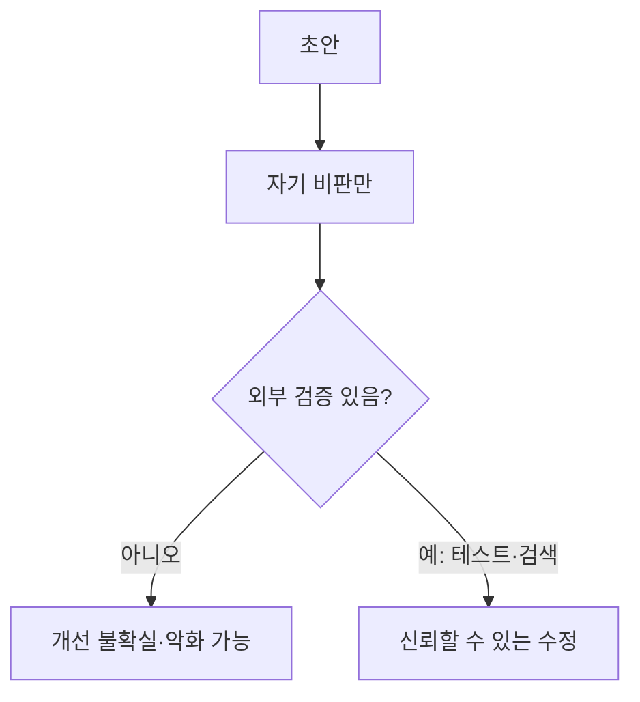

# 자기 수정의 한계

> 외부 피드백 없이 모델이 **스스로 답을 고치는 "내재적 자기 수정"** 은 추론 과제에서 잘 안 되고, 오히려 **성능이 나빠지기도** 한다. 비판·수정 루프는 외부 신호와 함께 써야 안전하다.

## 쉽게 말하면
시험 답안을 정답지 없이 다시 검토하면, 틀린 답을 맞다고 믿고 고수하거나 멀쩡한 답을 틀렸다고 바꾸기도 한다. 검산할 기준(계산기·채점표)이 있어야 재검토가 도움이 된다.

## 자세히
- **Huang 외**(arXiv 2310.01798, ICLR 2024 초록 확인): 외부 피드백 없이 모델이 자기 응답을 고치는 **내재적 자기 수정**을 연구. 추론 과제에서 LLM은 이를 잘 하지 못하며 "때로는 자기 수정 후 성능이 오히려 떨어진다"고 보고한다. (오라클 라벨 사용 여부는 초록에 없어 확인하지 않았다.)
- 대비: [비판·수정 루프](#critique-revision)의 Self-Refine은 7개 과제에서 약 20%p 향상을 보고했지만 과제 성격이 다르고(대화·문체 등 포함) 두 결과는 함께 읽어야 한다. 차이의 원인은 이 글에서 단정하지 않는다.
- 실무 원칙(권고): ① 테스트·검색·계산기 같은 **외부 검증 신호**를 루프에 넣는다 ② 반복 횟수를 제한한다 ③ 수정 전후를 비교해 개선이 없으면 되돌린다 ④ 생성자와 검토자의 컨텍스트를 분리한다([독립 리뷰어](#independent-reviewer)).

## 그림으로 보기

## 예시
- 코드 생성: 모델의 "맞는 것 같다" 대신 단위 테스트 실패 메시지를 피드백으로 주어 수정시키기.
- 수학 풀이: 모델에게 "틀린 곳이 있나?"만 묻는 대신 계산기·정답 형식 검사 결과를 제공.

## 헷갈리는 것과 비교
| 개념 | 차이 |
|---|---|
| 내재적 자기 수정 | 외부 신호 없이 스스로 |
| 외부 피드백 수정 | 테스트·도구 결과로 수정 |
| Self-Refine | 반복 자기 피드백, 과제에 따라 효과 |
| [독립 리뷰어](#independent-reviewer) | 별도 맥락의 검토자 |

## 더 읽을거리
- [Large Language Models Cannot Self-Correct Reasoning Yet](https://arxiv.org/abs/2310.01798)
- [Self-Refine](https://arxiv.org/abs/2303.17651)
