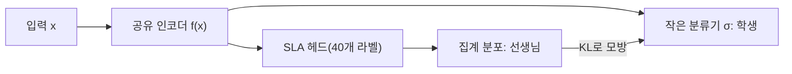
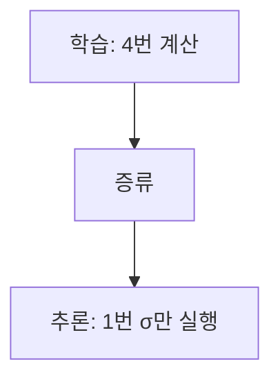

# SLA 자기 증류

> 집계 추론은 정확하지만 변환 횟수(M배)만큼 느리다. **자기 증류(self-distillation)**는 집계 예측을 "선생님" 삼아 별도 분류기를 학습시켜, **추론은 한 번만 해도 집계에 가까운 정확도**를 내게 하는 방법이다(SLA+SD).

## 쉽게 말하면
의사 네 명의 합의 의견(집계)을 신입 의사 한 명이 외워서, 앞으로는 혼자 보고도 합의 수준으로 진단하게 하는 것이다. 합의를 만드는 데 드는 시간은 학습 때 한 번만 쓴다.

## 자세히
- 출처: Lee et al., *Self-supervised Label Augmentation via Input Transformations*(ICML 2020, arXiv 1910.05872v2) 2장, 표 3.
- 목적 함수(논문 식 5): L_SLA+SD = L_SLA + D_KL(P_aggregated(·|x) ‖ σ(z; u)) + β·L_CE(σ(z; u), y). 즉 ① 결합 라벨 학습 손실 ② **집계 예측과 새 분류기 σ의 KL 발산**(집계 분포를 모방) ③ 원래 라벨 교차엔트로피(β는 0 또는 1 중 선택). σ는 파라미터 u를 가진 작은 분류기이고, 집계 분포 P_aggregated는 기울기 계산에서 **상수**로 취급한다. 학습 뒤에는 σ(f(x;θ);u)만 써서 집계 없이 추론한다.
- 비용: 집계 추론은 M배(회전 4종이면 4번) 계산이지만 SLA+SD는 한 번이다.
- 결과(논문 Table 3, 회전 사용, 정확도 %; SLA+SD / SLA+AG / 기준선):
  | 데이터셋 | 기준선 | SLA+SD | SLA+AG |
  |---|---|---|---|
  | CIFAR-10 | 92.39 | 93.26 (+0.94%) | 94.50 (+2.28%) |
  | CIFAR-100 | 68.27 | 71.85 (+5.24%) | 74.14 (+8.60%) |
  | CUB200 | 54.24 | 62.54 (+15.3%) | 64.41 (+18.8%) |
  | MIT67 | 54.75 | 63.54 (+16.1%) | 64.85 (+18.4%) |
  | Stanford Dogs | 60.62 | 66.55 (+9.78%) | 68.70 (+13.3%) |
  | tiny-ImageNet | 63.11 | 65.53 (+3.83%) | 66.95 (+6.08%) |
  - 읽는 법: SLA+SD는 집계(AG)만큼은 못 미치지만(CIFAR-100 71.85 vs 74.14) **추론 비용을 늘리지 않고** 기준선보다 대체로 크게 높다. 괄호 값은 기준선 대비 상대 이득(%)이다. 이득은 CUB200·MIT67처럼 데이터가 적은 세부 분류에서 15~16%로 특히 컸다.
  - 같은 표의 색상 순열(color permutation) 변환은 SLA+SD가 CIFAR-10에서 91.51(−0.95%)로 기준선보다 낮았다 — 변환 종류에 따라 효과가 다르다.
- 자기 증류 자체는 Hinton 등의 지식 증류 아이디어를 같은 모델 안에서 쓴 것이다(논문이 인용).
- 한계: 학습 때 모든 변환본을 계산해야 해 학습 비용이 늘어난다. 보고된 수치는 논문의 구성(WideResNet 등) 기준이다.

## 그림으로 보기

## 예시
- 모바일 앱에 모델을 넣을 때 추론 비용이 4배가 되면 곤란하므로 SLA+SD 형태로 학습한다.
- 교육: "느린 앙상블의 지식을 빠른 모델로 옮긴다"는 지식 증류 입문 사례.

## 헷갈리는 것과 비교
| 개념 | 차이 |
|---|---|
| 자기 증류 | 같은 모델의 집계 예측을 선생님으로 삼음 |
| 일반 지식 증류 | 별도의 큰 모델(선생님)이 작은 모델(학생)을 가르침 |
| [집계 추론](#aggregated-inference) | 선생님 역할의 느린 추론 |

## 더 읽을거리
- [Self-supervised Label Augmentation via Input Transformations (arXiv 1910.05872)](https://arxiv.org/abs/1910.05872) — 식 5·표 3(읽음).
