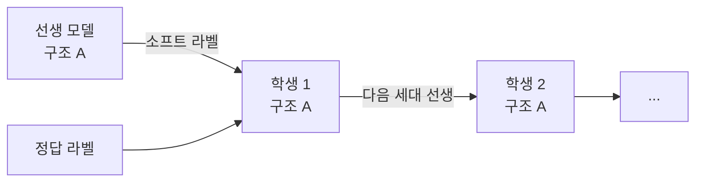

# 자기 증류(self-distillation)

> 자기 증류는 선생과 학생이 같은 구조인 지식 증류다. 학습한 모델을 선생으로 삼아 같은 크기의 학생을 다시 학습시켰더니 학생이 선생을 능가한 결과(Born-Again Networks)가 대표 사례다. 모델을 줄이는 게 아니라 성능을 올리는 증류다.

## 쉽게 말하면
시험을 한 번 치른 학생이 자기 답안과 채점 결과를 보며 다시 공부하면 같은 교과서로도 점수가 오르는 것과 비슷하다. 선생의 "정답은 B지만 C도 조금 그럴듯하다" 같은 부드러운 확률이 정답 하나만 알려 주는 라벨보다 풍부한 정보를 주기 때문이다(일반적 설명).

## 자세히
- **Born-Again Networks**(Furlanello 외, ICML 2018, arXiv 1805.04770): 학생을 선생과 **동일한 구조·크기**로 두고 선생의 출력으로 학습한다. 학생이 선생을 "significantly" 능가했고 컴퓨터 비전·언어 모델링 모두에서 확인됐다. DenseNet 기반 BAN이 CIFAR-10 검증 오류 3.5%, CIFAR-100 15.5%를 보고했다(검색 결과 기준 수치).
- 세대 반복: 학생이 다음 세대의 선생이 되도록 반복할 수 있다. 후속 논문은 이득이 선생 예측의 다양성 증가와 관련 있다고 본다(검색 요약). 원 실험은 증류 가중치·온도를 특정 설정으로 두었다는 후속 해석이 있으나 세부는 미확인.
- DenseNet↔ResNet처럼 구조가 달라도 이득이 있었다.
- 일반 [지식 증류](#knowledge-distillation-loss)와 비교: 일반 증류는 큰 모델→작은 모델(압축)이 목적, 자기 증류는 같은 크기에서 성능·보정·견고성 향상이 목적이다.
- LLM에서의 변형(주장·일반 인식): 모델이 생성한 데이터나 자기 평가로 다시 학습하는 합성 데이터·자기 개선 파이프라인과 맞닿아 있다. 모델 붕괴 위험이 있어 검증 필터가 중요하다.

## 그림으로 보기


## 예시
```python
loss = ce(student_logits, y) + alpha * kl(softmax(student/T), softmax(teacher/T))
# teacher = 같은 구조로 먼저 학습해 둔 모델, 이후 student를 teacher로 교체해 반복
```

## 헷갈리는 것과 비교
| 개념 | 차이 |
| --- | --- |
| 자기 증류 | 같은 구조, 성능 향상 목적 |
| [지식 증류](#knowledge-distillation-loss) | 큰→작은, 압축 목적 |
| [앙상블](#ensemble-uncertainty) | 여러 모델 평균 — 증류하면 하나로 압축 가능 |
| 자기 지도 학습 | 라벨 없이 스스로 과제를 만들어 학습 — 다른 개념 |

## 더 읽을거리
- [Born Again Neural Networks (arXiv 1805.04770)](https://arxiv.org/abs/1805.04770) — 동일 구조 학생이 선생을 능가(검색으로 확인)
