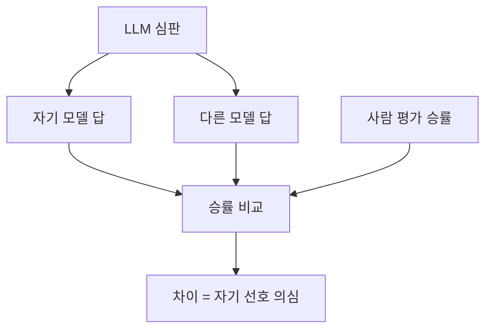

# 자기 선호 편향 (self-enhancement bias)

> LLM을 심판(judge)으로 쓸 때, 심판이 자기 자신(같은 모델)이 쓴 답을 더 좋게 평가하는 경향. 사람의 평가와 비교한 승률 차이로 의심하지만, 연구에서도 확정하기 어렵다고 한다.

## 쉽게 말하면
심사위원이 자기가 쓴 글을 섞어 놓은 공모전에서 채점하는 것과 같다. 일부러 편드는 게 아니어도 자기 문체가 편하게 읽혀 점수가 후할 수 있다. 의심은 하되 증거가 약하다는 점도 같이 기억해야 한다.

## 자세히
출처는 Zheng 외 "Judging LLM-as-a-Judge with MT-Bench and Chatbot Arena"(arXiv 2306.05685, 초록과 PDF 본문 직접 열람).
- **정의**: 사회인지 문헌에서 빌린 용어로, LLM 심판이 자기가 생성한 답을 선호하는 효과.
- **측정 방식**: 6개 모델의 승률(무승부 제외)을 서로 다른 LLM 심판과 사람의 평가로 비교했다(그림 3b).
- **관찰**: 사람과 비교해 GPT-4는 자기에게 10% 높은 승률을, Claude-v1은 자기에게 25% 높은 승률을 주었다. 그러나 다른 모델도 선호했고 GPT-3.5는 자기를 선호하지 않았다.
- **논문의 결론**: 데이터가 제한적이고 차이가 작아 자기 선호 편향이 있는지 판단할 수 없다고 한다. 통제 실험이 어려운 이유는 다른 모델 문체에 맞게 응답을 품질 변화 없이 바꿔 쓰기 어렵기 때문이라고 설명한다.
- **함께 보고된 편향**: 위치 편향(다음 노드), 장황함 편향. "반복 목록" 공격(원래 목록 앞에 같은 내용을 바꿔 쓴 목록을 붙여 길게 만든 답)에서 실패율은 Claude-v1 91.3%, GPT-3.5 91.3%, GPT-4 8.7%(23개 답)였다.
- **실무 대응(이 글의 제안)**: 심판 모델을 평가 대상 모델과 다른 계열로 두고, 표본은 사람 평가로 대조한다. 이 논문은 대응책으로 위치 편향과 수학 채점 한계에 대한 방법(순서 바꿔 두 번 판정, 참조 답 기반 심판 등)을 제시했고 자기 선호 자체의 완화책은 제시하지 않았다.
- 논문의 모델(GPT-4, Claude-v1, GPT-3.5)은 2023년 기준이라 현재 모델에 그대로 적용된다는 증거는 아니다.

## 그림으로 보기

## 예시
- A 모델 심판이 A 모델 답을 사람 평가보다 항상 10%p 높은 승률로 선택한다면 편향 의심. 다만 표본이 작으면 우연일 수 있다.
- 교육 실습: 같은 질문에 두 모델의 답을 심판 모델 두 종류에게 주고 각각 자기 답을 얼마나 선호하는지 표로 비교.

## 헷갈리는 것과 비교
| 개념 | 차이 |
|---|---|
| 자기 선호 편향 | 자기 모델 답을 선호 |
| 위치 편향 | 앞(또는 뒤) 위치를 선호 |
| 장황함 편향 | 긴 답을 선호 |
| [판정 일관성 측정](#judge-consistency) | 순서 바꿔 일치율을 재는 방법 |

## 더 읽을거리
- [Judging LLM-as-a-Judge (arXiv 2306.05685)](https://arxiv.org/abs/2306.05685) — 편향과 승률 비교(본문 열람)
