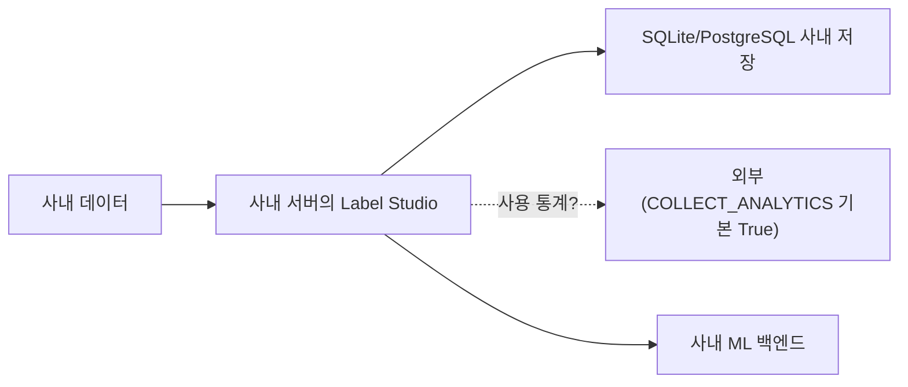
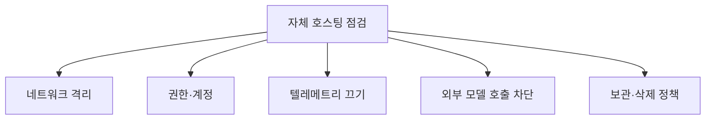

# 자체 호스팅 라벨링과 개인정보

> 라벨링 도구를 외부 클라우드 서비스가 아닌 우리 서버(또는 노트북)에서 직접 돌려, 고객 데이터를 사내 밖으로 내보내지 않고 라벨링하는 구성이다. Label Studio 같은 오픈소스 도구로 가능하지만 설정에 따라 외부로 나가는 통신이 남을 수 있어 점검이 필요하다.

## 쉽게 말하면
민감한 서류를 외부 사무소에 맡겨 정리하게 하는 대신, 사내 회의실에서 직원이 직접 정리하는 것과 같다. 서류는 건물 밖으로 안 나가지만, 회의실 전화가 외부로 통계를 보내고 있지는 않은지 확인해야 한다.

## 자세히
(Label Studio 설치 가이드를 직접 열어 확인하고, GitHub의 설정 소스 코드를 직접 읽어 확인. 법적 자문이 아니다.)
- **설치 방법(가이드)**: pip(`pip install label-studio` 후 `label-studio`), Docker(`heartexlabs/label-studio:latest`), Docker Compose(PostgreSQL 포함), Homebrew, Ubuntu, 소스, Anaconda. pip 설치는 `http://localhost:8080`을 연다(기본 포트 8080).
- **데이터 저장 위치(가이드)**: Docker 예에서 로컬 `./mydata` 폴더를 `/label-studio/data`에 마운트. 지원 DB는 **SQLite 3.35+ 또는 PostgreSQL 14+**, SQLite에서 100만 작업당 약 2.3GB, 운영 환경 디스크 50GB 권장. 컨테이너는 비루트 사용자로 실행되므로 마운트 폴더에 UID 1001 권한이 필요.
- **보안 관련(가이드)**: 별도의 "Secure Label Studio" 가이드가 있다(이번에 열어 보지 못함). 가이드는 최신 Google Chrome에서만 테스트됐다고 밝힌다.
- **사용 통계 전송(직접 확인)**: 설치 가이드 페이지에는 텔레메트리 설명이 없었다. 대신 오픈소스 저장소의 설정 코드(`label_studio/core/settings/base.py`)에 "분석 텔레메트리 데이터를 보낼지" 여부를 정하는 `COLLECT_ANALYTICS` 항목이 있고 **기본값이 True**로 정의돼 있다(옛 소문자 이름 `collect_analytics`도 호환). 엔터프라이즈 릴리스 노트(검색 결과)도 이 변수명이 대소문자 구분 없이 지정 가능해졌다고 한다. 어떤 데이터가 전송되는지는 확인하지 못했다. **폐쇄망·민감 데이터 환경이라면 `COLLECT_ANALYTICS=false`를 명시하고 방화벽으로 외부 통신을 점검**한다(제안).
- **개인정보 점검 체크리스트(제안)**
  1. 사내 네트워크 안에서만 접근(VPN·사내망), HTTPS 적용
  2. 라벨러 계정·권한 분리(프로젝트별)
  3. 이미지·음성 등 원본 파일 저장 위치와 백업 정책, 삭제 기한([사내 데이터 카드](#internal-data-card))
  4. 사전 라벨링에 외부 API 모델을 쓰면 데이터가 나간다 — [ML 백엔드](#label-studio-ml-backend)를 사내 모델로 구성
  5. 라벨러가 외부 인력이면 계약상 비밀 유지·접근 범위 제한
  6. 개인정보 마스킹 후 라벨링([학습 데이터 속 개인정보](#pii-in-training-data))
- **한계**: "자체 호스팅 = 안전"이 아니다. 패치·접근 통제·로그 보관 책임이 사내로 온다. 규제 대상 데이터는 보안·법무 검토를 거친다.

## 그림으로 보기



## 예시
```bash
# Docker로 사내 서버에 띄우기(가이드의 형태, 통계 전송 끄기)
docker run -it -p 8080:8080 -v $(pwd)/mydata:/label-studio/data \
  -e COLLECT_ANALYTICS=false heartexlabs/label-studio:latest
```
(가이드의 docker 형태에 환경 변수를 덧붙인 예시이며 직접 실행하진 않았다.)
- 병원·금융 데이터 라벨링: 사내망 서버 + 접근 계정 분리 + 원본 이미지 마스킹 후 업로드.

## 헷갈리는 것과 비교
| 구성 | 데이터 위치 | 주의 |
|---|---|---|
| 자체 호스팅(오픈소스) | 사내 | 운영·보안 책임 사내 |
| 벤더 클라우드 | 벤더 서버 | 계약·데이터 처리 조항 확인 |
| 로컬 노트북 실행 | 개인 PC | 접근 통제·백업 약함 |
| 클라우드 사설망(VPC) | 사내 계정 클라우드 | 접근·로그 설정 필요 |

## 더 읽을거리
- [Label Studio 설치 가이드](https://labelstud.io/guide/install) — 설치 방법·저장소·포트(열어 확인).
- [Label Studio 설정 코드: COLLECT_ANALYTICS](https://github.com/HumanSignal/label-studio/blob/develop/label_studio/core/settings/base.py) — 통계 전송 기본값(코드 확인).
