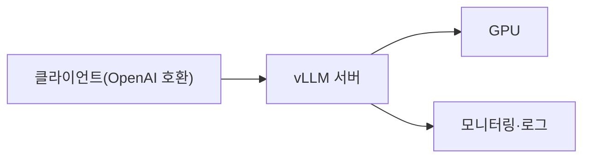
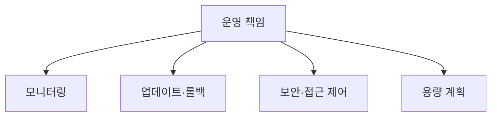

# 셀프호스팅 운영

> **셀프호스팅**은 모델 서버를 **직접 운영**하는 것이다. 비용·데이터 통제 이점이 있지만 모니터링·업데이트·보안·용량 관리를 내가 책임진다. vLLM 같은 서빙 엔진이 흔히 쓰인다.

## 쉽게 말하면
식당 음식을 시켜 먹다가 직접 주방을 차리는 것이다. 메뉴와 재료를 마음대로 정하지만, 장비 고장·위생·재고는 내 몫이다.

## 자세히
(vLLM 공식 문서 확인)
- **vLLM**: "빠르고 쉬운 LLM 추론·서빙 라이브러리". UC 버클리 Sky Computing Lab에서 시작. 특징: **PagedAttention**으로 어텐션 키·값 메모리를 효율 관리(원리는 해당 페이지에 설명 없음), **연속 배칭**, 청크 프리필, 프리픽스 캐싱, 양자화(FP8·INT8·INT4·GPTQ/AWQ·GGUF 등), 텐서·파이프라인·데이터·전문가 병렬, 추측 디코딩.
- **API**: **OpenAI 호환 API 서버**(Anthropic Messages API·gRPC도 지원)라서 기존 클라이언트를 바꾸지 않고 연결할 수 있다.
- **하드웨어**: NVIDIA·AMD GPU, x86/ARM/PowerPC CPU 등.
- **성능 주장**: 페이지는 "최첨단 서빙 처리량"이라고만 하며 수치는 없다. 연속 배칭으로 처리량 23배를 다룬 외부 글 제목이 링크돼 있을 뿐 vLLM 자체의 수치가 아니다.
- **운영 책임 체크리스트**(권고): 모니터링(지연·토큰/초·GPU 메모리), 모델·엔진 업데이트와 롤백, 접근 제어·키 관리·로그 개인정보, 부하에 따른 용량 계획, 장애 시 대체 경로(API 백업).

## 그림으로 보기



## 예시
```bash
# 개념 예: OpenAI 호환 서버로 띄운 뒤 기존 SDK의 base_url만 변경
# (정확한 명령은 vLLM 공식 문서 확인)
```
- 개인정보가 많은 사내 문서 요약을 사내 GPU 서버의 vLLM으로 처리.

## 헷갈리는 것과 비교
| 방식 | 책임 |
|---|---|
| 클라우드 API | 공급사가 운영 |
| [전용 엔드포인트](#dedicated-endpoint) | 공급사가 운영, 내 전용 용량 |
| 셀프호스팅 | 내가 운영 전체 |
| [엣지 추론](#edge-inference) | 기기 안에서 실행 |

## 더 읽을거리
- [vLLM 문서](https://docs.vllm.ai/en/latest/)
