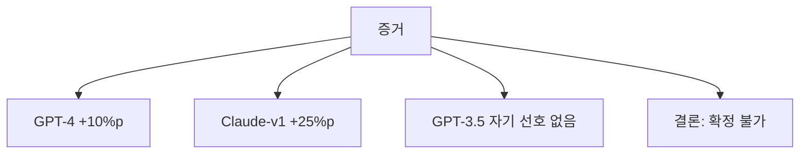

# 자기 선호 편향

> LLM 심판이 **자기 모델이 쓴 답을 더 후하게 평가**하는 경향(논문 용어: self-enhancement bias). 다만 증거는 약하고 통제 연구가 어렵다.

## 쉽게 말하면
자기가 쓴 글이 남이 쓴 글보다 더 좋아 보이는 심리와 비슷하다. 문체가 익숙해서 더 점수를 줄 수도 있다.

## 자세히
Zheng 외 (arXiv 2306.05685, PDF 본문 직접 읽음):
- 용어는 사회 인지 문헌의 "self-enhancement bias"에서 가져왔다.
- 관찰: 6개 모델의 승률(무승부 제외)을 심판별·사람별로 비교. 사람과 비교하면 일부 심판이 특정 모델을 선호했다. **GPT-4는 자기에게 승률이 10%p 높게**, **Claude-v1은 25%p 높게** 나왔다. 하지만 다른 모델도 선호했고 **GPT-3.5는 자기를 선호하지 않았다**.
- 결론(저자): 자료가 제한적이고 차이가 작아 **자기 선호 편향이 있는지 확정할 수 없다.** 다른 모델의 문체에 맞춰 품질 변화 없이 다시 쓰기가 어려워 통제 연구가 힘들다.
- 따라서 이 노드는 "있다"가 아니라 "의심되며 측정이 어렵다"로 읽는 것이 맞다. 최신 모델에서의 규모는 이 출처로 확인하지 못했다.
- 실무 대처(일반 지침): 심판 모델을 평가 대상과 다른 계열로 쓰거나 여러 심판을 섞고, 사람 샘플로 보정한다([채점기 교정](#grader-calibration)).

## 그림으로 보기

## 예시
- 모델 A 답과 B 답을 모델 A에게 평가시킬 때 A 쪽 점수가 높은지 사람 채점과 비교.
- 교육: "AI가 자기 숙제를 채점하면?"이라는 토론 소재.

## 헷갈리는 것과 비교
| 개념 | 차이 |
|---|---|
| 자기 선호 편향 | 자기 모델 답 선호(미확정) |
| [위치 편향](#position-bias) | 순서 의존 |
| [장황함 편향](#verbosity-bias) | 길이 선호 |

## 더 읽을거리
- [Judging LLM-as-a-Judge (arXiv 2306.05685)](https://arxiv.org/abs/2306.05685) — 3.3절 자기 선호 편향(읽음).
