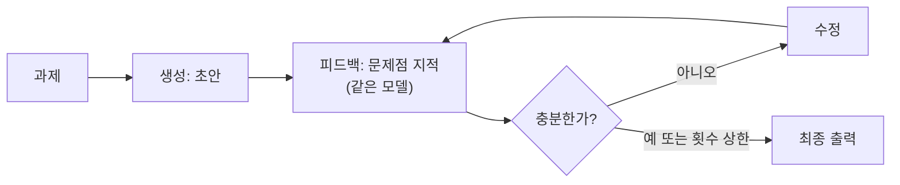

# Self-Refine

> **한 LLM이 초안을 쓰고(생성), 스스로 문제점을 지적하고(피드백), 그 피드백으로 고쳐 쓰는(수정) 과정을 되풀이**하는 추론 시점 기법. 추가 학습·정답 데이터·강화학습이 필요 없다. 2023년 논문이 7개 과제에서 한 번에 생성한 결과보다 평균 약 20%p 좋아졌다고 보고했다.

## 쉽게 말하면
글을 쓴 뒤 "너무 짧고 예시가 없네"라고 스스로 교정 보고 다시 쓰는 것과 같다. 처음부터 완벽하게 쓰려 하지 않고 "쓰기 → 점검 → 고치기"를 두세 번 돈다.

## 자세히
(Madaan et al., "Self-Refine: Iterative Refinement with Self-Feedback", 2023, arXiv 2303.17651 초록 기준)
- **방식**: ① 모델이 초기 출력 생성, ② **같은 모델**이 그 출력에 대한 피드백(무엇이 부족한지) 작성, ③ 피드백을 반영해 수정, ④ 만족하거나 정해진 횟수가 될 때까지 반복. 별도의 지도 데이터·추가 훈련·강화학습이 필요 없는 **테스트 시점** 기법이다.
- **보고된 결과**: 대화 응답 생성부터 수학 추론까지 **7개 과제**에서 GPT-3.5, ChatGPT, GPT-4로 시험했고, 사람 평가와 자동 지표 모두 한 번에 생성한 출력보다 선호했으며 과제 성능이 평균 **약 20%p(절대값)** 향상됐다고 한다(저자 보고, 모델·과제 설정에 따라 다름).
- **직접 실행한 축소판**(가짜 모델로 구조만 시연): 초안 "AI는 좋다." → 1회차 피드백 `['너무 짧음: 근거를 추가', '예시가 없음']` → 수정 → 2회차 피드백 "없음 → 종료". 최종 "AI는 좋다. 반복 업무를 자동화해 시간을 줄여 준다. 예를 들어 회의록 요약이 있다." — 피드백이 비면 끝나는 종료 조건과 최대 반복 횟수를 두는 구조다. (실제 품질 향상은 이 시연이 증명하지 않는다.)
- **언제 효과적인가**: 평가 기준이 **분명**하고(길이, 형식, 근거 유무, 코드 가독성) 피드백이 실제로 출력을 개선할 수 있는 과제. 이는 Anthropic이 말하는 evaluator-optimizer 워크플로의 한 형태다([평가자-최적화자](#evaluator-optimizer)).
- **한계와 주의**(일반 지침):
  1. 모델이 자기 오류를 **못 알아채면** 피드백이 무의미하다(사실 오류는 외부 검증이 필요).
  2. 반복마다 호출이 늘어 **비용·지연 증가**.
  3. 피드백이 과하면 출력이 **불필요하게 바뀌거나** 오히려 나빠질 수 있다 → 반복 상한과 비교 평가를 둔다.
  4. 외부 근거(테스트 실행 결과, 검색, 규칙 검사)를 피드백에 섞으면 안정적이다.

## 그림으로 보기


## 예시
```python
out = generate(task)
for _ in range(3):                    # 반복 상한
    fb = feedback(out)                # 같은 모델에게 "문제점을 목록으로"
    if not fb: break
    out = refine(out, fb)             # 피드백 반영해 수정
```
- 프롬프트: "아래 보고서 초안을 읽고 (1)근거 부족 (2)모호한 표현 (3)구조 문제를 항목으로 지적해 줘. 그다음 지적을 반영해 고쳐 써 줘."

## 헷갈리는 것과 비교
| 개념 | 차이 |
|---|---|
| Self-Refine | 한 모델이 스스로 비평·수정 |
| [평가자-최적화자](#evaluator-optimizer) | 생성과 평가를 (다른) 모델로 나눠 반복하는 패턴 |
| [프롬프트 체이닝](#prompt-chaining) | 고정된 단계 순서로 처리(반복 개선 아님) |
| [비판·수정 루프](#critique-revision) | 안전 규범에 맞게 비판·수정하는 훈련·추론 기법 |

## 더 읽을거리
- [Self-Refine (arXiv 2303.17651)](https://arxiv.org/abs/2303.17651) — 원 논문.
- [Anthropic: Building effective agents](https://www.anthropic.com/engineering/building-effective-agents) — evaluator-optimizer 워크플로 설명.
