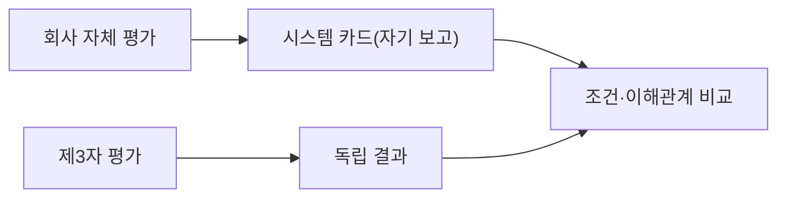
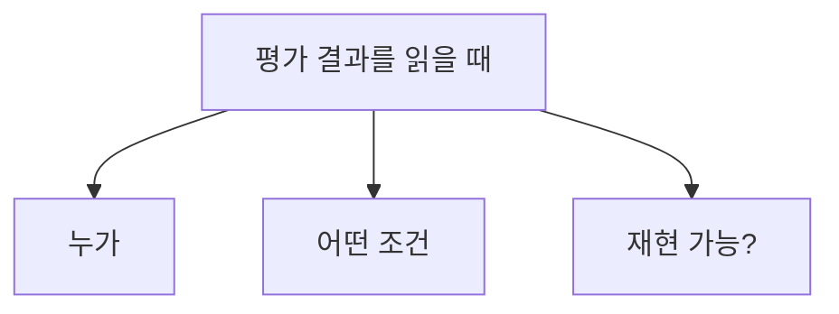

# 자기 보고 vs 독립 평가

> 시스템 카드의 평가 결과는 대부분 모델을 만든 회사가 직접 돌린 자기 보고다. 외부 기관이 같은 모델을 독립적으로 평가한 결과와 구분해서 읽어야 한다.

## 쉽게 말하면
자동차 회사가 직접 한 충돌 시험 결과와 소비자 단체가 한 시험 결과는 같은 무게가 아니다. 이해관계와 조건이 다르기 때문이다.

## 자세히
(Anthropic 투명성 허브 페이지와 Claude Opus 4.1 시스템 카드 부록을 하위 에이전트가 읽은 노트 기준. 허브 페이지는 179,559자 중 앞 10만 자만 읽었고 요약 도구를 거쳤다. 모델 카드 논문의 제3자 평가 언급은 미확인.)
- **자기 평가의 조건**: 허브 설명에 따르면 Anthropic은 자사 Claude를 추가 안전장치 없이 평가하고, **다른 프런티어 모델은 공개 엔드포인트**에서 평가한다. 외부 모델은 "공개된 그대로 제공된" 상태로 시험하며 추가 안전장치가 포함될 수도 아닐 수도 있다고 밝힌다 → 모델 간 비교 조건이 같지 않을 수 있다.
- **Opus 4.1 부록**: 평가를 Anthropic 내부 팀이 수행하며 독립 기관이 재실행한 결과는 읽지 못했다.
- **읽는 법(제안)**: ① 누가 평가했나(자사/제3자) ② 어떤 조건(안전장치·프롬프트·버전)인가 ③ 평가 데이터가 공개되었나 ④ 재현 가능한가 ⑤ 이해충돌(후원) 여부.
- **독립 평가의 가치**: 외부 감사는 이해관계가 달라 문제를 더 드러낼 수 있다(예: [알고리즘 감사](#algorithmic-audit)). 다만 외부 평가자도 모델 접근 범위·조건의 제약이 있다.

## 그림으로 보기

## 예시
- 신규 모델 도입 심사에서 벤더 카드의 점수를 자사 데이터 평가로 재확인.
- 교육 활용: 같은 모델의 자체 평가와 외부 평가 결과를 비교하는 토론.

## 헷갈리는 것과 비교
| 개념 | 차이 |
|---|---|
| 자기 보고 평가 | 개발사가 직접 실행 |
| 독립 평가 | 이해관계 없는 제3자 실행 |
| [안전장치 ON/OFF 평가](#safeguards-on-off-eval) | 평가 조건의 또 다른 축 |

## 더 읽을거리
- [Anthropic 투명성 허브](https://www.anthropic.com/transparency) — 평가 조건 설명(요약으로 확인).
