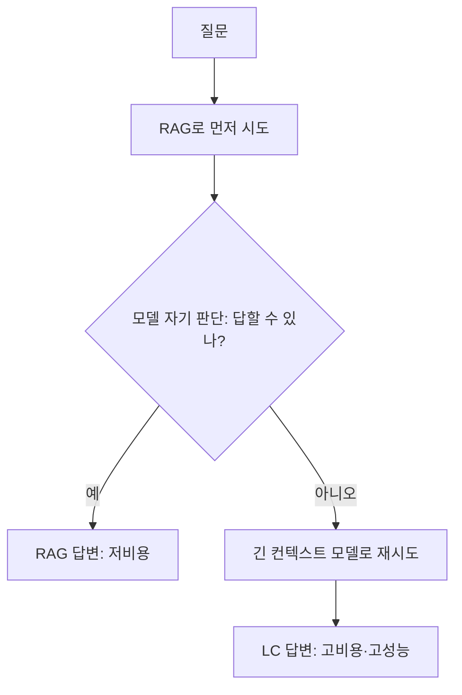
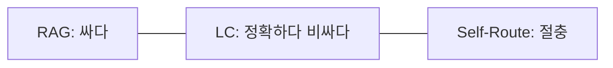

# Self-Route

> **Self-Route**는 질문마다 **RAG(검색 후 답변)** 로 풀지 **긴 컨텍스트(LC) 모델**에 통째로 넣을지를 모델의 자기 성찰로 골라, LC 성능에 가까우면서 비용을 크게 줄이는 라우팅 방식이다.

## 쉽게 말하면
쉬운 질문은 사서에게 해당 페이지만 찾아 달라고 하고, 어려운 질문은 책 전체를 펼쳐 놓고 읽는다. 어느 쪽으로 갈지를 먼저 판단하는 접수 창구가 Self-Route다.

## 자세히
(Li 외, arXiv 2407.16833 초록 확인)
- 여러 공개 데이터셋과 최근 모델 3개로 RAG와 LC를 비교했다.
- **LC가 충분한 연산이 있으면 평균 성능이 더 높다.** **RAG는 훨씬 저렴하다**는 것이 장점.
- **Self-Route**: RAG 결과에 대한 모델의 **자기 성찰**로 각 질의를 RAG 또는 LC로 보낸다. 초록은 LC 성능에 가깝게 유지하면서 연산 비용을 크게 줄인다고 보고한다.
- 자기 성찰의 구체 방식(예: "답할 수 없음" 판단)은 초록에 없어 확인하지 않았다.
- 활용 판단(권고): 문서가 컨텍스트에 들어갈 만큼 작고 정확도가 우선이면 LC, 문서가 방대하고 비용·지연이 중요하면 RAG, 둘이 섞이면 라우팅.

## 그림으로 보기

## 예시
- 사내 규정 챗봇: 대부분의 단순 질문은 RAG로, 여러 문서를 종합해야 하는 질문만 긴 컨텍스트로 처리해 비용 절감.

## 헷갈리는 것과 비교
| 개념 | 차이 |
|---|---|
| RAG | 관련 조각만 검색해 주입, 저렴 |
| 긴 컨텍스트 | 문서를 통째로 입력, 정확하나 비쌈 |
| Self-Route | 질의별로 둘 중 선택 |
| [JIT 검색](#just-in-time-retrieval) | 에이전트가 도구로 탐색 |

## 더 읽을거리
- [Retrieval Augmented Generation or Long-Context LLMs?](https://arxiv.org/abs/2407.16833) — 비교 연구와 Self-Route.
