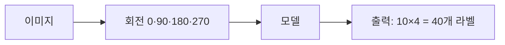
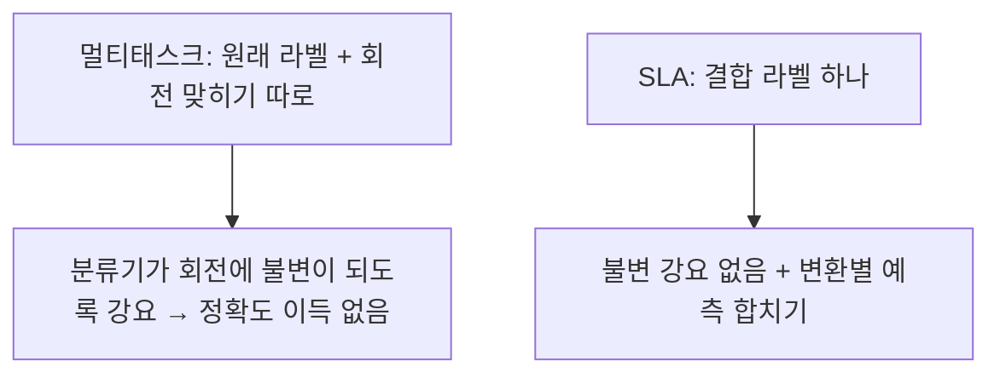

# 자기지도 라벨 증강

> 이미지를 회전하거나 색 채널을 바꾸는 변환을 하고, **"원래 라벨 × 어떤 변환을 했는가"를 합친 하나의 큰 라벨**을 맞히게 학습하는 방법(SLA)이다. 변환이 라벨을 바꿔도 되는 구조라, 회전했을 때 의미가 달라지는 6과 9 같은 경우에도 안전하게 변환을 쓸 수 있다.

## 쉽게 말하면
사진에 "고양이"라고만 적지 않고 "고양이, 90도 돌림"이라고 적는다. 돌린 사진을 그냥 "고양이"라고 가르치면 "돌려도 같다"를 강요하지만, 돌린 정도까지 라벨에 넣으면 그런 강요 없이 돌린 사진도 학습 데이터로 쓸 수 있다.

## 자세히
(Lee, Hwang, Shin 2020, arXiv 1910.05872 PDF 본문을 직접 읽음)
- 배경: 변환 종류를 맞히는 자기지도 과제를 원래 과제와 함께 학습하는 **멀티태스크** 방식은 완전 라벨 데이터에서는 보통 정확도 향상이 없었다. 원인으로 논문은 **원래 분류기가 변환에 불변이 되도록 강요**한다는 점을 든다. 회전 증강은 {6 vs 9}, {새 vs 박쥐}처럼 회전하면 구분이 바뀌는 과제를 더 어렵게 만든다.
- 방법(SLA): 원래 라벨(예: CIFAR-10의 10개)과 자기지도 라벨(회전 4종)의 **결합 분포를 하나의 과제로 학습**한다. 예: 10×4 = **40개 라벨**. 불변 제약을 걸지 않으며 각 변환에 다른 라벨을 준다.
- 추론: 변환별 예측을 합치는 **aggregated inference**로 단일 모델에서 앙상블 같은 효과를 낸다. 비용을 줄이려고 합친 예측을 하나의 분류기로 증류하는 **자기 증류(self-distillation)**를 제안한다(변환 한 번의 추론으로 같은 효과).
- 변환 종류: 회전(4가지)과 색 채널 순열(6가지)을 시험했다.
- 결과(논문 주장): 표준 완전 지도 CIFAR-100에서 상대 정확도 8.60% 향상, FC100의 5-way 5-shot에서 7.05% 향상(비교 기준 대비). few-shot과 불균형 분류에서도 일관되게 개선됐다고 보고한다. 2019~2020년 연구 결과다.
- 라벨 보존 관점: 이 방법은 "변환이 라벨을 바꾼다고 가정해도 되는 증강"을 제공해 증강 허용 범위를 넓힌다([라벨 보존 변환](#label-preserving-transform)). 단, 변환이 의미를 파괴하지 않는지는 도메인에서 여전히 확인해야 한다.

## 그림으로 보기

## 예시
- 숫자 인식에서 6과 9: 회전 180도 변환 이미지의 라벨을 "6-회전180"으로 따로 두면 6과 9를 혼동하지 않고 증강을 활용.
- 교육: "변환 정보를 라벨에 넣으면 증강이 안전해진다"는 아이디어.

## 헷갈리는 것과 비교
| 개념 | 차이 |
|---|---|
| 일반 증강 | 변환 후에도 원래 라벨 유지(불변 가정) |
| 멀티태스크 자기지도 | 원래 과제와 변환 맞히기를 따로 학습 |
| SLA | 두 라벨의 결합 분포를 하나로 학습 |
| [허용 목록](#augmentation-allowlist) | 라벨이 보존되는 변환만 쓰는 접근 |

## 더 읽을거리
- [Self-supervised Label Augmentation via Input Transformations (arXiv 1910.05872)](https://arxiv.org/abs/1910.05872) — 결합 라벨·집계 추론·자기 증류(PDF 본문 읽음).
