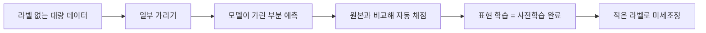
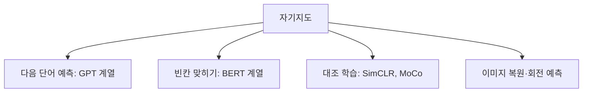

# 자기지도학습

> 자기지도학습(Self-supervised learning)은 사람이 붙인 정답 없이, 데이터 자체에서 정답을 만들어 "일부를 보고 나머지를 맞히는" 문제로 모델을 학습시키는 방법이다. LLM 사전학습의 기반이다.

## 쉽게 말하면
책의 한 문장에서 단어 하나를 가리고 "빈칸에 뭐가 들어갈까?"를 수없이 풀게 하는 것과 같다. 정답은 원문에 이미 있으니 채점자가 필요 없다. 이렇게 빈칸 퀴즈를 수십억 번 풀다 보면 문법과 상식, 세상 지식이 몸에 밴다.

## 자세히
Lilian Weng의 정리(2019)에 따르면:
- 데이터로 만든 가짜 문제를 **프리텍스트(pretext) 과제**라 부른다. 과제 자체의 정확도보다, 풀면서 배운 **중간 표현(representation)**이 실제 과제(다운스트림)에 쓸모 있는 것이 목적이다.
- **이유**: 라벨 데이터는 비싸고 키우기 어렵지만 라벨 없는 텍스트·이미지는 풍부하다. 그래서 라벨 없이 지도학습식 훈련을 하는 길이다.
- **이미지 예**: 회전 각도 맞히기(0/90/180/270°), 퍼즐 조각 순서 복원, 흑백 이미지 색칠, 가려진 영역 채우기, 노이즈 제거 오토인코더.
- **언어 예**: 과거 단어들을 보고 **다음 단어 예측**(LLM의 기본 목적). BERT 계열은 가린 단어 맞히기 등 자체 생성 라벨 과제를 쓴다.
- **대조 학습(contrastive)**: 같은 데이터를 변형한 두 버전은 가깝게, 다른 데이터는 멀게 만든다. SimCLR, MoCo, 문장용 SimCSE가 예. 성능은 증강 설정과 배치 크기에 크게 좌우되고, BYOL은 음성 쌍 없이도 좋은 결과를 보고했다.
- 이렇게 사전학습한 모델에 적은 라벨로 미세조정(관련: [파인튜닝 vs 프롬프팅](#fine-tuning-vs-prompting))하면 된다.

## 그림으로 보기

## 예시
- "서울은 대한민국의 ___" → 정답 "수도"는 문장 자체에서 나온다.
- 의료 영상 라벨이 부족할 때, 라벨 없는 영상으로 먼저 사전학습한 뒤 소량의 진단 라벨로 미세조정한다.

## 헷갈리는 것과 비교
| 개념 | 차이 |
| --- | --- |
| [분류와 회귀](#classification-regression) | 사람이 준 정답이 필요한 지도학습 |
| 비지도 학습 | 정답 없이 구조(군집 등)를 찾음. 자기지도는 데이터에서 만든 정답으로 지도학습식 손실을 씀 |
| [지도·비지도 학습](#supervised-unsupervised) | 상위 주제 |

## 더 읽을거리
- [Lilian Weng: Self-Supervised Representation Learning](https://lilianweng.github.io/posts/2019-11-10-self-supervised/) — 프리텍스트 과제 정리
- [Lilian Weng: Contrastive Representation Learning](https://lilianweng.github.io/posts/2021-05-31-contrastive/) — SimCLR·MoCo·BYOL·SimCSE
