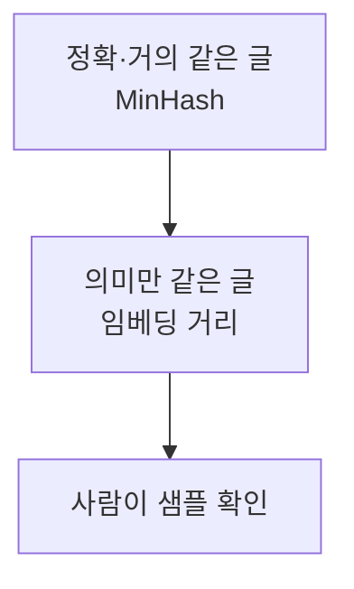

# 의미적 중복 제거

> 의미적 중복 제거는 글자가 달라도 뜻이 같은 데이터(의역·번역·비슷한 이미지 설명)를 임베딩 벡터의 가까움으로 찾아 덜어내는 방법이다. 글자 겹침만 보는 MinHash가 놓치는 중복을 잡는다.

## 쉽게 말하면
"올해 3분기에 회사가 사상 최대 이익을 냈다"와 "이 회사의 3분기 순이익이 역대 최고였다"는 단어가 거의 다르지만 같은 뉴스다. 글자 대조는 둘을 다른 문서로 보지만, 뜻을 숫자 좌표로 바꿔 두면 두 좌표가 가까워서 같은 이야기로 묶인다.

## 자세히
- **방법(SemDeDup 논문 초록, 열람)**: 사전학습 모델의 임베딩으로 뜻이 비슷하지만 똑같지는 않은 쌍을 찾아 제거한다. 모든 쌍을 비교하지 않도록 먼저 클러스터링한 뒤 각 클러스터 안에서만 가까운 쌍을 본다(검색 결과 요약 기준).
- **보고된 효과(논문 초록, 직접 재현하지 않음)**: LAION(이미지-텍스트) 일부에서 데이터의 약 50%를 성능 손실이 거의 없이 제거해 학습 시간이 약 절반이 됐다고 한다. 언어 모델은 C4(부분 정제 데이터)로 실험했고 기존 중복 제거보다 낫고 효율이 약 15% 개선됐다고 보고한다. 50%라는 수치는 이미지-텍스트 실험의 결과이며 언어 모델의 결과가 아니다.
- **직접 실험은 못 했다**: 임베딩 모델 설치가 이 환경에서 너무 오래 걸려 의역 문장의 코사인 유사도와 자카드 점수를 비교하는 실험을 하지 않았다. 따라서 임계값 같은 수치는 이 글에 적지 않는다.
- **절차(해석)**: ① 문서를 임베딩 ② 클러스터링(예: k-평균)으로 후보 범위 축소 ③ 클러스터 안에서 코사인 유사도가 임계값 이상인 쌍 찾기 ④ 대표 하나만 남기기. 임계값이 높으면 안전하지만 덜 제거하고, 낮으면 다양성까지 잃는다.
- **주의**: 의미가 같다고 가치가 같은 건 아니다. 희귀한 표현·소수 관점이 지워질 수 있어 제거 후 샘플을 사람이 확인한다. 임베딩 모델의 편향도 따라온다. 정확한 중복은 MinHash로 싸게 먼저 제거하고 의미적 중복 제거를 그 뒤에 둔다([MinHash](#minhash), [LSH 밴드·행 조정](#lsh-band-row-tuning)).

## 그림으로 보기

## 예시
- 고객 문의 학습 데이터에서 같은 질문이 다양한 문장으로 수천 건 반복될 때 클러스터마다 대표 몇 건만 남겨 학습 비용을 줄인다.
- 교육 활용: 의역한 문장 쌍을 만들어 자카드와 임베딩 유사도를 비교해 보는 실습(이 글에서는 실행하지 못함).

## 헷갈리는 것과 비교
| 개념 | 차이 |
| --- | --- |
| [MinHash](#minhash) | 글자(단어 조각) 겹침 기반 |
| 의미적 중복 제거 | 임베딩 거리 기반, 의역도 포착 |
| [학습 데이터 중복 제거](#training-data-deduplication) | 상위 목적 |
| [의역 샘플 오염](#rephrased-sample-contamination) | 의역이 필터를 통과하는 문제 |

## 더 읽을거리
- [SemDeDup (arXiv 2303.09540)](https://arxiv.org/abs/2303.09540) — 임베딩 기반 의미적 중복 제거 초록
