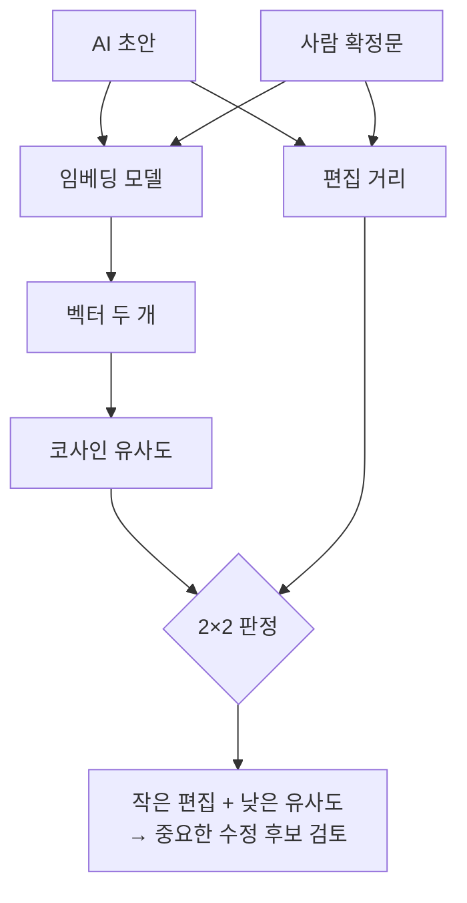

# 의미 유사도 (편집량 vs 의미 변화)

> 문자열이 얼마나 바뀌었는지(편집 거리)가 아니라 **뜻이 얼마나 바뀌었는지**를 임베딩의 코사인 유사도 같은 값으로 추정하는 방법. AI 초안과 사람이 고친 최종본 비교에서 "표면은 다르지만 뜻은 같다 / 표면은 거의 같지만 뜻이 다르다"를 구분하는 데 쓴다.

## 쉽게 말하면
"감사합니다"와 "고맙습니다"는 글자가 완전히 다르지만 뜻은 같다. 반대로 "300만 원"과 "30만 원"은 한 글자 차이지만 뜻이 크게 다르다. 편집 거리는 앞의 것을 크게, 뒤의 것을 작게 본다. 의미 유사도는 이 오판을 일부 줄여 주지만 완전하지 않다.

## 자세히
출처: Sentence-BERT 논문 초록(arXiv 1908.10084)과 Sentence Transformers 공식 문서의 의미 텍스트 유사도 사용법(둘 다 본문 확인, 2026-11-18). 숫자 오류에 대한 한계는 해석이며 이번에 직접 실험하지 않았다.
- **원리**: 각 문장을 벡터(임베딩)로 바꾸고 두 벡터의 **코사인 유사도**를 비교한다. 의미가 가까울수록 값이 크다.
- **SBERT의 요점**: BERT 교차 인코더는 문장 쌍을 함께 처리해야 해서 1만 문장에서 가장 비슷한 쌍을 찾는 데 약 5천만 번 연산, 약 65시간이 걸린다. SBERT는 샴 구조로 문장별 임베딩을 만들어 이를 약 5초로 줄였다고 저자들이 보고한다(BERT의 정확도를 유지한다고 주장, 초록에 구체 점수는 없음).
- **사용법**: 두 문장 목록을 `encode`한 뒤 `model.similarity()`로 모든 쌍의 점수를 얻는다. 기본은 코사인이고 내적·음의 유클리드·음의 맨해튼으로 바꿀 수 있다. 문서 예시에서 "The new movie is awesome"과 "The new movie is so great"는 0.8939, 무관한 쌍은 0 근처였다. `Normalize` 모듈이 있는 모델은 내적이 코사인과 같아 더 빠르다.
- **편집 거리와의 차이**: 편집 거리는 글자 수준 변화량, 의미 유사도는 뜻 수준 근접도다. 두 지표를 함께 쓰면 4분면으로 분류할 수 있다.

| 편집 거리 | 의미 유사도 | 해석 |
|---|---|---|
| 작음 | 높음 | 거의 그대로(진짜 무수정) |
| 큼 | 높음 | 표현만 다듬음 |
| 큼 | 낮음 | 내용을 크게 다시 씀 |
| 작음 | 낮음 | **작지만 중요한 수정**(숫자·부정어 등)일 수 있음 |

- **한계(해석)**: 임베딩은 숫자 한두 개나 "않다" 같은 부정 표현의 차이를 충분히 반영하지 못할 수 있다. 금액·날짜는 별도 규칙으로 대조한다([숫자·고유명사 오인식](#number-entity-errors)). 임계값은 모델마다 분포가 달라 자기 데이터에서 정해야 한다. 한국어 성능은 모델 선택에 달려 있고 문서에는 다국어 모델 설명이 없었다.

## 그림으로 보기


## 예시
```python
from sentence_transformers import SentenceTransformer
m = SentenceTransformer("paraphrase-multilingual-MiniLM-L12-v2")   # 모델명은 예시, 한국어 성능은 자체 평가 필요
e = m.encode(["고객이 300만 원을 입금했다", "고객이 30만 원을 입금했다"])
print(m.similarity(e[0:1], e[1:2]))   # 높게 나오더라도 숫자 차이는 별도 규칙으로 점검
```
교육 활용: 후편집 노력 측정 실습에서 "거리 작음 + 유사도 낮음" 건만 모아 어떤 수정이 숨어 있는지 찾아보게 한다.

## 헷갈리는 것과 비교
| 개념 | 차이 |
|---|---|
| 의미 유사도 | 뜻의 근접도(임베딩 코사인) |
| [정규화 편집 거리](#normalized-edit-distance) | 글자 수준 변화 비율 |
| [레벤슈타인 거리](#levenshtein) | 편집 횟수 |
| 교차 인코더 | 쌍을 함께 넣어 정확하지만 느림 |

## 더 읽을거리
- [Sentence-BERT (arXiv 1908.10084)](https://arxiv.org/abs/1908.10084) — 임베딩 기반 유사도 검색의 속도 문제와 해법
- [Sentence Transformers: 의미 텍스트 유사도](https://www.sbert.net/docs/sentence_transformer/usage/semantic_textual_similarity.html) — `similarity()` 사용법과 유사도 함수 선택
