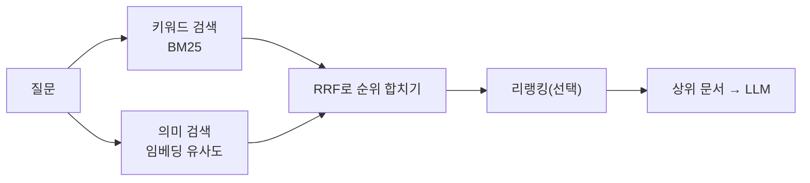
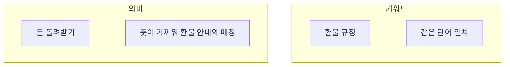

# 의미 검색 vs 키워드 검색

> 키워드 검색(BM25 등)은 질문과 **같은 단어**가 들어 있는 문서를 찾고, 의미 검색(임베딩 벡터 검색)은 **뜻이 가까운** 문서를 찾는다. 실무에서는 둘을 합친 하이브리드 검색이 흔하다.

## 쉽게 말하면
도서관에서 "환불"이라는 글자가 제목에 들어간 책만 찾는 사서(키워드)와, "돈 돌려받는 법"이라고 물어도 환불 안내서를 가져다주는 사서(의미)의 차이다. 다만 두 번째 사서는 제품 코드 "A-1023"처럼 정확한 글자가 중요한 질문엔 헛다리를 짚을 수 있다. 그래서 두 사서에게 모두 물어 답을 합친다.

## 자세히
- **키워드 검색(BM25)**: 단어 출현 빈도와 희소성으로 점수를 매기는 전통 방식. 제품 번호·고유명사·오류 코드처럼 정확한 문자열에 강하고 동의어·바꿔 쓴 표현에는 약하다.
- **의미 검색**: 글을 [임베딩](#embedding-clip)(숫자 벡터)으로 바꿔 두고 질문 벡터와 코사인 유사도가 높은 것을 찾는다. 바꿔 쓴 표현에 강하지만 정확한 식별자에는 약하고, 임베딩 모델 품질에 좌우된다. 보통 [벡터 DB](#vector-db)에 저장한다.
- **하이브리드**: 두 방식을 나란히 돌려 순위 목록을 합친다. BM25 점수와 코사인 유사도는 척도가 달라 직접 더할 수 없으므로 순위만 쓰는 **RRF(Reciprocal Rank Fusion)**가 흔하다. 문서 점수 = 각 검색기에서 1/(k+순위)의 합, k는 보통 60(2009년 Cormack 등 논문 기준).
- 주장: 벤더 블로그들이 하이브리드의 재현율 향상(예: recall@10 78%→91%)을 내놓지만 자기 데이터로 검증해야 한다.
- 결과 위에 [리랭킹](#reranking)을 얹어 상위 후보를 다시 정렬하는 구성도 흔하다. 이 검색 단계가 [RAG](#rag)의 품질을 좌우한다.

## 그림으로 보기

## 예시
- 사내 문서 검색: "ERR_4021이 뭐야?"는 키워드, "로그인이 자꾸 풀려요"는 의미 검색이 유리 → 하이브리드로 둘 다 처리.
- 선택 기준: 코드·ID·법조문 번호가 많으면 키워드 비중↑, 자연어 질문이 많으면 의미 검색 비중↑. 먼저 쉬운 BM25로 시작해 부족하면 추가하는 것이 무난하다.

## 헷갈리는 것과 비교
| 개념 | 차이 |
| --- | --- |
| 키워드(BM25) | 글자 일치, 빠르고 설명 쉬움, 동의어에 약함 |
| 의미 검색 | 뜻 일치, 임베딩 필요, 정확한 코드에 약함 |
| 하이브리드 | 둘의 순위를 합침 |
| [리랭킹](#reranking) | 이미 찾은 후보를 더 정밀하게 재정렬 |

## 더 읽을거리
- [Hybrid Search Explained (BigData Boutique)](https://bigdataboutique.com/blog/hybrid-search-explained) — BM25+벡터 결합과 RRF
- [Hybrid Search for RAG (Denser)](https://denser.ai/blog/hybrid-search-for-rag/) — RAG에서의 하이브리드 구성
