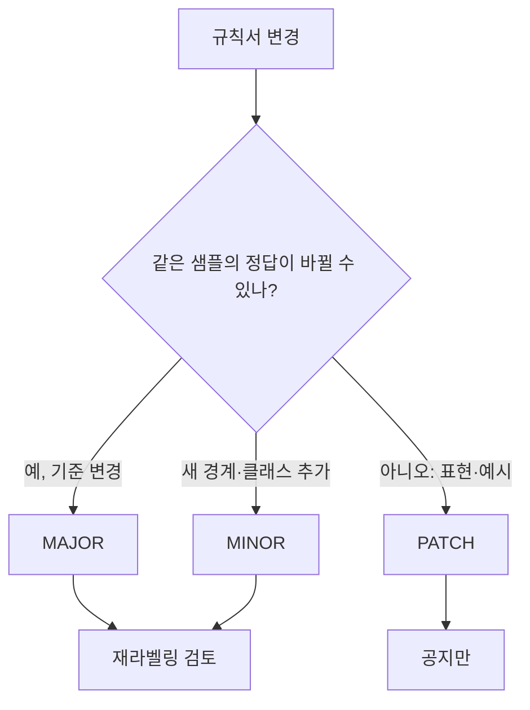
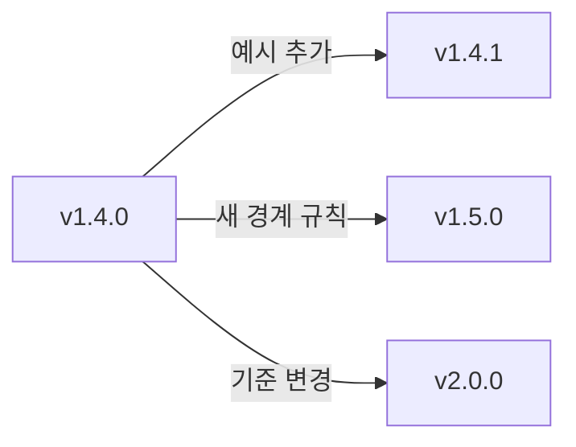

# 의미 변경 vs 표현 보강 버전

> 라벨 규칙서의 개정을 "라벨 판정이 달라질 수 있는 의미 변경"(MAJOR·MINOR)과 "판정은 그대로이고 설명·예시만 보강한 표현 보강"(PATCH)으로 나누어 버전 번호에 표시하면, 기존 라벨을 다시 라벨링해야 하는지 한눈에 알 수 있다.

## 쉽게 말하면
법을 고칠 때 "새 의무가 생긴 개정"과 "오탈자·문장 다듬기"를 구분해 두면, 새 의무가 생긴 개정에서만 옛 사건을 다시 검토하면 된다.

## 자세히
- **버전 규칙의 원형(Semantic Versioning 2.0.0, semver.org)**: 소프트웨어 버전은 MAJOR.MINOR.PATCH로 쓴다. MAJOR는 호환되지 않는 변경, MINOR는 호환되는 기능 추가나 폐기 예고, PATCH는 호환되는 버그 수정에서 올린다. MAJOR를 올리면 MINOR·PATCH는 0으로, MINOR를 올리면 PATCH는 0으로 되돌린다. 공개된 버전은 수정하지 않고 변경은 새 버전으로 한다. 0.y.z는 초기 개발 단계다. 이 규격은 소프트웨어 API용이므로 라벨 규칙서에는 아래처럼 빌려 쓰는 **우리의 제안**이다(공식 표준이 아니다).
- **라벨 규칙서에 대응(해석)**:

| 변경 종류 | 버전 | 재라벨링 | 예 |
| --- | --- | --- | --- |
| 기존 기준이 달라짐(같은 샘플의 정답이 바뀔 수 있음) | MAJOR (v2.0.0) | 영향받는 라벨 재검토 필요 | "반어법은 중립 → 부정으로" |
| 새 클래스·새 경계 규칙 추가(기존 정답은 대부분 유지) | MINOR (v1.4.0) | 해당 경계 샘플만 재검토 | "환불 문의 클래스 추가" |
| 문장 다듬기·예시 추가·오타(정답 불변) | PATCH (v1.4.1) | 재라벨링 불필요 | 예시 2개 추가 |

- **운영(해석)**: ① 변경 요약에 "라벨이 바뀔 수 있는가"를 반드시 적는다([규칙 변경 요약 양식](#change-summary-template)) ② 라벨에는 규칙서 버전을 저장한다([라벨 메타데이터 기록](#annotation-metadata-tracking)) ③ MAJOR·MINOR 변경은 [재검토 검색식](#relabel-query)으로 영향 범위를 찾는다 ④ PATCH는 전체에 공지만 한다([규칙 변경 전파](#rule-change-propagation)).
- **판단이 애매할 때(해석)**: 정답이 바뀔 가능성이 조금이라도 있으면 PATCH가 아니라 MINOR로 올린다. 표현을 다듬었는데 라벨러 사이에 해석이 달라졌다면 의미 변경이다.
- **초기 단계(규격 참고)**: 0.y.z는 안정되지 않은 초기 단계. 시범 라운드 중의 규칙서는 0.x로 두고 시범이 끝나면 1.0.0으로 고정하는 방식을 쓸 수 있다.

## 그림으로 보기

## 예시
- v1.4.0 → v1.4.1: 예시 두 개 추가, 정답 불변이므로 재라벨링 없음. v1.4.1 → v2.0.0: 반어법 판정 변경이므로 영향 라벨 재검토.
- 교육 활용: 규칙서 개정 사례 6개를 주고 MAJOR·MINOR·PATCH로 분류해 보게 한다.

## 헷갈리는 것과 비교
| 개념 | 차이 |
| --- | --- |
| 의미 변경 | 정답이 바뀔 수 있음 |
| 표현 보강 | 정답 불변, 설명만 개선 |
| [규칙 변경 전파](#rule-change-propagation) | 개정 배포 절차 |
| [규칙 변경 요약 양식](#change-summary-template) | 변경 종류를 기록하는 양식 |

## 더 읽을거리
- [Semantic Versioning 2.0.0](https://semver.org/) — MAJOR.MINOR.PATCH 규칙과 0.y.z
