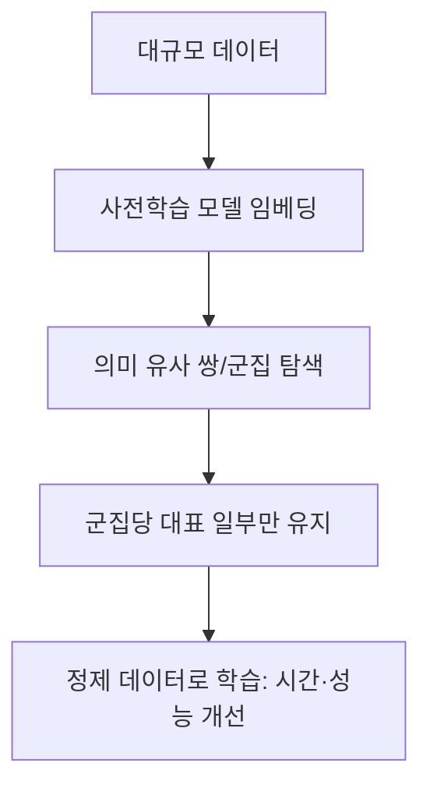

# SemDeDup

> **SemDeDup**은 사전학습 모델의 **임베딩**으로 "의미는 비슷하지만 글자는 다른" 의미 중복(semantic duplicate)을 찾아 제거하는 데이터 정제 방법이다. 정확 일치·표면 근접 중복 제거가 놓치는 중복을 줄여 학습 비용을 크게 낮춘다.

## 쉽게 말하면
같은 고양이 사진을 약간 다른 각도로 찍은 100장은 해시나 자카드로는 서로 다른 파일이지만 의미상 거의 같다. 그중 몇 장만 남기고 나머지를 치우면 모델은 거의 같은 걸 배우면서 훈련 시간은 줄어든다.

## 자세히
(Abbas 외, arXiv 2303.09540 초록 확인)
- **정의(초록)**: 사전학습 모델의 임베딩을 사용해 **"의미적으로 비슷하지만 정확히 같지는 않은" 데이터 쌍**을 찾아 제거한다. 대규모 웹 데이터에서 정확 일치 중복 제거가 놓치는 근사 중복을 겨냥한다. 초록은 군집화 단계를 설명하지 않는다(이 글에서 본문 미확인).
- **보고된 결과(저자 주장)**
  | 데이터 | 결과 |
  |---|---|
  | LAION 부분집합 | 데이터의 **약 절반을 제거해도 성능 손실이 작고**, 학습 시간이 대략 절반으로 감소 |
  | 분포 밖(OOD) 데이터 | 성능이 **향상** |
  | C4(부분 정제 언어 모델 데이터) | 이전 중복 제거 방법보다 **성능·효율 모두 우수** |
- **다른 중복 제거와의 관계(권장 구조)**: 정확 일치 해시 → 표면 근접([MinHash·자카드](#jaccard-threshold-tuning), [LSH](#lsh-post-verify)) → 의미 중복(SemDeDup) 순서로 값싼 방법부터 적용한다([중복 제거 단계 순서](#dedup-pipeline-order)).
- **임베딩 공간 활용**: 임베딩 위의 이웃 탐색은 [임베딩 공간 가치 평가](#embedding-space-valuation)에서 쓰는 도구와 같은 계열이다. 임베딩 모델의 도메인 적합성·편향이 제거 결과에 영향을 준다.
- **위험(권장 점검)**
  1. **소수 집단·희귀 개념이 "중복"으로 지워질 수 있다**: 제거 전후 [슬라이스별 성능](#slice-confidence-interval-table)을 비교.
  2. **임계값(유사도 기준)** 이 제거량을 정한다: 사람이 본 쌍 표본으로 정밀도 확인([임계값](#jaccard-threshold-tuning)과 같은 방식).
  3. 의미는 비슷하지만 **라벨이 다른** 쌍(경계 사례)은 보존한다.
  4. 되돌릴 수 있게 원본과 제거 목록을 보관한다([삭제하지 않기](#valuation-vs-deletion)).
- **한계**: 위 수치는 논문 초록의 저자 주장이며 이 글은 재현하지 않았다. 군집화·임계값 세부는 논문 본문을 확인해야 한다.

## 그림으로 보기



## 예시
```python
# 개념 코드 (논문의 정확한 알고리즘이 아님)
emb = encoder(items)
groups = cluster(emb)                       # 비슷한 임베딩끼리 묶음
keep = [pick_representative(g) for g in groups if is_semantic_dup_group(g, sim_threshold=0.95)]
```
- 사내 문의 로그 200만 건에서 의미가 같은 문의를 대표 몇 개만 남겨 분류기 학습 시간을 절반으로 줄이는 실험을 하고, 희귀 문의 유형의 성능이 유지되는지 확인.

## 헷갈리는 것과 비교
| 방법 | 잡는 중복 | 도구 |
|---|---|---|
| 정확 일치 | 바이트 동일 | 해시 |
| 표면 근접 | 글자 조각이 겹침 | 섀글·MinHash |
| 의미 중복(SemDeDup) | 의미가 비슷 | 임베딩 |
| [패러프레이즈 중복의 한계](#paraphrase-dedup-limit) | 표면 방법의 한계 | - |

## 더 읽을거리
- [SemDeDup (arXiv 2303.09540)](https://arxiv.org/abs/2303.09540) — 초록의 정의와 LAION·C4 결과(초록 열어 확인; 본문 미확인).
