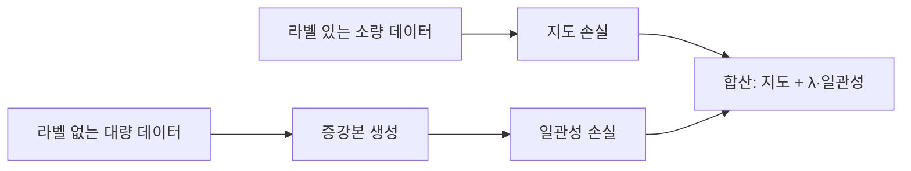
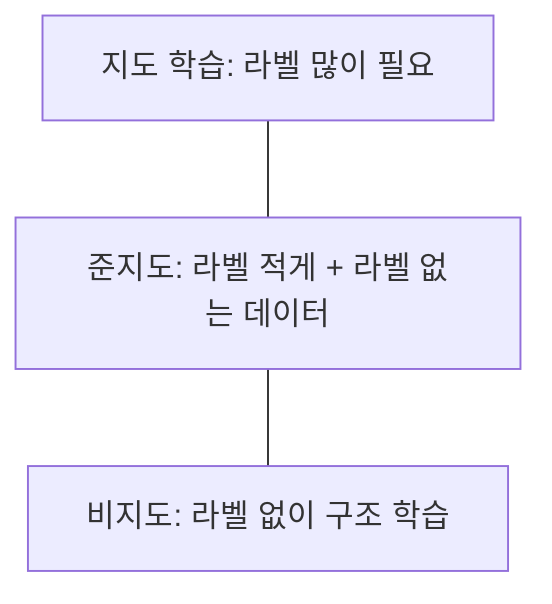

# 준지도 학습

> 정답 라벨이 달린 데이터는 적고 라벨 없는 데이터는 많을 때, **라벨 있는 데이터로 지도 학습을 하면서 라벨 없는 데이터도 함께 학습 신호로 쓰는** 방식이다.

## 쉽게 말하면
정답지가 있는 문제집은 10쪽뿐인데 문제만 있는 문제집이 1,000쪽 있다고 하자. 10쪽으로 기본기를 익히고, 나머지는 "같은 문제를 표현만 바꿔 내도 같은 답이 나와야 한다"는 규칙으로 스스로 점검하며 공부한다.

## 자세히
- 지도 학습은 라벨이 많아야 잘 되고, 비지도 학습은 라벨 없이 구조만 배운다. 준지도(SSL)는 둘 사이다. UDA 논문(Xie et al., arXiv 1904.12848, v6 2020-11)은 SSL을 "라벨이 부족한 딥러닝의 약점을 푸는 가장 유망한 패러다임 중 하나"라고 소개한다.
- 대표 접근 **일관성 학습(consistency training)**: 라벨 없는 입력에 작은 잡음(노이즈)을 주어도 모델 예측이 변하지 않게 한다. UDA의 주장: **잡음의 질**이 중요하며, 단순 잡음 대신 RandAugment·역번역 같은 강한 증강을 쓰면 성능이 크게 오른다.
- 학습 구조: 라벨 있는 배치에는 지도 손실, 라벨 없는 배치에는 원본-증강본 일관성 손실을 가중치 λ로 합산(논문 2장).
- 보조 기법: [신뢰도 마스킹](#confidence-masking), 샤프닝, 라벨 있는 쉬운 예제를 점차 풀어 주는 TSA.
- 논문이 보고한 수치(주장·논문 보고 기준): IMDb에서 라벨 20개만으로 오류율 4.20(라벨 25,000개 쓴 기존 최고 모델 능가), CIFAR-10에서 라벨 250개로 오류율 5.43, SVHN 250개로 2.72.
- 한계: 라벨 없는 데이터가 라벨 있는 데이터와 같은 분포라는 가정이 깔려 있다. 분포가 다르면 도움이 줄거나 해가 될 수 있다(일반적 지적, 이 논문에서 검증된 것은 아님).

## 그림으로 보기

## 예시
- 고객 문의 분류: 사람이 라벨한 문의 200건과 라벨 없는 문의 5만 건으로 분류기 학습.
- 교육: "라벨링 비용을 줄이는 3가지 길(준지도·약지도·합성 데이터)" 중 하나로 소개.

## 헷갈리는 것과 비교
| 개념 | 차이 |
|---|---|
| 준지도 학습 | 라벨 소량 + 라벨 없는 데이터를 함께 사용 |
| 자기지도 학습 | 데이터 자체에서 만든 과제로 표현 학습(사전학습) |
| 의사 라벨(pseudo-label) | 모델 예측을 라벨처럼 써서 재학습하는 준지도 기법 |
| [UDA](#uda-consistency-training) | 일관성 학습에 강한 증강을 쓰는 준지도 방법 |

## 더 읽을거리
- [Unsupervised Data Augmentation for Consistency Training](https://arxiv.org/abs/1904.12848) — 초록·1~2장 PDF 텍스트로 읽음.
