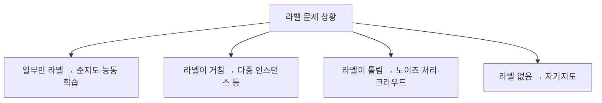
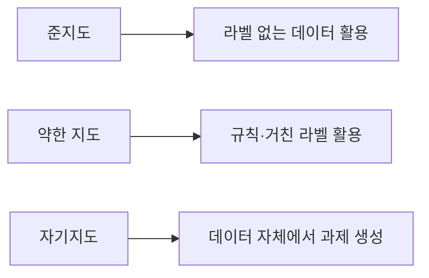

# 준·약·자기지도 학습 비교

> 라벨이 부족하거나 거친 상황에서 쓰는 세 학습 방식의 구분이다. 준지도는 일부만 라벨이 있을 때, 약한 지도는 라벨이 거칠거나 틀릴 때, 자기지도는 라벨 없이 데이터 자체에서 학습 신호를 만들 때 쓴다.

## 쉽게 말하면
학생이 공부할 때 ①문제집 일부만 정답이 있는 경우(준지도) ②정답이 대충 쓰여 있거나 일부 틀린 경우(약한 지도) ③정답지 없이 문제 자체에서 규칙을 찾아내는 경우(자기지도)다.

## 자세히
(Zhou, "A brief introduction to weakly supervised learning", National Science Review 2018 본문 일부를 직접 열어 확인. 자기지도 설명은 제안.)
- **약한 지도의 3유형(Zhou)**
  - **불완전(incomplete)**: 일부 샘플만 라벨. 해법: **능동 학습**(사람 오라클에 가장 가치 있는 샘플의 라벨을 질의)과 **준지도 학습**(사람 개입 없이 라벨 없는 데이터 활용: 생성·그래프·저밀도 분리 S3VM·불일치 기반 co-training).
  - **부정확(inexact)**: 라벨이 원하는 것보다 거침. 대표: **다중 인스턴스 학습**(가방에 양성이 하나라도 있으면 양성, 어느 것인지는 모름. 약물 활성 예측).
  - **오류(inaccurate)**: 일부 라벨이 틀림. 라벨 노이즈 처리(의심 샘플 제거·재라벨)와 크라우드소싱(다수결·작업자 품질 모델링).
  - 실제 응용에서는 이 유형들이 함께 나타난다고 논문이 언급.
- **자기지도 학습(제안)**: 데이터 내부에서 만든 과제(마스킹된 단어 맞히기, 다음 단어 예측)로 표현을 배운다. 외부 라벨이 필요 없다. 프로그램형 약한 지도(LF 등)는 불확실한 규칙 라벨로 학습하는 약한 지도의 한 갈래다.

## 그림으로 보기

## 예시
- 라벨 200개 + 문서 1만 개: 준지도 / 규칙으로 1만 개에 약한 라벨: 약한 지도 / 문서 수백만 개로 언어모델 사전학습: 자기지도.
- 교육 활용: 세 가지를 학생 공부 상황 비유로 비교하는 표 만들기.

## 헷갈리는 것과 비교
| 개념 | 필요한 것 | 예 |
|---|---|---|
| 준지도 | 일부 정답 + 라벨 없는 데이터 | 자기학습, co-training |
| 약한 지도 | 거칠거나 노이즈 있는 라벨 | LF, 다중 인스턴스 |
| 자기지도 | 라벨 없음(데이터 자체) | 마스킹 언어모델링 |

## 더 읽을거리
- [A brief introduction to weakly supervised learning (NSR 2018)](https://academic.oup.com/nsr/article/5/1/44/4093912) — 불완전·부정확·오류 3유형.
