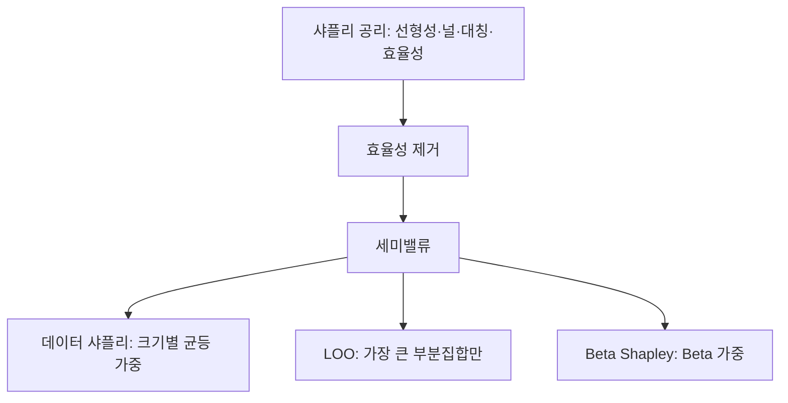

# 세미밸류

> **세미밸류(semivalue)** 는 샤플리 값의 공리 중 **효율성(가치의 합 = 전체 효용)만 빼고** 선형성·널 플레이어·대칭성을 만족하는 가치 개념이다. 데이터 샤플리, Leave-One-Out(LOO), Beta Shapley가 모두 이 틀 안의 특수한 경우다.

## 쉽게 말하면
점수 계산에서 "각 부분집합 크기에서의 기여를 어떻게 가중해 평균할까"만 다르게 하는 가족이다. 모든 크기를 똑같이 치면 샤플리, 맨 끝(나머지 전부가 있을 때)만 보면 LOO, 작은 크기를 더 중요하게 보면 Beta Shapley다.

## 자세히
- **정의(Kwon & Zou, Beta Shapley, arXiv 2110.14049, 본문 확인)**: 함수 ψ가 **선형성·널 플레이어·대칭성**을 만족하면 세미밸류. 논문은 "효율성 공리는 ML에서 본질적이지 않다"고 본다 — 양의 상수를 곱해도 값의 **합은 바뀌지만 순서는 안 바뀌고**, 저품질 점 식별에는 효율성이 필요 없다.
- **표현 정리(정리 2)**: 모든 세미밸류는 **한계 기여의 가중 평균** ψ(z) = (1/n) Σⱼ C(n−1, j−1) · w⁽ⁿ⁾(j) · Δⱼ(z)로 쓸 수 있다(Δⱼ = 크기 j−1 부분집합에 z를 더했을 때의 평균 성능 변화, 가중치 조건 Σ C(n−1,j−1) w⁽ⁿ⁾(j) = n).
  | 가중 w⁽ⁿ⁾(j) | 결과 |
  |---|---|
  | 1/C(n−1,j−1) (크기별 균등) | **데이터 샤플리** |
  | n·1(j=n) (가장 큰 부분집합만) | **LOO** |
  | ∫ t^{j−1}(1−t)^{n−j} dξ(t) 꼴(ξ는 [0,1] 위 확률측도) | 같은 족의 다른 세미밸류, ξ=Beta이면 **Beta Shapley** |
- **왜 균등 가중이 문제인가(논문 논지)**: 부분집합이 커지면 점 하나를 더해도 성능 변화가 거의 0이라(예: 음의 로그우도에서 U(S∪{z})−U(S)=O_p(|S|⁻²)) **큰 부분집합의 한계 기여는 잡음에 묻힌다.** 균등 평균은 이 잡음 많은 항에 같은 가중을 주므로 최적이 아니라는 주장이다. 작은 부분집합에 더 가중을 주면 잡음이 줄어든다.
- **유일성(명제 3)**: 합이 같은 두 세미밸류는 동일하다. 즉 가중 함수의 모양이 달라도 가치 총량이 같으면 같은 세미밸류.
- **직접 계산(앞 글의 3점 예, U(∅)=0.50, U(ABC)=0.82)**: 샤플리 φ=(0.2183, 0.0833, 0.0183), 합 0.3199. LOO = U(ABC)−U(나머지 둘) = (0.22, 0.10, 0.02), 합 0.34 ≠ 0.32 — LOO는 효율성을 만족하지 않지만 세미밸류다. 두 방법 모두 A>B>C 순위는 같다.
- **논문 보고 결과(저자 주장)**: Beta Shapley가 최신 방법보다 ① 잘못 라벨된 학습 데이터 탐지 ② 부분 표본 학습 ③ 추가/제거 영향이 큰 점 식별에서 낫다고 한다.
- **교육 포인트**: "공정한 분배(효율성)"와 "쓸모 있는 순위(저품질 탐지)"는 다른 목표다.

## 그림으로 보기



## 예시
```python
def semivalue(U, players, weight):          # weight(j, n): 크기 j 부분집합 가중
    n = len(players); phi = {}
    for z in players:
        rest = [p for p in players if p != z]; total = 0
        for r in range(n):                   # 크기 r 부분집합
            for S in combinations(rest, r):
                total += weight(r + 1, n) * (U(list(S) + [z]) - U(list(S)))
        phi[z] = total / (2 ** (n - 1))      # 정규화는 가중 정의에 따라 다름(개념 코드)
    return phi
```
- 잘못 라벨된 점 탐지가 목적이면 정확한 합(효율성)보다 **하위 순위의 안정성**이 중요하므로 세미밸류를 후보에 둔다.

## 헷갈리는 것과 비교
| 개념 | 효율성 | 가중 |
|---|---|---|
| 샤플리 | O | 크기별 균등 |
| LOO | X | 최대 크기만 |
| Beta Shapley | X | 작은 크기 강조 가능 |
| 세미밸류 | X(선택) | 임의 가중 |

관련: [샤플리 효율성 공리](#shapley-efficiency-axiom), [TMC-Shapley](#tmc-shapley)

## 더 읽을거리
- [Beta Shapley (arXiv 2110.14049)](https://arxiv.org/abs/2110.14049) — 세미밸류 정의·표현 정리(PDF 본문 확인).
- [Data Shapley (arXiv 1904.02868)](https://arxiv.org/abs/1904.02868) — 널·대칭·선형 3가지 조건과 임의 상수 C(PDF 본문 확인).
