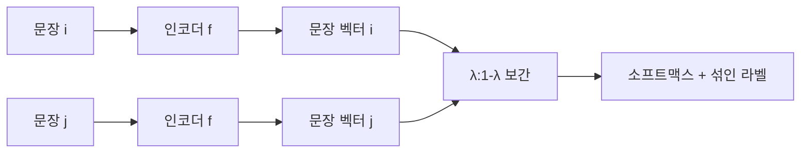
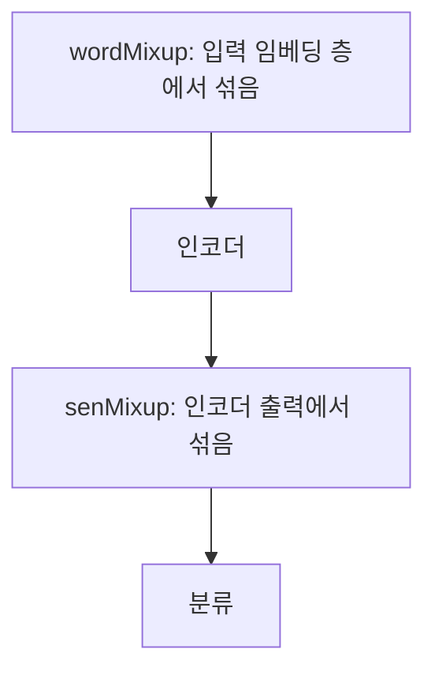

# senMixup

> 문장 분류 모델에서 CNN·LSTM 인코더가 만든 **문장 벡터(소프트맥스 직전 은닉층)를 두 샘플 사이에서 선형 보간**하고 라벨도 같은 비율로 섞는 Mixup 변형이다(Guo et al., arXiv 1905.08941).

## 쉽게 말하면
두 문장을 각각 요약 카드 한 장으로 압축한 뒤, 카드 내용을 "0.6 : 0.4"로 섞어 새 카드를 만든다. wordMixup이 재료(단어)를 섞는다면 senMixup은 이미 만들어진 요약본을 섞는다.

## 자세히
- 구조: 문장 B^i, B^j를 인코더 f(CNN 또는 LSTM)에 넣어 문장 임베딩 f(B^i), f(B^j)를 얻고, 각 차원 k마다 **B̃_k = λ·f(B^i)_k + (1−λ)·f(B^j)_k**, 라벨 ỹ = λy^i + (1−λ)y^j. 섞은 벡터를 소프트맥스 층에 넣어 교차엔트로피로 학습한다.
- λ는 Beta(α, α)에서 샘플, 논문은 α=1(균등분포) 사용. 같은 미니배치 안에서 짝을 지어 추가 계산이 작다.
- 정규화 효과: 논문 Figure는 MR 데이터에서 일반 CNN은 학습 손실이 금방 0이 되어 더 배울 신호가 없지만, wordMixup·senMixup은 학습 손실이 0 위에 머물러 학습 신호가 계속된다고 설명한다. 섞인 샘플의 공간이 커서 소수 개별 샘플에 과적합하기 어렵다는 해석이다.
- 결과(RandomTune, 정확도 %, 10회 평균): CNN TREC 90.2 → 92.1, SST-1 43.6 → 45.2, Subj 90.6 → 92.7, MR 75.5 → 77.9. LSTM SST-1 45.9 → 48.3, SST-2 84.4 → 86.7.
- 임베딩 설정에 따라 다르다: 임베딩을 **고정**했을 때 SST-2에서 CNN 정확도가 오히려 떨어졌고(80.4 → 77.6), 임베딩을 학습하면 대체로 향상됐다. 논문 결론: 임베딩을 같이 학습할 때 효과가 안정적.
- wordMixup과의 비교: 대부분 데이터셋에서 비슷한 성능이며 데이터셋별로 한쪽이 1~1.2%p 낫다(예: LSTM Subj는 wordMixup이 1.2%p 우위).
- 한계: 5개 소규모 문장 분류 데이터셋·CNN/LSTM 기준이다. 현대 트랜스포머 모델에서의 효과는 이 논문만으로 알 수 없다(주의).

## 그림으로 보기

## 예시
- 질문 유형 분류(TREC) CNN: 두 질문의 문장 벡터를 섞어 학습 → 정확도 90.2에서 92.1로.
- 교육: "깊은 층에서 섞는 방식(manifold mixup)"으로 이어지는 개념 소개.

## 헷갈리는 것과 비교
| 개념 | 차이 |
|---|---|
| [wordMixup](#wordmixup) | 단어 임베딩 행렬을 위치별로 섞음 |
| senMixup | 인코더가 만든 문장 벡터를 섞음 |
| [텍스트용 Mixup](#mixup-for-text) | 두 기법을 포함하는 상위 개념 |
| [임베딩 공간 증강](#embedding-space-augmentation) | 표현 공간에서 변형하는 방법 모음 |

## 더 읽을거리
- [Augmenting Data with Mixup for Sentence Classification](https://arxiv.org/abs/1905.08941) — 2~4장과 Table 2~6 PDF 텍스트로 읽음.
