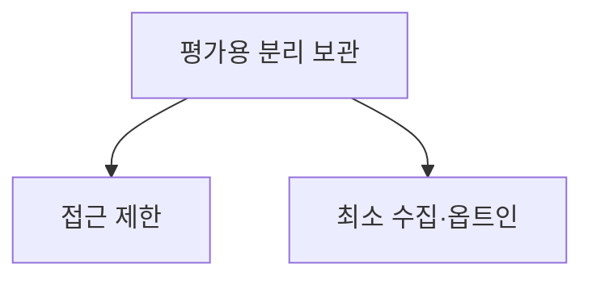

# 민감 속성 수집의 한계

> 공정성 평가를 하려면 성별·인종 같은 민감 속성이 필요하지만, 이를 수집하는 데는 동의·개인정보·재식별 위험이 따른다. 데이터시트와 데이터 카드는 이런 속성의 포함 여부와 처리를 문서화하도록 요구한다.

## 쉽게 말하면
공정한지 확인하려면 집단별 성적표가 필요한데, 집단 정보를 모으는 일 자체가 사생활 위험이다. 필요와 위험 사이의 균형을 문서로 남기는 것이 출발점이다.

## 자세히
(Gebru 외 Datasheets arXiv 1803.09010 v8과 Pushkarna 외 Data Cards arXiv 2204.01075를 하위 에이전트가 원문으로 읽은 노트 기준. Data Cards의 정확한 항목 라벨은 그림 속 문구라 일부 미확인.)
- **Datasheets §3.2 질문**: 데이터에 "인종·민족 기원, 성적 지향, 종교적 신념, 정치적 의견·노조 가입, 위치, 금융·건강, 생체·유전, 주민번호 등 정부 신분, 범죄 이력" 같은 민감 정보가 있는가? 있다면 설명. 또 기밀 정보(법적 특권, 의사-환자 비밀 등)가 있는가, **개인을 식별할 수 있는가**를 묻는다. 일부 질문은 GDPR 준수 정보를 이끌어 낸다.
- **Datasheets §3.3 동의**: 해당 개인이 수집·사용에 동의했는가, 동의 방법, **동의 철회 수단**이 있는가.
- **Data Cards**: "Sensitivity of Dataset"(민감 필드의 의도·처리·위험)과 "The Human and Other Sensitive Attributes" 구역이 있다. 그림 설명은 사람 속성을 포함·수집한 결정의 이유, 집단별 통계·상관, 위험과 절충을 보고하도록 권한다. 보존·삭제 정책과 접근 제한도 주제에 포함.
- **사례**: 3만 장 이미지에 10만 개 상자(박스)를 단 사례가 소개된다.
- **긴장(제안)**: 평가용으로만 수집해 분리 보관, 자기 보고 방식·옵트인, 최소 수집, 접근 통제, 소규모 집단의 재식별 위험 점검.

## 그림으로 보기

## 예시
- 채용 모델 평가를 위해 성별·연령을 별도 평가용 테이블에 암호화 보관하고 학습에는 쓰지 않음.
- 교육 활용: 수집 필요성과 개인정보 위험을 토론하는 케이스 스터디.

## 헷갈리는 것과 비교
| 개념 | 차이 |
|---|---|
| 민감 속성 수집 | 평가를 위한 데이터 확보 |
| [Fairness through unawareness](#fairness-through-unawareness) | 속성을 쓰지 않는 접근 |
| 개인정보 마스킹 | 식별 정보를 가림 |

## 더 읽을거리
- [Datasheets for Datasets (arXiv 1803.09010)](https://arxiv.org/abs/1803.09010) — §3.2·3.3 질문.
- [Data Cards (arXiv 2204.01075)](https://arxiv.org/abs/2204.01075) — 민감 속성 구역.
