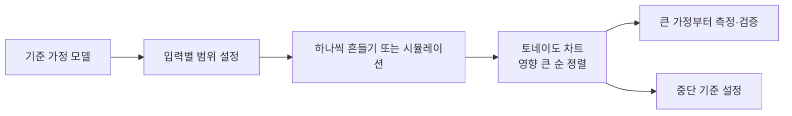

# 비용 추정 민감도 분석

> AI 도입 효과 계산에서 가정(물량·절감률·비용 등)을 하나씩 흔들어 보며, 어떤 가정이 결론을 가장 크게 좌우하는지와 결론이 뒤집히는 지점을 찾는 분석.

## 쉽게 말하면
여행 예산을 짤 때 "환율이 10% 오르면? 비행기표가 20% 비싸지면?"을 따져 보는 것과 같다. 예산 총액보다, 어느 항목이 흔들리면 여행이 무너지는지를 알아야 대비할 수 있다.

## 자세히
- **손익분기 역질문**: "이 프로젝트가 본전이 되려면 가정이 어때야 하나"를 먼저 묻고, 각 불확실한 입력이 얼마나 틀리면 결정이 뒤집히는지 본다(강의 자료 종합).
- **토네이도 차트**: 입력 하나씩을 그럴듯한 범위로 움직였을 때 결과(예: NPV) 변동 폭을 가로 막대로 그려 긴 순서로 정렬한다. 가장 긴 막대가 측정 노력을 집중할 가정이다.
- **몬테카를로 방식(FlowX 문서 예시, 벤더 자료)**: 입력을 분포로 둔다 — 물량 ±20%, 건당 수작업 시간 ±15%, LLM 호출 비용 ±10%, 대체율 Beta(8,2), 할인율 삼각분포 7~13%. 1,000회(보고용 10,000회) 시뮬레이션해 p10·p50·p90을 낸다. 그 문서의 전형적 순위는 물량 > 대체율 > 수작업 시간 > LLM 비용 > 할인율. LLM 비용은 절감액에 비해 작아 영향이 적은 경우가 많다고 한다(그 사례 한정).
- **보고 방식**: 점추정 대신 범위. 예시: p50 NPV $4.6M, 90% 구간 $2.9M~$6.1M(벤더 예시 수치). 최악(p10)이 감당 안 되면 범위를 줄이거나 연기한다.
- **엔지니어링 제약으로 번역**: 예컨대 응대 자동 처리율 가정이 달라지면 회수 기간이 18→36개월이 되는 사례가 있다(출처 가이드 예시). 그러면 "처리율 X% 미만이면 중단" 같은 기준을 미리 정한다.
- 한 번에 한 입력만 바꾸는 방식은 입력 간 상관(물량↑ → 처리율↓)을 놓친다. 시나리오(낙관·기준·비관)를 함께 쓴다.

## 그림으로 보기

## 예시
- 상담 자동화 ROI: 물량이 ±20%에서 결과를 가장 흔들면, 모델 가격 협상보다 먼저 실제 문의 물량 로그를 2달 측정한다.
- 이사회 보고: "기준 연 4.6억, 90% 범위 2.9~6.1억. 자동 해결률 40% 미만이면 손익분기 못 넘음."(가상 수치)

## 헷갈리는 것과 비교
| 개념 | 차이 |
|---|---|
| 민감도 분석 | 어떤 가정이 중요한가 |
| 손익분기 분석 | 본전이 되는 값 |
| 시나리오 분석 | 가정 묶음을 통째로 비교 |
| [정확도 경제학](#accuracy-economics) | 정확도 대비 성공·실패 비용 계산 |

## 더 읽을거리
- [FlowX: Sensitivity analysis](https://docs.flowx.ai/5.9/observatory/roi/sensitivity-analysis) — AI 에이전트 ROI의 분포·p10/p50/p90 방식(벤더 문서)
- [Break-even & sensitivity 강의](https://frostburg-state-university.github.io/bju/lectures/lecture-06-breakeven-sensitivity/) — 손익분기와 민감도 개념(검색 결과로만 확인)
