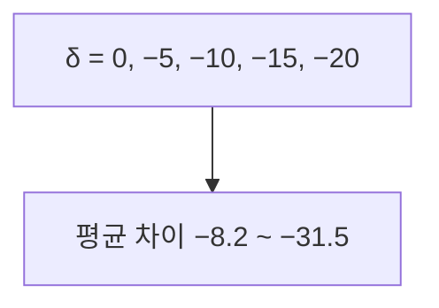

# MNAR 민감도 분석

> 결측이 관측 데이터로 설명되지 않는 방식(MNAR)일 수 있을 때, "대체값을 일정량 이동"시키는 식의 가상 시나리오를 여러 개 돌려 결론이 얼마나 흔들리는지 확인하는 방법이다.

## 쉽게 말하면
무응답자의 혈압이 응답자보다 5, 10, 15 높다고 가정해 보고 그래도 결론이 같은지 보는 것이다. 가정이 틀려도 결론이 안 바뀌면 안심할 수 있다.

## 자세히
(FIMD 9.2절과 3.8절을 하위 에이전트가 원문으로 읽은 노트 기준.)
- **델타 조정**: mice의 후처리로 대체된 값에 δ를 더한다. 예(Leiden 85+ 코호트 수축기 혈압): δ = 0, −5, −10, −15, −20 mmHg.
- **실현된 평균 차이**: 대체값−관측값 평균 차이는 −8.2, −12.3, −20.7, −26.1, −31.5 (관측 평균 152.9).
- **결과**: 125 mmHg 미만의 위험비는 1.76에서 1.89로 거의 변하지 않았고(완전 사례 분석 1.76), 결론이 **견고**했다.
- **모형들(3.8절)**: 선택 모형(selection model), 패턴 혼합 모형(pattern-mixture model), 두 모형 사이 베이즈 정리 변환, δ 해석 표.
- **실무(제안)**: 주 분석(MAR 가정) + 현실적인 δ 범위의 시나리오를 미리 정해 결과 표에 함께 싣는다.

## 그림으로 보기

## 예시
- 임상 시험 탈락자의 결과가 더 나쁘다고 가정(δ)하고 치료 효과가 유지되는지 확인.
- 교육 활용: δ를 슬라이더로 움직이며 결론이 뒤집히는 지점 찾기.

## 헷갈리는 것과 비교
| 개념 | 차이 |
|---|---|
| 민감도 분석 | 가정을 바꿔 결론 안정성 확인 |
| [메커니즘 진단](#mechanism-diagnosis) | MNAR 여부는 데이터로 알 수 없어 필요 |
| 다중 대체 | 불확실성을 반영(δ는 그 위의 시나리오) |

## 더 읽을거리
- [FIMD 9.2절](https://stefvanbuuren.name/fimd/sec-sensitivity.html) — 델타 조정 예.
- [FIMD 3.8절](https://stefvanbuuren.name/fimd/sec-nonignorable.html) — 선택·패턴 혼합 모형.
