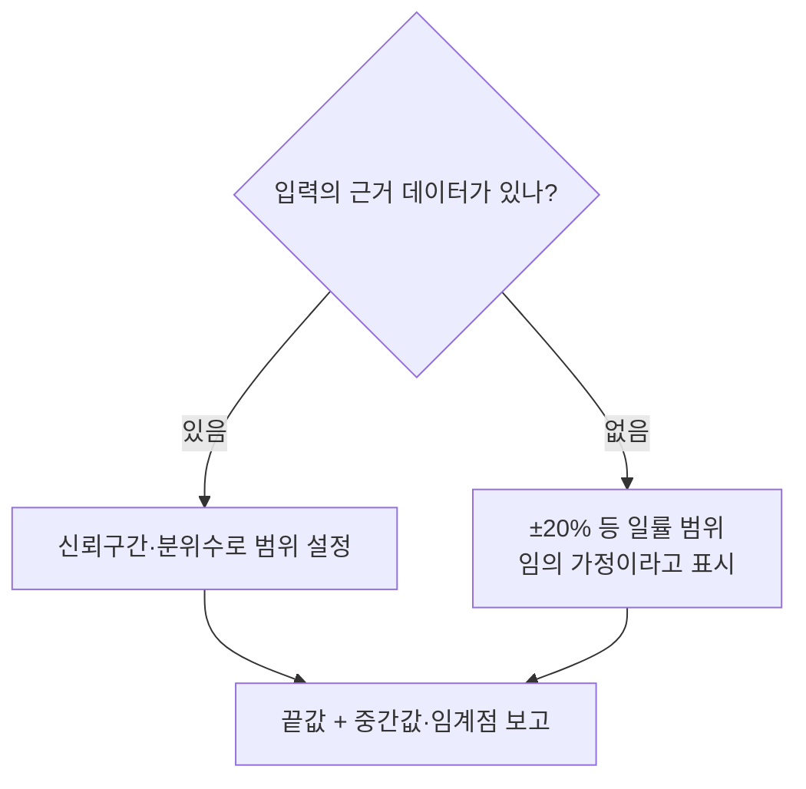
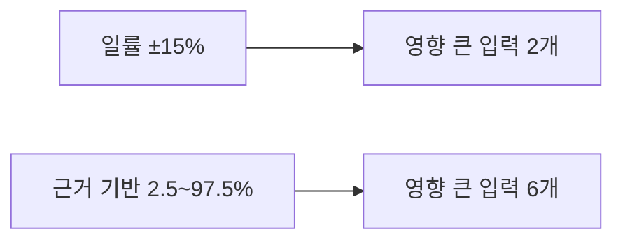

# 민감도 범위 선택

> 민감도 범위 선택은 일원 민감도 분석에서 각 입력을 얼마나 움직일지(±20% 같은 일률 범위인지, 신뢰구간 같은 근거 있는 범위인지) 정하는 일이다. 범위가 순위와 결론을 바꾸므로 분석의 신뢰도를 좌우한다.

## 쉽게 말하면
자동차 연비가 얼마나 달라질지 볼 때, 모든 요인을 "±20%"로 똑같이 바꾸면 공정해 보이지만 현실과 맞지 않는다. 타이어 공기압은 ±5%만 변하고 도로 경사는 ±50%까지 변하는데 둘을 같은 폭으로 흔들면 중요도 순위가 왜곡된다.

## 자세히
- **보건경제 분야의 실제 관행(ISPOR Europe 2024 발표 초록, NICE 평가 검토, 열람)**: 검토한 NICE 기술 평가는 모두 일원 분석을 했고 대부분 토네이도 차트로 보고했다. 범위는 대부분 표준오차·신뢰구간 같은 관찰된 불확실성에 근거했고, 임의 범위는 소수였다. 다만 대부분 범위의 양 끝 값에서만 결과를 보여 주고 중간 값은 없었다.
- **끝값만 보여 주는 한계(같은 초록)**: 95% 신뢰구간의 양 끝은 합쳐 5% 확률일 뿐이라 의사결정자는 중간 값에 대한 정보를 얻지 못한다. 저자들은 십분위값, 사분위 범위, 결과가 뒤집히는 임계점(threshold) 표시를 대안으로 제시한다.
- **방법 비교(McQueen·Campbell, 2017 학회 초록, 열람)**: 영국 HIV/AIDS 마르코프 비용효과 모델을 재현해 모든 입력을 ±15%로 흔든 경우와 근거 기반 분포의 2.5·97.5백분위로 흔든 경우를 비교했다. 기준 ICER은 7,654파운드/QALY. 상위 10개 입력의 ICER 불확실성은 근거 기반이 평균 3,251파운드/QALY 더 컸고(p=.0096), 기준 ICER의 10%를 넘는 입력은 근거 기반 6개 대 일률 방식 2개였다. 저자는 모든 민감도 분석에 근거 기반 입력 불확실성을 쓰라고 권한다. 한 모델의 사례이므로 일반화에는 주의가 필요하다.
- **지침과 현실의 괴리(검색 요약, 본문 미열람)**: 많은 지침이 "임상적·통계적으로 타당한 범위"를 권하지만 실제로는 임의로 고르는 경우가 많다는 지적이 있다.
- **AI ROI 분석에의 적용(해석)**: ① 사내 파일럿 데이터가 있으면 그 변동(표준오차·분위수)을 범위로 쓴다 ② 근거가 없는 입력은 ±20% 같은 일률 범위를 쓰되 "근거 없는 가정"이라고 표시한다 ③ 모든 입력에 같은 논리를 적용해 순위가 범위 폭의 인공물이 되지 않게 한다 ④ 결과가 뒤집히는 임계값(예: 사용률이 얼마 아래면 적자)을 함께 적는다.

## 그림으로 보기

## 예시
- 상담 AI ROI: "월 절감 시간"은 파일럿 20명의 측정값으로 신뢰구간을 구해 범위로 쓰고, "라이선스 비용"은 견적서의 구간을 쓴다. 근거가 없는 "이탈 감소율"만 ±20%로 두고 표에 "가정"이라고 적는다.
- 교육 활용: 같은 모델을 ±20%와 신뢰구간으로 각각 그려 순위가 바뀌는지 비교하는 실습을 한다.

## 헷갈리는 것과 비교
| 개념 | 차이 |
| --- | --- |
| [일원 민감도 분석](#one-way-sensitivity) | 방법. 범위 선택은 그 입력 설정 |
| [토네이도 차트](#tornado-chart) | 결과를 그린 그림. 범위가 막대 길이를 결정 |
| 확률적 민감도 분석 | 모든 입력을 분포로 동시에 추출. 범위 대신 분포를 지정 |

## 더 읽을거리
- [ISPOR Europe 2024: Tornado Diagrams and One-Way Sensitivity Analysis](https://www.ispor.org/heor-resources/presentations-database/presentation/euro2024-4015/146785) — NICE 평가의 범위 관행
- [VP131: Comparison of Variation Methods for One-Way Sensitivity Analyses](https://cambridge.org/core/journals/international-journal-of-technology-assessment-in-health-care/article/vp131-comparison-of-variation-methods-for-oneway-sensitivity-analyses/0CD4A12A422824BA09B66B9F304C2868) — ±15% 대 근거 기반 비교
