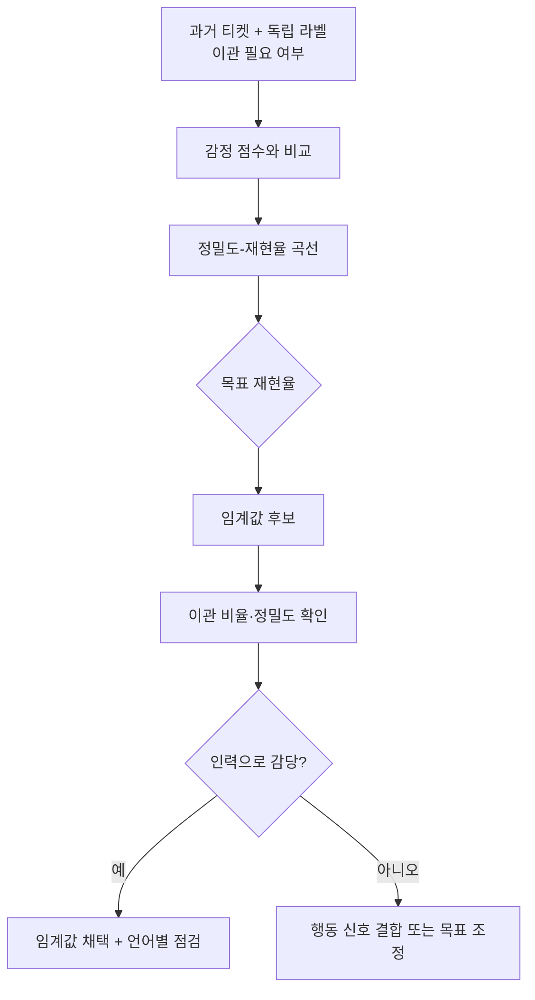

# 감정 임계값 보정

> "감정 점수가 얼마 이상이면 사람에게 넘긴다"는 기준 숫자를 **과거 티켓에 사람이 붙인 정답(이관이 필요했는지)과 비교해 정하는 절차**. 목표 재현율을 먼저 정하고, 그 재현율을 달성하는 점수에서 임계값을 고르며, 그때 감수할 오탐(불필요한 이관)량을 함께 본다.

## 쉽게 말하면
화재경보기 민감도를 정할 때 "실제 화재의 90%는 반드시 울려야 한다"를 먼저 정하고, 그 민감도에서 헛울림이 얼마나 나는지 보고 감당 가능한지 판단하는 것과 같다. 민감도를 올리면 헛울림이 늘어 직원이 지친다.

## 자세히
출처: scikit-learn의 정밀도·재현율·`precision_recall_curve` 정의([에스컬레이션 재현율](#escalation-recall) 노드에서 확인)와 **직접 실행한 합성 데이터 시뮬레이션**(scikit-learn, 2026-11-18). 아래 숫자는 가상이며 실제 상담 데이터가 아니다.
- **절차(제안)**: ①과거 티켓 표본에 "사람이 개입했어야 했는가"를 독립 검수자가 라벨링 ②감정 점수와 라벨로 `precision_recall_curve` 계산 ③목표 재현율(위험이 클수록 높게)에서 임계값 선택 ④그때의 정밀도·이관 비율(업무량)을 확인 ⑤언어·채널·고객 유형별로 따로 검토 ⑥주기적으로 재보정.
- **시뮬레이션 설정**: 티켓 5,000건, 실제 이관 필요 8%(386건). 필요한 건의 부정 점수는 Beta(4,3), 아닌 건은 Beta(2,5).
- **결과**:

| 목표 재현율 | 임계값 | 정밀도 | 이관 비율(전체 대비) |
|---|---|---|---|
| 80% | 0.409 | 22.2% | 27.8% |
| 90% | 0.322 | 16.3% | 42.8% |
| 95% | 0.262 | 13.5% | 54.5% |

  재현율을 80%에서 95%로 올리면 이관 비율이 28% → 55%로 거의 두 배가 된다. 정밀도는 10~20%대에 머문다. 이 예에서는 감정 점수만으로는 필요한 건과 아닌 건이 많이 겹친다는 뜻이다.
- **해석(제안)**: 이런 경우 감정 점수 단독 임계값보다 행동 신호(재문의, 반복 이관 요청, 키워드)와 결합하는 편이 효율적이다([빈정거림 탐지](#sarcasm-detection)). 임계값은 업무량(상담사 인력)과 놓침 비용의 균형으로 정한다.
- **함정**: ①라벨이 편향되면(상담사가 실제로 이관한 건만 정답으로 삼는 경우) 놓친 건을 학습하지 못한다 ②표본이 작으면 임계값이 흔들린다([단계별 최소 표본](#minimum-sample-size)) ③모델·언어가 바뀌면 점수 분포가 변한다([다국어 감정 분석](#multilingual-sentiment)).

## 그림으로 보기


## 예시
```python
from sklearn.metrics import precision_recall_curve
p, r, t = precision_recall_curve(y_needed_handoff, negative_score)
i = max(k for k in range(len(t)) if r[k] >= 0.90)
threshold, precision_at, flag_rate = t[i], p[i], (negative_score >= t[i]).mean()
```
교육 활용: 이관 기준 회의에서 "임계값을 몇으로 할까"가 아니라 "목표 재현율과 감당할 이관량이 각각 얼마인가"를 먼저 묻는 연습.

## 헷갈리는 것과 비교
| 개념 | 차이 |
|---|---|
| 임계값 보정 | 라벨과 비교해 기준 숫자를 정함 |
| 확신 보정(calibration) | 모델 확신이 실제 정확도와 맞는지 |
| [에스컬레이션 재현율](#escalation-recall) | 이관이 필요한 건을 잡은 비율 |
| [감정 트리거](#sentiment-trigger) | 감정으로 이관하는 규칙 전체 |

## 더 읽을거리
- [scikit-learn: Precision, recall, F-measure](https://scikit-learn.org/stable/modules/model_evaluation.html#precision-recall-and-f-measures) — `precision_recall_curve`와 F-beta
- [에스컬레이션 재현율](#escalation-recall) — 재현율 중심 운영 기준
