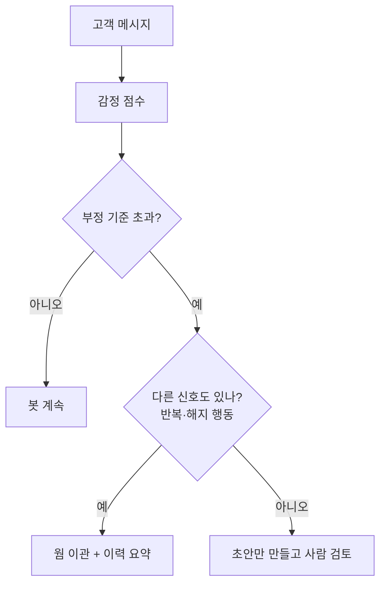
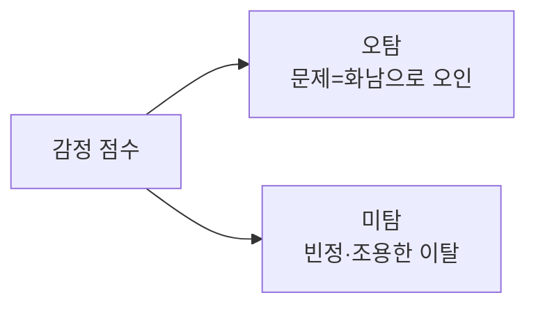

# 감정 기반 이관

> 고객 메시지의 감정 점수가 부정 쪽으로 기울면 봇을 멈추고 사람에게 넘기는 트리거. 쓸모는 있지만 오탐(과다 경보)과 미탐(놓침)이 둘 다 크다.

## 쉽게 말하면
매장 직원이 손님 표정을 보고 "이분은 매니저가 나서야겠다"고 느끼는 감각을 점수로 흉내 낸 것이다. 표정 읽기가 틀릴 수 있으니 이 신호 하나만으로 결정하지 않는다.

## 자세히
- **작동**: 메시지마다 감정 점수(등급 척도)를 매기고, 기준을 넘으면 자동 응답을 멈추고 이관. 음성은 톤·크기도 읽지만 텍스트는 못 읽어 빈정거림이 더 어렵다.
- **과다 경보**: 문제를 말하는 티켓 전부를 "화남"으로 표시. Zendesk는 문제가 있다는 이유만으로 부정으로 분류하지 않게 보정한다고 설명(eesel 인용).
- **미탐**: 빈정거림이 긍정으로 읽히거나, 조용히 떠나는 공손한 고객이 중립으로 나옴. 긴 대화는 맥락을 잃기도 한다.
- **완화책**
  - 점수는 대기열 순서 정하기에 쓰고, 한 메시지로 되돌릴 수 없는 결정을 내리지 않는다.
  - 낮은 확신의 판독은 사람이 보는 초안으로 돌린다.
  - 우리 과거 티켓으로 보정하고, 언어별로 따로 시험한다.
  - 감정 외 신호(해지 관련 행동, 반복 질문)를 함께 본다.
  - 이관 시 전체 이력을 넘겨 고객이 반복하지 않게 한다.
- **임계값**: 글마다 예시만 있고(-0.5, -0.6 등) 근거가 없다. 한 글(Quidget)은 "매우 부정"이라고만 쓰고 수치를 주지 않았다. 반드시 자기 데이터로 정한다.
- **연속 신호 규칙**("부정 2회 연속이면 이관")은 검색 요약에서 본 제안으로, 열어 본 두 글에서는 확인하지 못했다. 주장으로 둔다.
- 대문자 같은 표면 신호는 거친 대리 지표라 오탐이 늘 수 있다.

## 그림으로 보기

## 예시
- "정말 대단한 서비스네요 ㅋㅋ 3번째 환불 요청인데" → 점수만 보면 긍정, 반복 신호와 합치면 이관.
- 교육 실습: 실제 불만 메시지 10개에 점수를 매겨 보고 오탐·미탐 사례를 표로 정리.

## 헷갈리는 것과 비교
| 개념 | 차이 |
|---|---|
| 감정 기반 이관 | 감정 점수로 판단 |
| [신뢰도 보정과 이관](#confidence-calibration-handoff) | 모델의 확신 신호로 판단 |
| [이관 트리거 신호](#escalation-triggers) | 감정을 포함한 상위 신호 모음 |
| [응대 전환율 deflection](#deflection-rate) | 이관을 늦추면 오르지만 만족은 떨어질 수 있음 |

## 더 읽을거리
- [eesel: AI sentiment analysis for support](https://eesel.ai/blog/ai-sentiment-analysis-for-support) — 작동·실패 양상(벤더)
- [Quidget: The AI handoff problem](https://quidget.ai/blog/ai-automation/the-ai-handoff-problem-5-triggers-for-bot-to-human-escalation-best-practices/) — 감정 트리거 사례(벤더)
