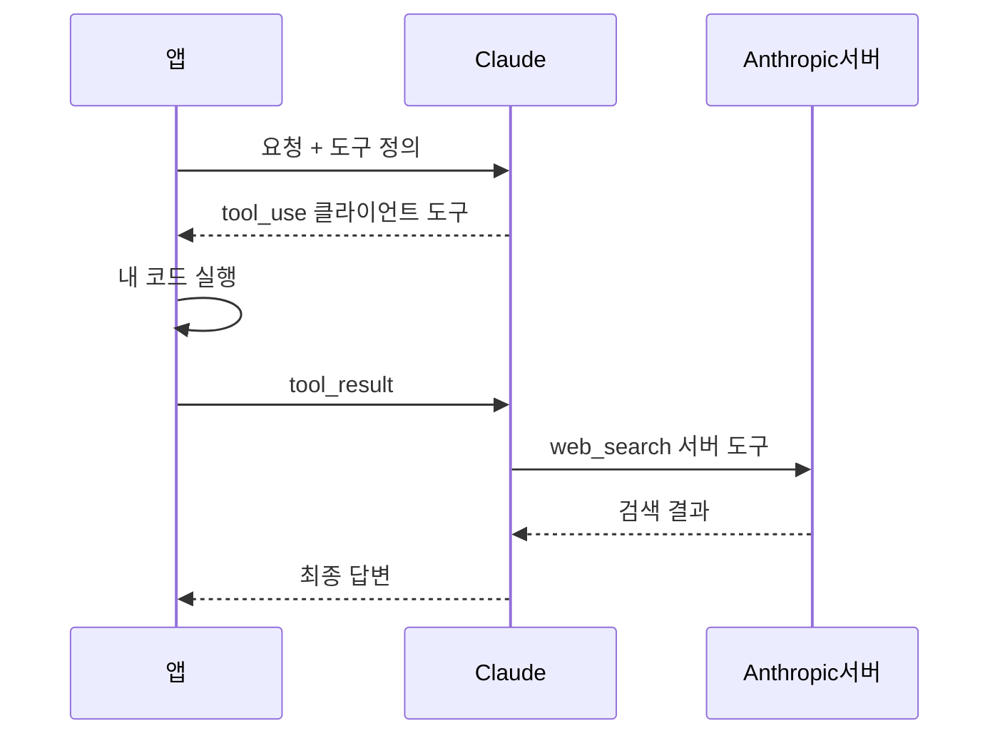
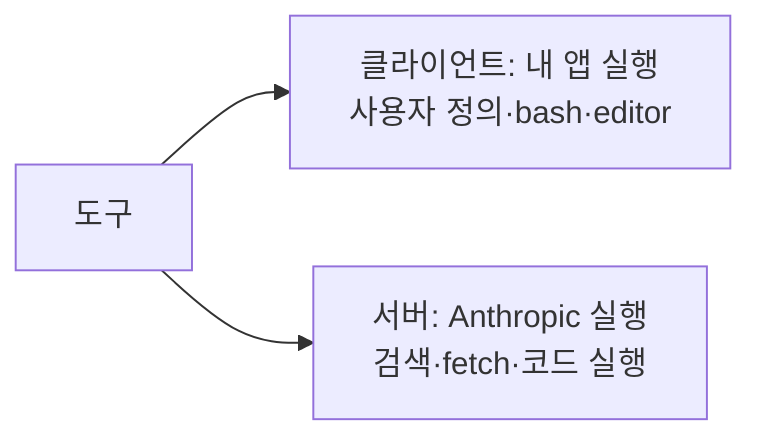

# 서버 도구 vs 클라이언트 도구

> 도구는 "코드를 누가 실행하느냐"로 나뉜다. 클라이언트 도구는 내 애플리케이션이, 서버 도구는 모델 제공사(Anthropic) 인프라가 실행한다.

## 쉽게 말하면
식당에서 재료를 손님이 직접 사 와 요리사에게 건네는 것(클라이언트)과, 식당 주방에 이미 있는 재료로 요리사가 바로 만들어 내는 것(서버)의 차이다. 앞쪽은 내가 통제하지만 일이 많고, 뒤쪽은 편하지만 주방 규칙을 따라야 한다.

## 자세히
Anthropic 문서(2026-11 확인):
- **클라이언트 도구**: 내가 정의한 도구와, Anthropic이 스키마를 공개하고 모델을 훈련한 도구(`bash`, `text_editor`, memory, computer use, browser use)가 포함된다. 모델이 `stop_reason: "tool_use"`와 `tool_use` 블록을 돌려주면 **내 코드가 실행**하고 `tool_result`를 보낸다.
- **서버 도구**: `web_search`, `web_fetch`, `code_execution`, `tool_search` 등. **Anthropic 인프라에서 실행**되어 결과가 같은 응답에 담긴다. 내 쪽 처리 코드가 필요 없다(단, 같은 병렬 호출 묶음에 내 클라이언트 도구가 섞이면 사정이 달라질 수 있다).
- 서버 도구 호출은 `server_tool_use` 블록(`srvtoolu_` ID)으로 나오며, 이 ID에 `tool_result`를 돌려주면 안 된다(tool search 문서).
- **비용**: 클라이언트 도구는 일반 요청과 같은 토큰 과금. 서버 도구는 웹 검색 건당 등 추가 사용량 과금이 있을 수 있다.
- **보안 관점**(일반 지식): 클라이언트 도구는 내 환경에서 실행되므로 권한·샌드박스·승인 절차를 내가 설계한다. 서버 도구는 격리된 Anthropic 컨테이너에서 돌지만 데이터가 외부로 나간다는 점을 따진다.
- 같은 이름의 구분이 MCP에도 이어진다: 원격 MCP 서버를 API가 직접 연결하는 MCP connector는 별도 서버 쪽 기능이다.

## 그림으로 보기

## 예시
사내 DB 조회 도구 → 클라이언트 도구(내 네트워크 안에서만 접근 가능). 최신 뉴스 확인 → 서버 도구 `web_search` 한 줄 추가로 끝.

## 헷갈리는 것과 비교
| 개념 | 실행 주체 | 내 코드 필요 |
| --- | --- | --- |
| 클라이언트 도구 | 내 앱 | 필요(tool_result 반환) |
| 서버 도구 | Anthropic | 불필요 |
| [도구 검색](#tool-search) | 서버 도구의 한 종류 | 정의 목록만 전달 |
| [병렬 도구 호출](#parallel-tool-use) | 둘이 섞여 나올 수 있음 | 클라이언트 몫만 |

## 더 읽을거리
- [Tool use with Claude](https://platform.claude.com/docs/en/agents-and-tools/tool-use/overview) — 클라이언트/서버 구분과 선택 가이드
- [Tool search tool](https://platform.claude.com/docs/en/agents-and-tools/tool-use/tool-search-tool) — 서버 도구 동작 예
