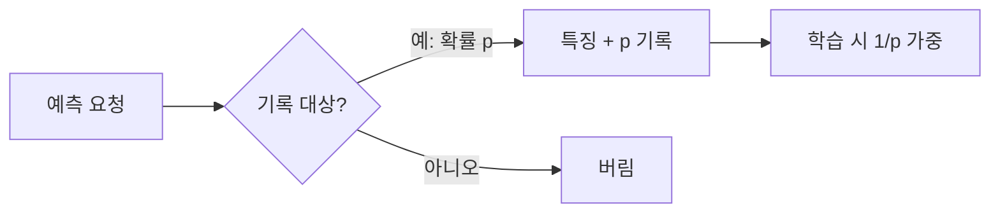
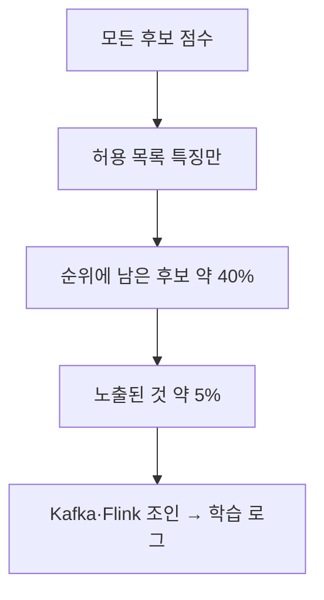

# 서빙 로그 샘플링

> 서빙 시점에 모델이 본 특징(feature)을 전부 기록하면 저장·전송 비용이 폭발하므로, **일부만 골라 기록**하고 그 선택 확률(가중치)을 함께 보관해 나중에 학습·분석에서 보정하는 방법이다.

## 쉽게 말하면
식당이 손님 전원의 주문 과정을 녹화하면 창고가 모자란다. 그래서 일부 테이블만 녹화하되 "이 녹화는 10곳 중 1곳을 뽑은 것"이라고 적어 둔다. 나중에 통계를 낼 때 그 숫자를 곱해 전체를 짐작할 수 있다.

## 자세히
[서빙 시점 특징 로깅](#log-serving-features)은 학습-서빙 불일치(skew)를 없애는 대신 규모 문제가 생긴다. 직접 확인한 Uber 엔지니어링 글("Taming the ML Firehose")의 사례:
- **규모**: 약 800만 QPS, 모든 예측을 기록하면 하루 수천억 건·압축 전 약 1.7PB, 전송량 약 9.3GiB/초.
- **줄이는 방법 ① 허용 목록**: 모델이 쓰는 특징만 직렬화해 보냄 → 페이로드 4~5배 감소. 긴 특징 이름은 정수 ID로 치환.
- **② 노출(impression) 필터**: 후보 중 약 40%가 순위에 남고 그중 약 5%만 사용자에게 보인다. 보인 예측만 Flink로 조인해 학습용으로 남김.
- **결과(글 주장)**: 주요 특징의 불일치 10% 초과 → 0%, 신선도 며칠 → 몇 시간.
- **그 글에 없는 것**: 샘플링 가중치·재가중 방법은 언급이 없고 선택 편향 논의도 없다. 따라서 "가중치 보관"은 일반적인 통계 원칙(역확률 가중, 표본 확률을 로그에 같이 기록)으로 이해하고, Uber 사례가 그렇게 했다고 읽지 않는다.
- **샘플링 설계 선택지(일반 원칙)**: 균등 무작위, 층화(희귀 클래스·고위험 구간을 높은 비율로), 오류·저신뢰 예측은 항상 기록. 어떤 방식이든 **기록 확률**을 각 행에 남겨야 평균·비율을 보정할 수 있다.
- **함정**: 노출된 것만 기록하면 안 보인 후보에 대한 학습이 없다(선택 편향 가능). 늦게 도착하는 결과가 조인 창을 넘으면 누락된다.

## 그림으로 보기

## 예시
- 추천 시스템: 노출된 항목은 전부, 노출 안 된 후보는 1%만 기록하고 `sample_prob=0.01`을 같이 저장해 오프라인 평가에서 1/p로 보정.
- 교육 소재: "모든 걸 저장하지 못할 때 어떻게 일부만 믿을 수 있나?"를 표본 조사 비유로 설명.

## 헷갈리는 것과 비교
| 개념 | 차이 |
|---|---|
| 서빙 로그 샘플링 | 기록 자체를 일부만, 확률 보관 |
| [서빙 시점 특징 로깅](#log-serving-features) | 서빙 때 쓴 값을 그대로 저장하는 상위 방법 |
| [특징 로그 개인정보·보관](#feature-log-privacy-retention) | 기록한 로그의 보관·권한 문제 |

## 더 읽을거리
- [Taming the ML Firehose (Uber Engineering)](https://www.uber.com/blog/taming-ml-firehose/) — 허용 목록·노출 필터로 로깅 비용을 줄인 사례(기업 블로그, 수치는 사례 한정).
- [Eliminate training-serving skew (Confluent)](https://www.confluent.io/blog/eliminate-training-serving-skew-mlops/) — 스트리밍으로 같은 변환을 양쪽에 쓰는 대안(검색 요약만 확인, 본문은 열지 않음).
