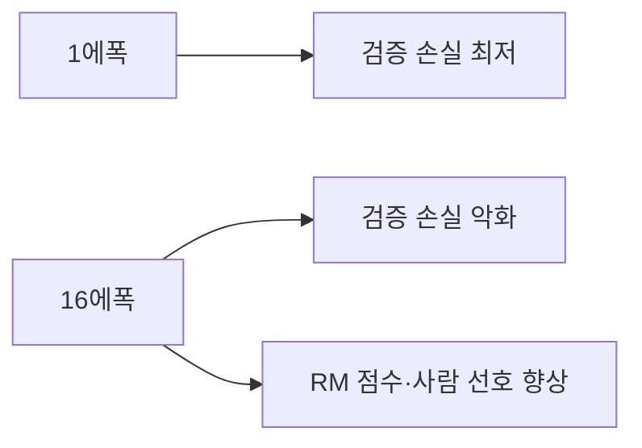
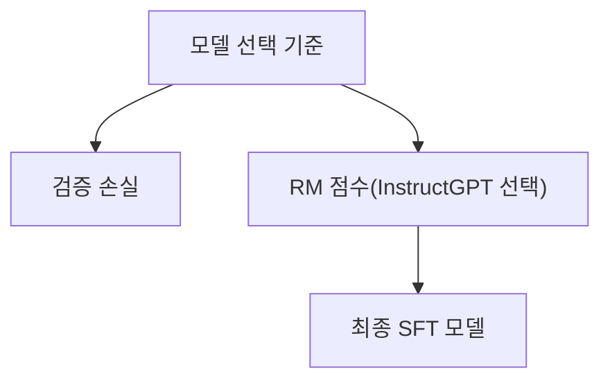

# SFT 에폭과 과적합

> InstructGPT의 SFT는 1에폭만 돌려도 검증 손실이 과적합 신호를 보이는데, 16에폭까지 학습한 쪽이 보상 모델 점수와 사람 선호도는 오히려 좋았다. 검증 손실만 보고 일찍 멈추면 안 될 수 있다는 사례다.

## 쉽게 말하면
문제집을 한 번 풀면 연습문제 점수는 오르지만 같은 문제를 여러 번 풀면 그 문제만 외워서 점수가 이상해진다. 그런데 실제 시험(사람이 평가하는 답변 품질)에서는 여러 번 푼 학생이 더 낫게 나왔다는 이야기다.

## 자세히
(Ouyang 외 arXiv 2203.02155 4장 학습 세부와 부록을 직접 읽고 확인.)
- **SFT 설정**: **16 에폭**, 코사인 학습률 감소, residual dropout 0.2. 최종 SFT 모델은 **검증 세트의 RM 점수**로 선택했다.
- **관찰**: SFT 모델은 **1에폭 뒤 검증 손실 기준으로 과적합**하지만, 더 많은 에폭이 RM 점수와 사람 선호 평가에는 도움이 되었다(저자 표현: "despite this overfitting").
- **보상 모델은 반대**: RM 학습에서는 데이터를 여러 에폭 돌리면 빠르게 과적합해 검증 손실이 눈에 띄게 악화되므로(부록) 한 번만 도는 설정을 썼다. 같은 프롬프트의 K개(4~9개) 응답을 한 배치에 묶는 이유도 과적합을 피하기 위한 것이다.
- **교훈(제안)**: 검증 손실은 "다음 단어 예측 일치도"이고 실제 목표는 사람 선호다. 둘이 어긋날 때는 목표 지표(선호·RM 점수·사람 평가)로 모델을 고른다. 다만 이는 InstructGPT 설정 한 사례이며 일반 법칙은 아니다.

## 그림으로 보기

## 예시
- 사내 FAQ 모델을 3·10에폭으로 학습해 검증 손실과 사람 평가(선호 투표)를 함께 비교.
- 교육 활용: "손실이 올랐는데 왜 더 좋다고 하지?"로 지표와 목표의 차이를 설명.

## 헷갈리는 것과 비교
| 개념 | 차이 |
|---|---|
| SFT 다에폭 | 데이터를 반복해 시범 행동을 더 잘 익힘 |
| 보상 모델 1에폭 | 반복하면 빠르게 과적합 |
| [InstructGPT 3단계](#instructgpt-three-stage) | 이 설정이 속한 전체 절차 |

## 더 읽을거리
- [InstructGPT 논문 (arXiv 2203.02155)](https://arxiv.org/abs/2203.02155) — SFT 16에폭, 과적합 관찰.
