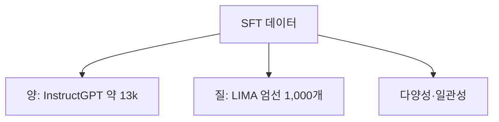

# SFT(지도 미세조정)

> 사람이 쓴 "프롬프트 → 모범 답안" 쌍으로 사전학습된 모델을 추가 학습시켜, 지시를 따르는 모델로 만드는 단계다. 사전학습 모델은 글을 이어 쓰는 데 능하지만, SFT를 거쳐야 질문에 답하는 비서처럼 행동한다.

## 쉽게 말하면
책을 많이 읽어 아는 건 많지만 질문에 어떻게 답할지는 모르는 학생에게, 선배가 "이런 질문엔 이렇게 답한다"는 모범 답안을 수천 개 보여 주고 따라 쓰게 하는 연습이다.

## 자세히
(InstructGPT 논문 arXiv 2203.02155 PDF 본문과 LIMA 논문 arXiv 2305.11206 초록을 직접 열어 확인.)
- **InstructGPT 3단계**: ① 라벨러가 시범 답안을 쓰고 지도 정책(SFT) 학습 ② 모델 출력 비교로 보상 모델 학습 ③ 보상 모델로 강화학습(PPO). SFT는 ①번 단계다.
- **데이터 규모(InstructGPT)**: **SFT 데이터는 약 13,000개 학습 프롬프트**(API 제출분+라벨러 작성), 보상 모델 데이터 33,000개, PPO 데이터 31,000개(API만, 라벨 없음). 40명의 계약 라벨러를 고용했고 데이터의 96% 이상이 영어. 프롬프트는 생성·QA·대화·요약·추출 등 다양하다.
- **학습 설정(논문 부록)**: SFT를 **16 에폭**, 잔차 드롭아웃 0.2, 코사인 학습률 감소로 학습했다. SFT 모델이 **검증 손실 기준으로는 1에폭 이후 과적합**하지만, 더 많은 에폭이 보상 모델 점수와 인간 선호도를 높였고 최종 SFT 모델은 검증 세트의 RM 점수로 골랐다고 적는다.
- **결과(초록)**: 1.3B InstructGPT가 175B GPT-3보다 인간 평가에서 선호됐다(파라미터 약 100배 적음). 진실성 향상, 독성 출력 감소, 공개 NLP 벤치마크 성능 저하는 최소.
- **적은 데이터로도(LIMA, 초록)**: 65B LLaMa를 **엄선한 1,000개 프롬프트-응답 쌍**으로 일반 지도 손실만으로 미세조정(RL·선호 모델 없음). 사람 평가에서 응답이 GPT-4와 동등하거나 더 선호된 경우가 **43%**, Bard 대비 58%, 인간 피드백으로 학습된 DaVinci003 대비 65%. 저자 결론: "LLM의 거의 모든 지식은 사전학습에서 배워지며, 고품질 출력에는 제한된 양의 지시 튜닝 데이터면 된다" — 데이터 양보다 질·다양성이 중요하다는 해석(보통 '표면 정렬 가설'로 불리나 초록에 용어는 없음).
- **데이터 설계 포인트(제안)**: ① 다양한 과제·형식 ② 답안 품질 일관성([라벨 일관성 규칙서](#label-consistency-guideline)) ③ 위험 질문에 대한 응답 정책 포함 ④ 평가 세트와 분리([문서 단위 분할](#document-level-split)).
- 이후 단계: 선호 데이터로 정렬을 더 다듬는다([RLHF](#rlhf)).

## 그림으로 보기



## 예시
```jsonl
{"prompt": "고객이 환불을 요청합니다. 정중한 답장을 써 주세요.", "response": "안녕하세요 고객님, 불편을 드려 죄송합니다..."}
{"prompt": "다음 회의록을 세 줄로 요약해 주세요: ...", "response": "1) ... 2) ... 3) ..."}
```
- 사내 CS 챗봇: 우수 상담원의 답변 500~2,000쌍을 모아 SFT. 답안 톤과 금지 사항을 규칙서로 먼저 정한다.

## 헷갈리는 것과 비교
| 개념 | 차이 |
|---|---|
| SFT | 모범 답안을 따라 쓰기(정답이 있는 학습) |
| [RLHF](#rlhf) | 사람의 선호 비교로 학습한 보상 모델을 최적화 |
| 사전학습 | 대규모 텍스트에서 다음 단어 예측 |
| 프롬프트 엔지니어링 | 모델을 바꾸지 않고 입력만 조정 |

## 더 읽을거리
- [Training language models to follow instructions with human feedback (arXiv 2203.02155)](https://arxiv.org/abs/2203.02155) — 3단계·데이터 규모(PDF 본문 확인).
- [LIMA: Less Is More for Alignment (arXiv 2305.11206)](https://arxiv.org/abs/2305.11206) — 1,000쌍 미세조정(초록 확인).
