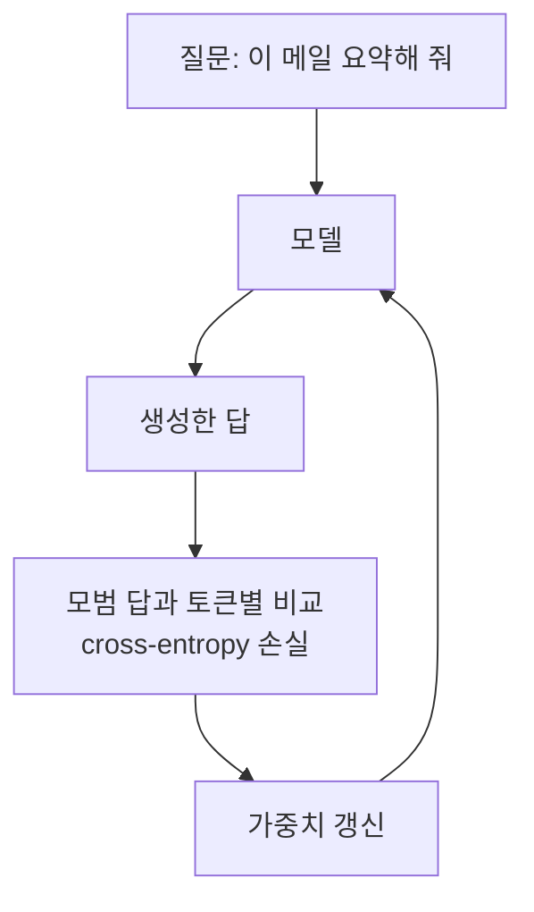

# 지도 미세조정(SFT)

> Supervised Fine-Tuning. "질문 → 좋은 답" 예시를 보여 주고 그대로 따라 쓰도록 훈련해, 글만 이어 쓰던 사전학습 모델을 지시를 따르는 어시스턴트로 바꾸는 단계.

## 쉽게 말하면
책을 엄청 많이 읽은 신입이 있다. 말은 잘 이어 가지만 "이 보고서 요약해 줘"라고 하면 엉뚱하게 보고서 다음 문장을 써 버린다. 선배가 모범 답안 예시를 수천 개 보여 주며 "이런 질문엔 이렇게 답하는 거야"라고 따라 쓰게 하면 업무 형식을 익힌다. 이것이 SFT다.

## 자세히
- **위치**: 사전학습 → **SFT** → (보상 모델 + RLHF 또는 [DPO](#dpo)) 순서. InstructGPT(2022)는 라벨러가 쓴 시범 답으로 GPT-3를 먼저 SFT했다.
- **목표 함수**: 정답 토큰 시퀀스의 음의 로그우도(토큰 단위 cross-entropy)를 줄인다. 즉 "다음 토큰 맞히기"를 답 부분에 대해서만 다시 한다(Hugging Face TRL 문서).
- **데이터 형식**: `{"prompt": ..., "completion": ...}` 또는 `{"messages": [{"role":"user"...},{"role":"assistant"...}]}`. 대화 형식이면 채팅 템플릿이 자동 적용된다.
- **프롬프트는 학습 제외**: `completion_only_loss`(프롬프트·완성 형식의 기본값)나 `assistant_only_loss=True`로 답 부분에만 손실을 계산한다.
- **양보다 질**: LIMA 논문(2023)은 65B LLaMA를 엄선한 1,000개 예시만으로 SFT해 사람 평가에서 43% 경우 GPT-4와 동등하거나 더 낫다고 보고했다. 지식은 대부분 사전학습에서 오고 SFT는 형식·말투를 가르친다는 주장.
- **실무 팁**: 전체 미세조정은 학습률 약 2e-5(TRL 기본), LoRA 어댑터는 약 1e-4. `packing=True`로 짧은 예시를 묶어 효율을 높인다.
- **한계**: 정답이 하나뿐이라 "더 나은 답"을 배울 수 없다. 이를 보완하는 것이 선호 학습.

## 그림으로 보기




## 예시
TRL 최소 코드(공식 문서):
```python
from trl import SFTTrainer
from datasets import load_dataset

trainer = SFTTrainer(
    model="Qwen/Qwen3-0.6B",
    train_dataset=load_dataset("trl-lib/Capybara", split="train"),
)
trainer.train()
```
업무 예: 회사 FAQ 답변 500~1,000건을 정리해 SFT하면 말투와 서식이 회사 스타일로 고정된다(새 지식 주입은 RAG가 더 적합한 경우가 많다).

## 헷갈리는 것과 비교
| 개념 | 차이 |
|---|---|
| 사전학습 | 대량 원문으로 다음 토큰 학습. SFT는 소량의 질문-답 쌍 |
| [DPO](#dpo) / [RLHF](#rlhf) | 두 답의 우열(선호)을 학습. SFT는 단일 정답 모방 |
| 프롬프트 엔지니어링 | 가중치를 바꾸지 않음. SFT는 가중치를 바꿈 |

## 더 읽을거리
- [TRL SFT Trainer 문서](https://huggingface.co/docs/trl/sft_trainer) — 데이터 형식·손실·LoRA 코드
- [LIMA: Less Is More for Alignment (arXiv 2305.11206)](https://arxiv.org/abs/2305.11206) — 1,000개 예시로 정렬
- [InstructGPT (arXiv 2203.02155)](https://arxiv.org/abs/2203.02155) — SFT가 3단계 중 첫 단계
