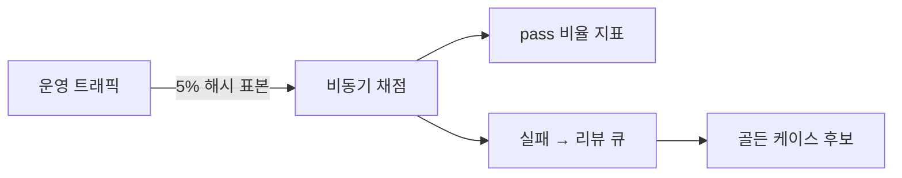

# 섀도 평가

> 운영 중인 트래픽의 **일부를 비동기로 따로 채점**해서, 시험 세트가 못 보는 드리프트(서서히 나빠짐)를 감시하는 방법이다.

## 쉽게 말하면
학교가 시험 기간 외에도 수업 중 무작위로 몇 명의 노트를 몰래 살펴 "요즘 이해도가 떨어지나?"를 보는 것이다. 수업(서비스)에는 지장을 주지 않는다.

## 자세히
(Stack Overflow Blog와 Langfuse 가이드를 직접 읽었다.)
- **표본 비율(SO 예)**: `SHADOW_SAMPLE_RATE = 0.05`(5%)를 하드코딩하지 말고 설정값으로 둔다.
- **결정적 해시 표본(SO)**: 결정 ID 해시를 `% 10000`으로 나눠 1% 미만 비율이 0으로 반올림되는 일을 막고, 난수 대신 해시를 써 **재현 가능**하고 테스트가 불안정해지지 않게 한다.
- **비동기·지표(SO)**: 채점은 핵심 경로 밖에서 비동기로 하고, `shadow_eval_pass_ratio`를 조각별 태그와 함께 낸다. 실패한 결정은 리뷰 큐로 보내 **새 골든 케이스 후보**로 삼는다.
- **드리프트 보기(SO)**: 한 시간 단위 등락이 아니라 "2주에 걸친 하락" 같은 추세를 본다.
- **Langfuse**: 운영 트래픽의 일정 비율을 LLM 판정자로 채점하고 경고·알림 임계값으로 Slack·웹훅 등에 보낸다(Cloud 및 self-hosted v4+).
- **한계**: 오프라인 게이트는 시험한 입력만 덮는다(Langfuse). 섀도 평가에도 판정자 오류가 있다.

## 그림으로 보기

## 예시
- 학습 챗봇 대화의 5%를 야간에 누출 판정자로 채점해 주간 추세를 본다.

## 헷갈리는 것과 비교
| 개념 | 차이 |
|---|---|
| 섀도 평가 | 운영 표본을 사후 채점 |
| 회귀 게이트 | 배포 전 고정 세트로 시험 |
| [기준선 재설정](#eval-baseline-rebaselining) | 합격 기준 갱신 |

## 더 읽을거리
- [Stack Overflow Blog](https://stackoverflow.blog/2026/10/07/evals-as-a-deployment-gate-and-how-to-know-when-they-drift/) — 직접 읽음.
- [Langfuse](https://langfuse.com/resources/engineering/llm-regression-testing.md) — 운영 샘플 평가(직접 읽음).
