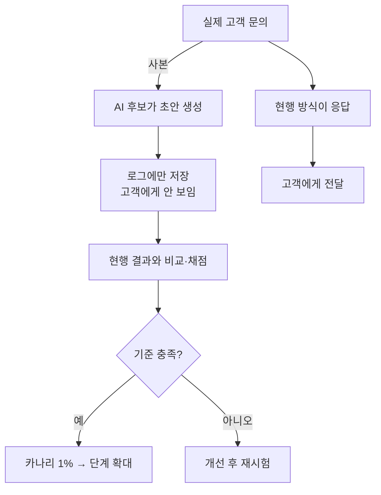

# 섀도 모드 (Shadow Mode)

> 새 AI 모델·기능을 실제 요청을 그대로 받아 돌려 보되, **그 결과를 사용자에게 보여 주거나 행동에 쓰지 않고 기록만 하는** 시험 방식. 상담 현장에서는 "AI 초안을 고객이 아니라 상담사(또는 평가자)만 본다"로 응용한다.

## 쉽게 말하면
신입 운전사가 실제 운행 노선을 같이 타되 핸들은 잡지 않고 "내가 운전했다면 이렇게 했을 것"을 적어 두는 연습이다. 사고가 날 일이 없으면서도 실제 도로 사정에서 실력을 볼 수 있다.

## 자세히
출처: Tian Pan 블로그의 LLM 단계적 출시 글(본문 확인), 섀도 배포 관련 검색 요약(2026-11-18). 모두 블로그·벤더 글이라 표준이 아니고, 문서의 수치는 예시다. Seldon 문서는 접속이 막혀 열지 못했다.
- **방식**: 현재 모델이 사용자에게 응답하는 동안 같은 요청의 사본을 후보 모델에도 보낸다. 후보 출력은 사용자에게 보이지 않고 로그로 간다. 요청 복제는 라우터·프록시·게이트웨이에서 하고 그림자 응답은 프록시에서 차단한다는 서술이 있다.
- **비교 대상**: 사실 정확성·어조·과업 완수·형식 준수를 LLM 판정자로 채점, 토큰 수·비용 차이, 동시 부하에서의 지연. 정답이 나중에 생기는 과제는 같은 요청에서 정확도를 비교한다.
- **비용**: 두 모델을 동시에 돌려 평가 기간 동안 추론 비용이 대략 두 배가 된다는 서술.
- **적합한 변경**: 모델 업그레이드, 큰 프롬프트 구조 변경, 새 도구 스키마 같은 큰 변경. 작은 프롬프트 수정에는 과하다는 취지.
- **카나리와의 차이**: 카나리는 실제 사용자 일부(1%, 5%, 20%, 50%, 100% 같은 단계)에게 새 결과를 보여 사용자 영향까지 본다. 섀도는 사용자 반응이 없다. 일반적 순서는 섀도 → 카나리. 카나리 1%는 최소 24~48시간 유지, 롤백 조건 예시는 p99 지연 40% 초과·거절률 5% 초과·건당 비용 예산 초과(글의 예시 수치).
- **한계(해석)**: 사용자 피드백이 없어 만족도를 못 잰다. 외부 행동을 일으키는 기능(환불·계정 변경)은 그림자 호출도 부작용이 없게 막아야 한다. 글은 이 부분을 다루지 않았다.
- **상담 응용(제안)**: 초안을 상담사에게 보여 주되 고객에게는 안 보내는 기간을 두고, 상담사가 실제로 보낸 답과 초안의 차이·수락 의향을 기록한다([초안 수락률](#draft-acceptance-rate)). 롤백 조건은 사전에 합의한다([롤백 계획](#rollback-plan)).

## 그림으로 보기

## 예시
- 새 요약 모델을 도입하기 전 2주 동안 모든 통화에 후보 요약을 생성만 해 두고, 상담사가 쓴 요약과 사건 담당자 검수 결과를 비교.
- 교육 활용: "AI 출시 전 검증 단계 설계"를 섀도→카나리→전면 순서의 게이트 표로 그려 보는 실습.

## 헷갈리는 것과 비교
| 개념 | 차이 |
|---|---|
| 섀도 모드 | 결과를 사용자에게 안 보이고 비교 |
| 카나리 | 일부 사용자에게 실제로 제공 |
| A/B 테스트 | 어느 쪽이 더 나은지 비교(사용자 노출) |
| [롤백 계획](#rollback-plan) | 문제 시 되돌리는 조건과 담당 |

## 더 읽을거리
- [Tian Pan: LLM 점진적 출시(섀도·카나리·A/B)](https://tianpan.co/blog/2026/04/09/llm-gradual-rollout-shadow-canary-ab-testing) — 단계 구성과 예시 임계값
- [Atlan: Shadow Deployment](https://atlan.com/know/shadow-deployment-for-ml-models/) — 섀도 배포 개요(검색 결과 제목만 확인)
