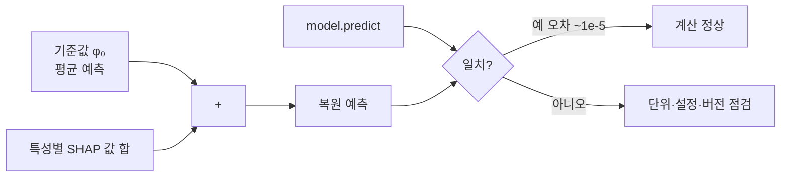

# SHAP 가법성 확인

> SHAP 값은 **기준값(평균 예측) + 모든 특성의 SHAP 값 = 모델의 그 예측**이라는 가법성(local accuracy)을 만족해야 한다. 이 등식을 직접 계산해 맞는지 확인하면 설명 코드나 설정이 틀리지 않았는지 검산할 수 있다.

## 쉽게 말하면
가계부에서 항목별 지출을 모두 더하면 총지출이 돼야 하는 것과 같다. 설명 값들을 더했는데 모델의 예측과 다르면, 설명이 어딘가 잘못 계산된 것이다.

## 자세히
출처: Molnar "Interpretable ML" SHAP 장(열어서 읽음: 가법 모델, local accuracy·missingness·consistency 성질) + 이 세션의 직접 실행.
- **성질(Molnar)**: SHAP는 **local accuracy**(귀속 값의 합이 예측에서 기준값을 뺀 값과 같음), **missingness**(없는 특성은 0), **consistency**(특성의 한계 기여가 커지면 귀속 값이 줄지 않음)를 만족한다. 설명은 기준값 φ₀에 특성별 기여가 더해지는 가법 모델이다.
- **직접 확인(이 세션, shap 0.51.0)**: 특성 3개 합성 데이터(y = 3·x0 − 2·x1 + 잡음, x2 무관)로 XGBoost 회귀 모델을 학습하고 앞 200행에 `shap.Explainer`를 적용해 `sv.values.sum(1) + sv.base_values`를 `model.predict`와 비교했다. 최대 절대 오차는 약 **1.1e-05**로 부동소수점 수준이었다.
- **검산 코드**:
  ```python
  sv = shap.Explainer(model)(X)
  recon = sv.values.sum(1) + sv.base_values
  assert np.allclose(recon, model.predict(X), atol=1e-4)
  ```
- **주의**: 분류 모델은 SHAP 값이 확률이 아닌 **로그 오즈(마진)** 단위인 경우가 흔하므로 비교 대상을 맞춰야 한다. 이 점은 일반적인 구현 설명이고 이번 실험(회귀)에서 확인하지 않았다. 트리 모델의 설정(예: 경로 의존)에 따라 가법성이 근사일 수 있으니 허용 오차를 둔다.
- **한계**: 가법성이 맞아도 설명이 **옳다**는 뜻은 아니다. 상관 변수 문제나 조작 가능성은 별개다([상관 변수와 SHAP](#feature-correlation-shap), [사후 설명의 정확도 검증](#post-hoc-explanation-validity)).

## 그림으로 보기


## 예시
- 신용 모델 설명 파이프라인에 이 검산을 자동 테스트로 넣어, SHAP 라이브러리나 모델 업데이트 후에도 가법성이 유지되는지 확인.
- 분류 모델: 로그 오즈로 복원한 값과 모델의 마진 출력을 비교.

## 헷갈리는 것과 비교
| 개념 | 차이 |
|---|---|
| 가법성(local accuracy) | SHAP 값 합과 예측의 일치, 계산 검산 |
| 충실도 | 설명이 모델 행동을 반영하는 정도, 더 넓은 개념 |
| [SHAP 라이브러리](#shap-library) | 검산 대상 도구 |
| [Shapley 값](#shapley-values) | 가법성이 나오는 이론적 기반 |

## 더 읽을거리
- [Interpretable Machine Learning — SHAP (Molnar)](https://christophm.github.io/interpretable-ml-book/shap.html) — 세 성질(열어서 확인)
- [shap/shap (GitHub)](https://github.com/shap/shap) — 사용법(열어서 확인)
