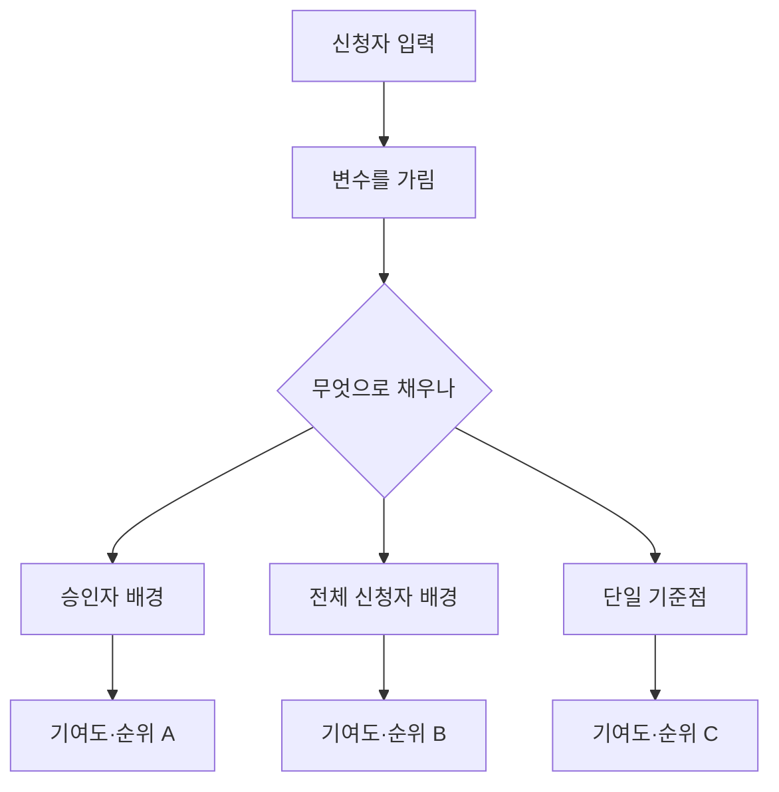
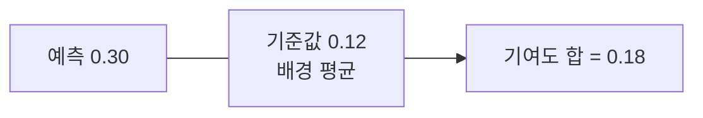

# SHAP 기준 분포 선택

> SHAP은 "변수 하나를 가리면 예측이 얼마나 바뀌나"를 계산한다. 이때 "가린다"를 무엇으로 채우느냐가 배경(background) 데이터다. 배경을 무엇으로 고르느냐에 따라 같은 모델·같은 신청자도 기여도와 순위가 달라진다. 신용 거절 이유 코드를 뽑을 때 가장 먼저 못 박아야 하는 설정이다.

## 쉽게 말하면
"이 학생이 합격선에서 얼마나 부족한가"는 합격선을 무엇으로 잡느냐에 따라 달라진다. 합격자 평균 기준이면 크게 부족하고, 전체 응시자 평균 기준이면 조금 부족하다. SHAP의 배경 데이터가 바로 이 합격선(기준선)이다. 승인된 사람들과 비교할지, 전체 신청자와 비교할지에 따라 "무엇 때문에 거절됐나"의 답이 달라진다.

## 자세히
출처: Interpretable Machine Learning 책 SHAP 장(직접 읽음), SHAP 공식 문서 TreeExplainer 항목·TrustyAI 논문(검색 결과로 확인). 직접 실험한 수치는 아니다.
- **기준값(baseline)** φ₀ = 모델 평균 예측 E[f(X)]. 기여도의 합 = 예측 − 기준값. 배경 데이터를 바꾸면 기준값과 각 기여도가 같이 변한다(책에 직접 명시된 것은 아니고 식에서 따라오는 해석).
- **KernelSHAP(주변 분포)**: 가린 변수를 배경 데이터에서 무작위로 뽑은 값으로 채운다. 변수 간 의존 구조를 무시하므로 비현실적 조합이 생길 수 있다.
- **TreeSHAP interventional**: 고전적 Shapley 값을 계산. 배경 데이터가 필요하고, 계산 시간은 배경 행 수에 선형. SHAP 문서는 배경 100~1000개를 적당하다고 안내한다.
- **TreeSHAP path-dependent**: 각 분기의 훈련 표본 수를 써서 배경이 필요 없다. 조건부 SHAP에 가깝지만, 모델이 쓰지 않는 변수라도 중요한 변수와 상관이 있으면 0이 아닌 기여도를 받을 수 있다.
- **TrustyAI 사례**: 같은 선형 모델이라도 배경 두 가지에 따라 SHAP 값이 크게 달랐다. 모든 SHAP 값은 배경 데이터와의 비교다.
- **대안**: 입력에 따라 배경을 정하는 반사실 배경(CoSHAP 논문), 단일 기준점만 쓰는 Baseline Shapley(Wells Fargo 논문).
- **신용 거절 설명에서의 의미**: 승인 사례를 배경으로 쓰면 "승인된 사람과 비교해 무엇이 나빴나"를 묻는 것이고 법이 요구하는 이유 진술의 정신과 가깝다. 단 어느 배경이 규제상 올바른지 규제기관의 입장은 이번에 찾지 못했다. **선택한 배경을 모델 문서에 기록**하고 배경을 바꿔 순위가 얼마나 흔들리는지 민감도를 확인해야 한다(이 글의 권고).
- 점검법: 기준값 + 기여도 합 = 선택한 출력이 되는지 확인한다.

## 그림으로 보기

## 예시
- 배경 = 최근 1년 승인자 500명: "연체 이력"이 1위. 배경 = 전체 신청자 500명: "한도 사용률"이 1위로 바뀌는 경우가 생길 수 있다(가상 예).
- 모델 카드에 "배경: 2025년 승인자 중 무작위 500, 고정 시드"를 적어 둔다.

## 헷갈리는 것과 비교
| 개념 | 차이 |
|---|---|
| 배경 데이터 | "가린 값"을 채울 기준 표본. 설명의 비교 대상 |
| 기준값 φ₀ | 배경에서 얻은 평균 예측 |
| [이유 그룹핑](#reason-grouping) | 상관 변수를 묶는 문제 |
| [이유 코드](#reason-codes) | 설명 결과를 통지 문구로 바꾸는 단계 |

## 더 읽을거리
- [Interpretable ML: SHAP](https://christophm.github.io/interpretable-ml-book/shap.html) — KernelSHAP·TreeSHAP 변형 비교
- [shap.TreeExplainer 문서](https://shap.readthedocs.io/en/latest/generated/shap.TreeExplainer.html) — interventional·path-dependent 옵션(검색 결과로만 확인)
- [TrustyAI Explainability Toolkit (arXiv 2104.12717)](https://arxiv.org/pdf/2104.12717) — 배경에 따라 달라진 SHAP 사례(검색 결과 요약)
