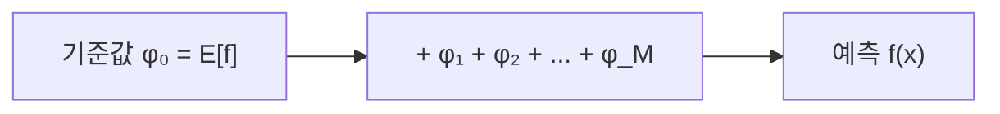
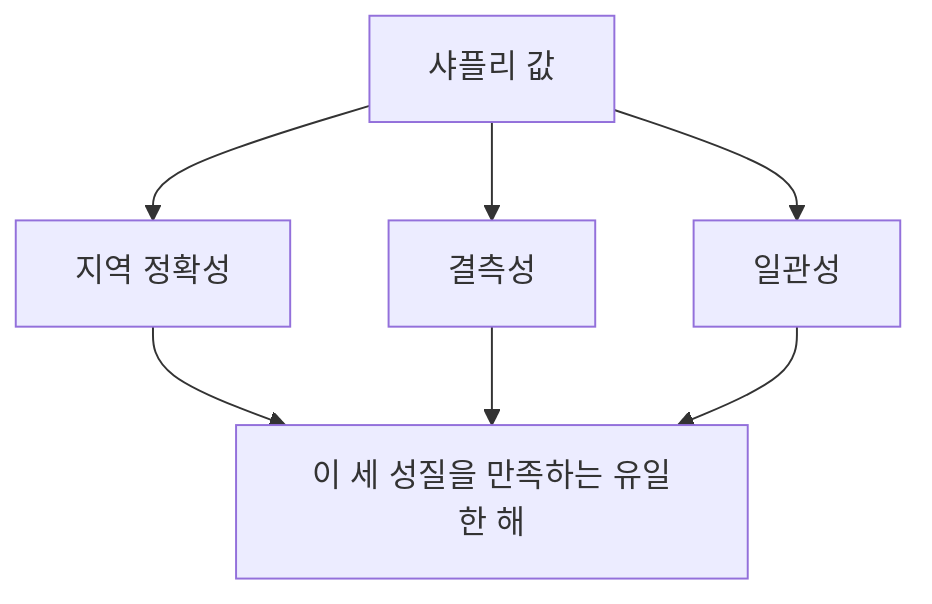

# SHAP 특징 기여도

> 게임이론의 샤플리 값으로 각 특징이 개별 예측에 얼마나 기여했는지를 더하기 형태로 나눠 설명하는 방법이다(Lundberg & Lee, 2017). 영향 함수가 훈련 데이터의 기여를 묻는다면 SHAP은 입력 특징의 기여를 묻는다.

## 쉽게 말하면
팀 프로젝트의 성과를 멤버별 공로로 나누는 계산이다. 누가 빠졌을 때 성과가 얼마나 줄어드는지를 모든 조합에서 평균해 공정하게 나눈다.

## 자세히
(Lundberg & Lee arXiv 1705.07874를 하위 에이전트가 원문으로 읽은 노트 기준.)
- **가법 특징 기여 모델**: g(z') = φ₀ + Σᵢ φᵢ z'ᵢ, z' ∈ {0,1}ᴹ. LIME, DeepLIFT, LRP, 샤플리 회귀·샘플링, QII가 이 형태에 속한다.
- **3가지 성질**: ① 지역 정확성 f(x) = φ₀ + Σφᵢ ② 결측성(x'ᵢ = 0이면 φᵢ = 0) ③ 일관성(모델이 한 특징에 더 의존하게 바뀌면 기여가 줄지 않음).
- **정리 1**: 이 성질을 모두 만족하는 해는 **샤플리 값이 유일**: φᵢ = Σ_{z'⊆x'} |z'|!(M−|z'|−1)!/M! [f_x(z') − f_x(z'\i)].
- **SHAP 값** = f_x(z') = E[f(z) | z_S](조건부 기대)의 샤플리 값, 기준값은 E[f(z)].
- **Kernel SHAP(정리 2)**: 가중 선형 회귀로 근사. 가중치 π_x'(z') = (M−1) / (C(M,|z'|)·|z'|·(M−|z'|)), |z'| ∈ {0, M}에서 π=∞로 φ₀와 합 제약을 강제. 샤플리 샘플링·LIME보다 표본 효율이 좋다(그림 3, 결정 트리 모델 200회 반복).
- **기타**: Deep SHAP(DeepLIFT+샤플리), Max SHAP(O(M²)), Linear SHAP. 근사는 특징 독립성·모델 선형성을 가정.
- **사용자 연구(MTurk)**: 30명·52명 참가, SHAP이 LIME·DeepLIFT보다 사람의 설명과 더 일치.

## 그림으로 보기



## 예시
```python
import shap
explainer = shap.Explainer(model, X_background)
shap_values = explainer(X_test[:100])
```
- 교육 활용: 대출 승인 예측에서 소득·부채 등의 기여를 막대 그래프로 보기.

## 헷갈리는 것과 비교
| 개념 | 차이 |
|---|---|
| SHAP | 특징의 예측 기여(샤플리 기반) |
| [영향 함수](#influence-functions) | 훈련 데이터의 기여 |
| LIME | 국소 선형 근사(가법 모델의 한 예) |

## 더 읽을거리
- [A Unified Approach to Interpreting Model Predictions (arXiv 1705.07874)](https://arxiv.org/abs/1705.07874) — SHAP 원논문.
