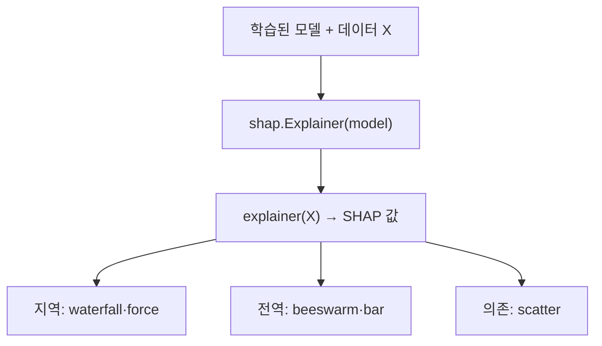

# SHAP 라이브러리

> Shapley 값에 기반해 머신러닝 모델의 예측을 설명하는 파이썬 라이브러리. `shap.Explainer(model)`로 설명기를 만들고 `explainer(X)`로 설명 값을 얻으며, 지역·전역 설명 그림을 제공한다. GitHub의 설명은 "어떤 ML 모델의 출력이든 설명하는 게임 이론적 접근".

## 쉽게 말하면
모델이 한 사람을 "고위험"이라고 판정했을 때, 소득·나이·부채가 각각 점수를 얼마씩 올리고 내렸는지를 막대 하나로 보여 주는 도구다. 기여도를 모두 더하면 모델의 최종 점수가 된다.

## 자세히
출처: GitHub shap/shap README(열어서 읽음) + 이 세션에서 `pip install shap`(0.51.0)으로 직접 실행한 결과.
- **설치(README)**: `pip install shap` 또는 `conda install -c conda-forge shap`. GPU 트리 SHAP(`GPUTreeExplainer`)은 별도 패키지 `shap-cuda`(`pip install "shap[cuda]"`).
- **기본 사용(README)**: `explainer = shap.Explainer(model)` → `shap_values = explainer(X)`.
- **그림**: `waterfall`(예측 한 건의 기준값에서 출력까지 분해), `force`(한 건 또는 여러 행), `beeswarm`(전역 특성 영향 분포), `bar`(특성별 평균 절댓값), `scatter`(특성 값 대 SHAP 값), `text`(텍스트 모델).
- **지원 모델**: 트리 앙상블(XGBoost·LightGBM·CatBoost·scikit-learn·pyspark; 빠른 정확 알고리즘), 임의 모델(KernelExplainer; 느림), 딥러닝(DeepExplainer·GradientExplainer), 선형 모델(LinearExplainer), Hugging Face 트랜스포머 파이프라인(NLP).
- **직접 확인(이 세션)**: 특성 3개의 합성 데이터에서 y = 3·x0 − 2·x1 + 잡음(x2는 무관)으로 XGBoost 회귀 모델을 학습하고, 앞 200행에 `shap.Explainer`를 적용했다.
  - **가법성**: SHAP 값 합 + 기준값이 모델 예측과 일치(최대 오차 약 1.1e-05).
  - **평균 절댓값 SHAP**: x0 7.708, x1 4.619, 무관한 x2 0.031. 데이터 구조와 순서가 일치했다.
  - 합성 데이터 한 번의 실행이며 실제 데이터에서 같은 크기가 나온다는 뜻은 아니다.
- **주의**: 특성 상관이 있으면 해석이 달라질 수 있고([상관 변수와 SHAP](#feature-correlation-shap)), SHAP 값은 인과가 아니며 오해·조작 가능성이 있다([SHAP 오해와 조작](#shap-misinterpretation)).

## 그림으로 보기


## 예시
```python
import shap, xgboost as xgb
model = xgb.XGBRegressor().fit(X, y)
explainer = shap.Explainer(model)
sv = explainer(X[:200])
shap.plots.beeswarm(sv)          # 전역 영향
shap.plots.waterfall(sv[0])      # 한 건 설명
# 검증: sv.values.sum(1) + sv.base_values ≈ model.predict(X[:200])
```

## 헷갈리는 것과 비교
| 개념 | 차이 |
|---|---|
| SHAP 라이브러리 | Shapley 기반 설명 구현체 |
| [Shapley 값](#shapley-values) | 이론적 기반 개념 |
| [전역 vs 지역 설명](#global-vs-local-explanation) | 라이브러리가 만드는 두 종류의 설명 |
| LIME | 다른 지역 설명 방법(이번엔 다루지 않음) |

## 더 읽을거리
- [shap/shap (GitHub)](https://github.com/shap/shap) — 설치·기본 사용·그림·지원 모델(열어서 확인)
- [A Unified Approach to Interpreting Model Predictions (arXiv 1705.07874)](https://arxiv.org/abs/1705.07874) — SHAP 원논문
