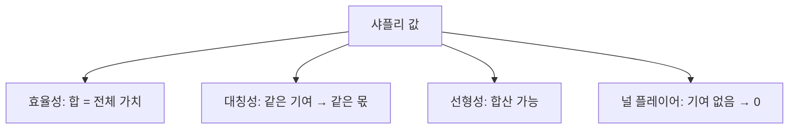
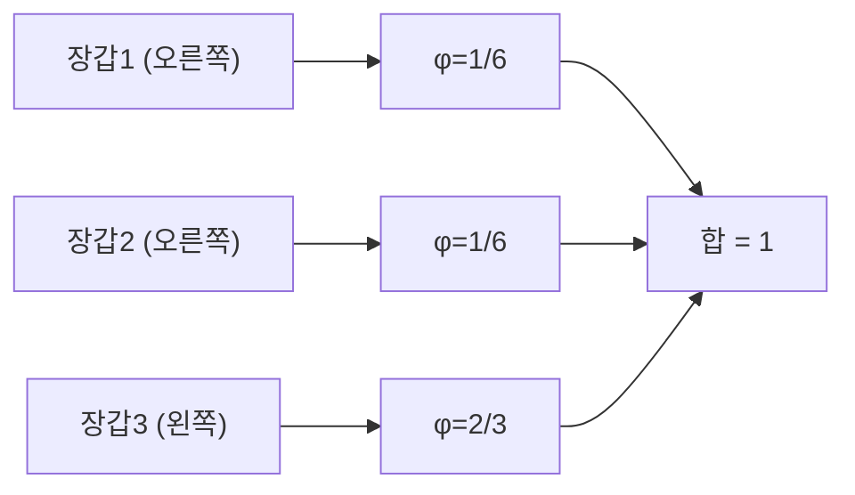

# 샤플리 공리

> 협력 게임에서 "전체 이익을 참여자에게 공정하게 나누는 방법"으로 샤플리 값이 만족하는 **네 가지 성질** — 효율성, 대칭성, 선형성(가법성), 널 플레이어 — 과, 이 네 성질을 모두 만족하는 분배는 **샤플리 값 하나뿐**이라는 유일성 정리.

## 쉽게 말하면
세 명이 장갑 한 켤레를 맞춰 팔아야 돈이 된다고 하자. 오른쪽 장갑 2명과 왼쪽 장갑 1명이면 왼쪽 장갑 가진 사람이 훨씬 희귀하다. 공정한 분배의 규칙을 네 가지 상식으로 못 박으면 몫이 하나로 정해진다.

## 자세히
(Wikipedia "Shapley value" 본문 확인) 가치 함수 v, 참여자 집합 N, n=|N|.
| 공리 | 내용 | 데이터 평가에서의 뜻 |
|---|---|---|
| **효율성** | Σᵢ φᵢ(v) = v(N) | 점 가치의 합 = 전체 데이터 성능(−기준) |
| **대칭성** | i, j가 어떤 S에 더해도 기여가 같으면 φᵢ = φⱼ | 똑같은 두 데이터는 같은 값 |
| **선형성(가법성)** | φᵢ(v+w) = φᵢ(v)+φᵢ(w), φᵢ(av)=aφᵢ(v) | 시험 점별 효용의 합이면 값도 합 |
| **널 플레이어** | 어떤 S에 더해도 변화 없으면 φᵢ = 0 | 모델에 무관한 점은 0 |
- **공식**: φᵢ(v) = Σ_{S⊆N∖{i}} [|S|!(n−|S|−1)!/n!] · (v(S∪{i}) − v(S)). 같은 값을 **n! 가지 순서**에서의 한계 기여의 평균으로 쓸 수 있다(순서 평균 형태가 몬테카를로 근사의 기초).
- **유일성**: Wikipedia는 샤플리 값이 이 네 성질을 만족하는 "유일한 해"라고 하며 증명은 Ichiishi(1983)를 인용한다.
- **장갑 게임 예(Wikipedia 계산을 직접 검산)**: 오른쪽 장갑 1·2, 왼쪽 장갑 3. 한 켤레가 되는 연합(예: {1,3}, {2,3}, {1,2,3})의 값은 1. 6개 순서에서 참여자 1의 한계 기여는 (0,0,0,0,1,0)이라 φ₁=1/6, 대칭으로 φ₂=1/6. 참여자 3은 (1,1,1,1,0,0)이라 φ₃=4/6=2/3. **합 = 1/6+1/6+2/3 = 1 = v(N)** 으로 효율성 확인.
- **데이터 평가로 옮길 때의 사정**: Data Shapley 논문은 널·대칭·선형 3가지를 공정성 조건으로 요구하고 상수 C가 임의라고 한다. Beta Shapley 논문은 효율성이 ML에서 본질적이지 않다고 보고 효율성을 제거해 [세미밸류](#semivalue)로 일반화한다. 즉 네 공리 전부를 쓸지는 목적에 달렸다([효율성](#shapley-efficiency-axiom)).
- **한계**: 샤플리 값 계산은 모든 부분집합·순열이 필요해 n이 크면 지수적으로 어렵고 근사가 필요하다([TMC-Shapley](#tmc-shapley)).

## 그림으로 보기



## 예시
```python
from itertools import permutations
v = lambda S: 1 if set(S) in ({1,3}, {2,3}, {1,2,3}) else 0
phi = {p: 0 for p in (1,2,3)}
for order in permutations((1,2,3)):
    cur = []
    for p in order: phi[p] += v(cur+[p]) - v(cur); cur.append(p)
print({p: x/6 for p, x in phi.items()})   # {1: 1/6, 2: 1/6, 3: 2/3}
```
- 학습 데이터 3개에 적용하면 "중복 데이터는 같은 값, 무관 데이터는 0"이라는 직관이 공리로 보장된다.

## 헷갈리는 것과 비교
| 개념 | 설명 |
|---|---|
| 샤플리 값 | 네 공리를 모두 만족하는 유일한 분배 |
| 세미밸류 | 효율성 제외 |
| LOO | 샤플리 공리 중 대칭·널은 만족하지만 효율성 불만족 |
| 가법성 | 선형성의 일부(합) |

## 더 읽을거리
- [Wikipedia: Shapley value](https://en.wikipedia.org/wiki/Shapley_value) — 네 성질·공식·장갑 게임(본문 열어 확인).
- [Beta Shapley (arXiv 2110.14049)](https://arxiv.org/abs/2110.14049) — 효율성 제거(PDF 본문 확인).
