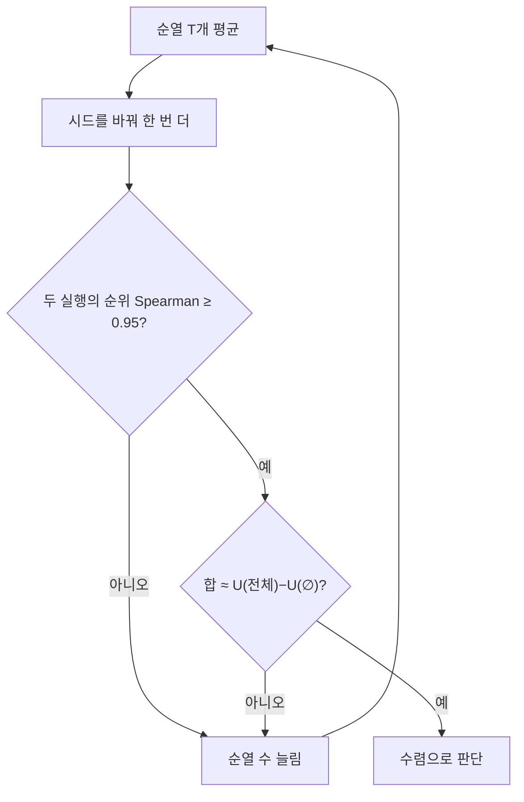
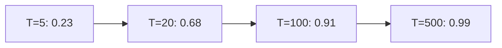

# 샤플리 수렴 점검

> 몬테카를로로 근사한 데이터 샤플리 값은 **순열을 몇 번 뽑았느냐**에 따라 값과 순위가 달라진다. 순열 수를 늘리며 **값이 안정되는지, 순위가 같게 나오는지**를 확인해야 "가치 순위"를 믿고 쓸 수 있다.

## 쉽게 말하면
여론조사를 10명에게 물으면 결과가 매번 다르다. 1,000명에게 물으면 비슷해진다. 샤플리 근사도 무작위 순열을 더 많이 평균할수록 안정되므로, 두 번 따로 돌렸을 때 같은 결론이 나오는지 보고 멈춘다.

## 자세히
- **근사의 성질(Ghorbani & Zou, arXiv 1904.02868 부록 A, 본문 확인)**: 무작위 순열을 뽑아 한계 기여를 평균하는 몬테카를로는 샤플리 값의 **불편 추정**이다. 실무에서는 "평균이 경험적으로 수렴할 때까지" 순열을 생성한다(알고리즘 1의 "수렴 기준").
- **직접 시뮬레이션(순수 파이썬, 8개 점, 정확한 값은 8!=40,320 순열 전수 계산, 30회 반복 평균)**: 점들의 가치가 서로 **매우 가까운** 어려운 경우(정확한 값 0.0565, 0.0522, … 0.0249, 점 간 간격 약 0.004)
  | 순열 수 T | 정확값 대비 최대 오차 | 정확 순위와 Spearman | 서로 다른 두 실행 간 Spearman |
  |---|---|---|---|
  | 5 | 0.0236 | 0.535 | 0.233 |
  | 20 | 0.0148 | 0.821 | 0.678 |
  | 100 | 0.0063 | 0.956 | 0.911 |
  | 500 | 0.0025 | 0.997 | 0.994 |
  | 2,000 | 0.0013 | 1.000 | 1.000 |
  순열을 5번만 뽑으면 두 실행의 순위가 거의 무관(0.233)하다. 값이 뚜렷이 다른 쉬운 경우(0.136~−0.028)에서는 T=20에도 순위가 0.99 안정이었다. **필요한 순열 수는 점들의 가치 간격에 달려 있다**(가상 효용·작은 n의 결과이며 실제 데이터에서는 더 많이 필요).
- **점검 방법(권장)**
  1. **독립 실행 비교**: 같은 T로 시드를 달리해 두 번 돌려 순위 Spearman을 본다(위 마지막 열). 0.95 미만이면 더 돌린다.
  2. **누적 평균 곡선**: T를 늘리며 점별 값이 변하는 폭이 임계(예: 직전 대비 평균 변화 1% 미만)로 줄 때까지.
  3. **효율성 합계 확인**: Σφᵢ ≈ U(전체) − U(∅)([효율성 공리](#shapley-efficiency-axiom)). 크게 어긋나면 수렴 부족이나 절단 편향 의심.
  4. **관심 구간만 안정**: 응용이 "가치 하위 10% 제거(오염 탐지)"라면 하위 점들의 집합이 실행 간에 일치하는지(자카드)를 본다.
  5. **작은 데이터 검증**: 정확값을 구할 수 있는 작은 데이터에서 같은 설정을 검증(논문은 4~14점 합성 데이터에서 TMC와 진짜 값의 상관 98.4~99.5% 보고).
- **절단과의 관계**: [절단 허용오차](#truncation-tolerance)를 크게 하면 순열당 계산은 줄지만 편향이 생기므로, 수렴 점검은 절단을 켠 상태 그대로 해야 의미가 있다.
- **한계**: 위 수치는 8점 가상 효용 시뮬레이션이다. 실제 모델 학습에는 점 하나당 순열 수가 수백~수천 필요할 수 있다(일반 주의).

## 그림으로 보기



## 예시
```python
def spearman(a, b): ...                       # 두 값 벡터의 순위 상관
runs = [tmc_shapley(T=500, seed=s) for s in (0, 1)]
print("실행 간 Spearman:", spearman(*runs))
print("합 점검:", sum(runs[0]), score(all) - score(empty))
```
- 학습 데이터에서 가치 하위 5% 삭제 실험 전에, 두 실행의 하위 5% 집합 일치율(자카드)이 0.8 이상인지 확인.

## 헷갈리는 것과 비교
| 개념 | 설명 |
|---|---|
| 수렴 점검 | 순열 수가 충분한지 |
| 절단 허용오차 | 순열 내부 계산 중단 기준 |
| 순위 안정성 | 결과 순위가 실행마다 같은지 |
| [TMC-Shapley](#tmc-shapley) | 이 근사 알고리즘 |

## 더 읽을거리
- [Data Shapley (arXiv 1904.02868)](https://arxiv.org/abs/1904.02868) — 몬테카를로 불편성과 수렴 기준(PDF 본문 확인). 위 표는 이 글의 직접 시뮬레이션.
