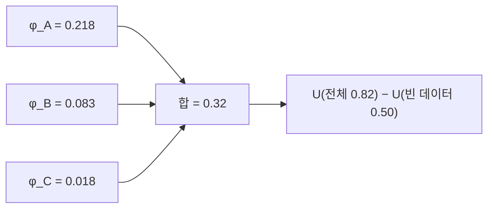
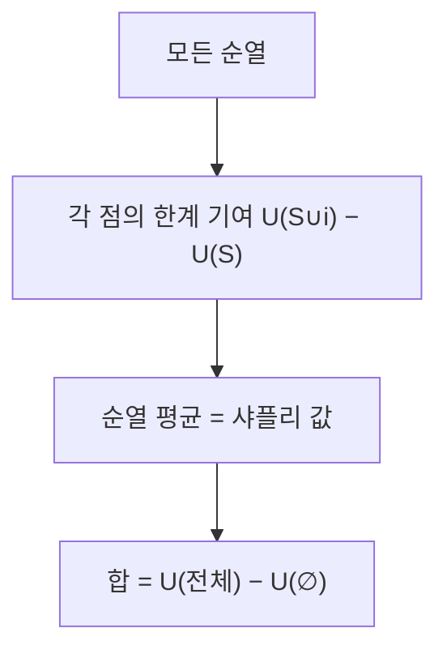

# 샤플리 효율성 공리

> 데이터 샤플리(Data Shapley)에서 **모든 학습 데이터 점의 가치를 더하면 전체 데이터로 학습한 모델의 성능과 빈 모델(아무것도 모르는 기준) 성능의 차이와 정확히 같다**는 성질. 성능 향상이라는 "전체 몫"이 빠짐없이, 겹침 없이 나뉜다는 뜻이다.

## 쉽게 말하면
세 사람이 함께 일해 번 수익을 나눌 때, 각자 가져가는 몫을 모두 더하면 총수익과 같아야 한다. 누군가 몫을 더 가져가거나 어딘가에서 몫이 사라지면 공정하지 않다. 효율성 공리는 이 "몫의 합 = 전체 수익"이다.

## 자세히
- **정의(협력 게임 이론)**: n개 플레이어(데이터 점)와 효용 함수 U(S)(S의 데이터로 학습한 모델의 검증 성능)가 있을 때 샤플리 값 φᵢ는 i를 더했을 때의 **한계 기여**를 모든 순서·부분집합에 대해 평균한 값이다. 효율성: Σᵢ φᵢ = U(전체) − U(∅).
- **데이터 샤플리(Ghorbani & Zou, ICML 2019, arXiv 1904.02868, 초록 확인)**: n개 학습 점 각각에 학습된 예측기의 성능에 대한 기여를 기준으로 가치를 매긴다. 저자는 데이터 샤플리가 공정한 데이터 가치 평가가 갖춰야 할 몇 가지 자연스러운 성질을 **유일하게 만족**한다고 한다(초록은 성질 목록을 적지 않음). 큰 데이터·신경망에는 몬테카를로·기울기 기반 근사를 제안하며, 일회 제외(leave-one-out)나 레버리지 점수보다 정보가 많고 낮은 가치의 점은 이상치·오염 데이터를 잘 잡아낸다고 주장한다. 동기는 의료·소비자 시장에서 데이터를 만든 개인에게 공정한 보상을 주는 것이다.
- **직접 계산한 3점 예(가상 효용)**: 데이터 A·B·C, 검증 정확도 U(∅)=0.50, U({A})=0.70, U({B})=0.55, U({C})=0.50, U({A,B})=0.80, U({A,C})=0.72, U({B,C})=0.60, U({A,B,C})=0.82. 6개 모든 순열의 한계 기여를 평균하면 φ_A=0.2183, φ_B=0.0833, φ_C=0.0183이고 합은 **0.3199 ≈ 0.32 = 0.82 − 0.50**. 효율성이 성립한다(반올림 오차 범위). C는 단독으로는 0.50 그대로(기여 없음)이지만 A와 같이 있을 때 약간 기여해 0.0183이 된다.
- **효율성이 주는 해석**: 가치가 성능 향상의 **분할**이라 "전체 향상의 몇 %를 이 점이 만들었는가"로 읽을 수 있다. 음수 가치도 가능(성능을 해치는 점: 오염 데이터).
- **다른 공리(일반 이론)**: 대칭성(같은 기여면 같은 값), 널 플레이어(기여가 없으면 0), 가법성. 샤플리 값은 이 공리들을 모두 만족하는 유일한 분배라는 것이 고전 결과이며, 데이터 샤플리의 "유일성"도 이를 따른다.
- **주의**: 효율성은 **어떤 효용 함수를 쓰느냐**에 종속된다([효용 함수 선택](#utility-function-choice)). 효용 U(전체)와 U(∅)의 정의(빈 데이터일 때 무작위 성능 등)가 가치의 총량을 정한다. 근사(TMC)로 구한 값은 합이 정확히 맞지 않을 수 있고, 합계가 U(전체)−U(∅)에서 크게 벗어나면 수렴을 의심한다([수렴 점검](#shapley-convergence-check)).

## 그림으로 보기



## 예시
```python
from itertools import permutations
def shapley(players, U):
    phi = {p: 0.0 for p in players}; perms = list(permutations(players))
    for pr in perms:
        cur = []
        for p in pr:
            phi[p] += U(cur + [p]) - U(cur); cur.append(p)
    return {p: v/len(perms) for p, v in phi.items()}
# sum(phi.values()) == U(players) - U([])  → 효율성 점검에 쓴다
```
- 학습 데이터 1,000개의 가치를 계산한 뒤 합이 (전체 정확도 − 기준 정확도)와 비슷한지 점검해 근사 품질 확인.

## 헷갈리는 것과 비교
| 개념 | 설명 |
|---|---|
| 효율성 | 가치의 합 = 전체 성능 향상 |
| 대칭성 | 같은 기여 → 같은 값 |
| 널 플레이어 | 기여 없음 → 0 |
| leave-one-out | 한 점만 뺀 차이(합이 전체와 같지 않음) |

관련: [TMC-Shapley](#tmc-shapley)

## 더 읽을거리
- [Data Shapley: Equitable Valuation of Data for Machine Learning (arXiv 1904.02868)](https://arxiv.org/abs/1904.02868) — 정의·주장(초록 열어 확인). 효율성 식과 3점 계산은 이 글에서 직접 계산.
