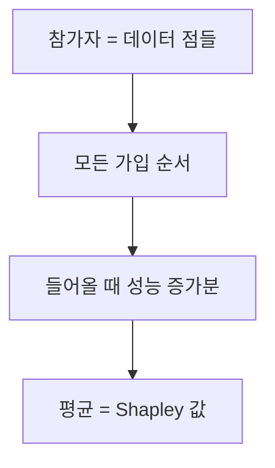
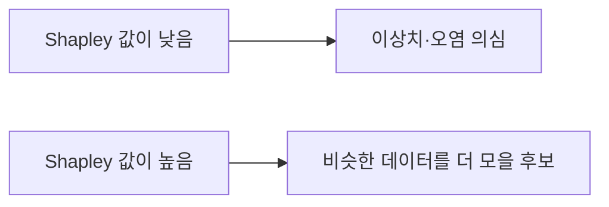

# Shapley 값

> 협력 게임에서 **각 참가자가 전체 성과에 기여한 몫을 공정하게 나누는** 방법이다(Lloyd Shapley, 1951). 데이터 가치 평가에서는 학습 데이터 한 점을 "참가자", 모델 성능을 "성과"로 보고 각 데이터의 기여를 계산한다.

## 쉽게 말하면
팀 프로젝트로 상금 100만 원을 받았는데 누가 얼마나 기여했는지 다툰다. 모든 입장 순서를 가정하고 "내가 들어왔을 때 성과가 얼마나 늘었나"를 평균 내면 순서 운에 휘둘리지 않는 몫이 나온다.

## 자세히
- **정의(Wikipedia, 직접 확인)**: 플레이어 i의 몫은 가능한 모든 연합에 대한 **평균 한계 기여**다. φᵢ(v) = Σ over S ⊆ N∖{i} of |S|!(n−|S|−1)!/n! · [v(S∪{i}) − v(S)]. n!개의 가입 순서를 평균 내는 형태와 같다.
- **공리**: 효율성(몫의 합 = 전체 가치), 대칭성(동일 기여자는 동일 몫), 선형성(합성 게임의 몫은 각 몫의 합), 널 플레이어(기여가 0이면 몫 0). 이 성질을 모두 만족하는 해는 Shapley 값뿐이라고 문서는 말한다.
- **손으로 푸는 예(글러브 게임)**: 선수 1·2는 오른손 장갑, 선수 3은 왼손 장갑 하나씩, 한 켤레를 만들 때만 1을 번다. φ₁ = 1/6, φ₂ = 1/6, φ₃ = 2/3.
- **계산 비용(공식에서 도출한 추론)**: 합이 나머지 모든 부분집합을 훑으므로 참가자 수에 지수적으로 늘어난다. 그래서 데이터 평가에서는 근사가 필수다.
- **Data Shapley(Ghorbani & Zou, arXiv 1904.02868, 2019, 초록 직접 확인)**: 학습 데이터 n개 각각의 기여를 점수화한다. 저자들은 공정성 속성을 유일하게 만족한다고 주장하고, 신경망·대규모 데이터용 **몬테카를로·기울기 기반 추정법**을 개발했다. 생물의학·이미지·합성 데이터 실험에서 leave-one-out이나 leverage 점수보다 정보가 많고, 낮은 값은 이상치·오염을, 높은 값은 더 수집할 데이터의 방향을 가리킨다고 보고했다(논문 주장).
- **한계(해석)**: 가치 함수 v(예: 검증 정확도)를 무엇으로 정하느냐에 결과가 의존하고, 학습 재실행이 많이 필요해 비싸다. 데이터가 서로 중복이면 몫이 나뉘어 낮게 보일 수 있다.

## 그림으로 보기

## 예시
- 라벨링 데이터 1만 건에서 Shapley 값이 가장 낮은 하위 5%를 점검해 잘못된 라벨을 찾는다(Data Shapley가 제안한 용도).
- 교육 소재: 장갑 게임을 손으로 계산해 "순서에 따른 기여 평균" 개념을 체험.

## 헷갈리는 것과 비교
| 개념 | 차이 |
|---|---|
| Shapley 값 | 모든 순서 평균, 공리 만족 |
| Leave-one-out | 한 점 빼고 비교, 중복 데이터에 둔감 |
| 특징 중요도(SHAP) | 같은 아이디어를 입력 특징에 적용(이 글은 직접 확인하지 않음) |

## 더 읽을거리
- [Shapley value (Wikipedia)](https://en.wikipedia.org/wiki/Shapley_value) — 정의·공리·글러브 게임(직접 확인).
- [Data Shapley (arXiv 1904.02868)](https://arxiv.org/abs/1904.02868) — 데이터 가치 평가 적용(초록 확인).
