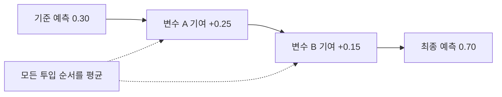

# Shapley 값

> 협력 게임이론에서 "팀 성과를 각 참여자 기여로 공정하게 나누는 방법". 머신러닝에서는 각 입력 변수가 한 예측에 얼마나 기여했는지를 나누는 데 쓰이며, SHAP의 수학적 기초다.

## 쉽게 말하면
세 친구가 함께 일해 100만 원을 벌었을 때, 누가 몇 번째로 합류했는지에 따라 기여가 달라 보인다. 가능한 합류 순서를 모두 평균 내서 각자의 평균 추가 기여를 구하면 공정한 몫이 나온다. 이것이 Shapley 값이다.

## 자세히
- **ML에서의 대응**: 참여자 = 입력 변수, 성과 = 예측값. 변수를 하나씩 "넣었을 때" 예측이 얼마나 변하는지를 모든 변수 조합 순서로 평균한다.
- **SHAP(Lundberg & Lee, 2017, arXiv 1705.07874, 초록 확인)**: 한 예측에 대해 각 특성에 중요도 값을 할당. 새로운 "가법적 특성 중요도 척도" 부류를 식별하고 이 부류가 바람직한 성질을 갖는 유일한 해를 가짐을 증명했으며, 기존 6개 설명 방법을 이 틀로 통합한다. 더 효율적인 계산 방법도 제안한다.
- **계산 예(직접 계산한 장난감 예)**: 기준 예측 0.30, 변수 A만 보면 0.50, B만 보면 0.40, 둘 다 보면 0.70. A의 기여 = [(0.50-0.30) + (0.70-0.40)]/2 = 0.25, B의 기여 = [(0.40-0.30) + (0.70-0.50)]/2 = 0.15. 합 0.25+0.15 = 0.40 = 0.70-0.30(기여의 합이 기준 대비 예측 변화와 같다).
- **용도**: 신용 거절 이유 순위화, 의료 위험 요인 설명. 이유 문구로 바꾸는 작업은 [이유 코드](#reason-codes).
- **주의**: 변수 간 상관이 크면 "변수를 뺀다"는 정의가 모호해져 해석이 바뀔 수 있다. 값은 모델 설명이지 인과가 아니다. 변수 수가 많으면 정확 계산이 비싸 근사 알고리즘을 쓴다.

## 그림으로 보기


## 예시
```python
import shap
explainer = shap.Explainer(model, X_background)
sv = explainer(X.iloc[:1])   # 한 건의 변수별 기여
shap.plots.waterfall(sv[0])
```
출력으로 "소득 +0.12, 연체 -0.30"처럼 변수별 가감을 본다.

## 헷갈리는 것과 비교
| 개념 | 차이 |
|---|---|
| Shapley 값 | 공정 분배 원리 |
| SHAP | Shapley를 ML에 적용한 도구 |
| 변수 중요도(feature importance) | 전체 평균 영향, 개별 예측 설명 아님 |
| [반사실 설명](#counterfactual-explanation) | 무엇을 바꾸면 결과가 바뀌나 |

## 더 읽을거리
- [A Unified Approach to Interpreting Model Predictions](https://arxiv.org/abs/1705.07874) — SHAP 원논문(초록 확인)
