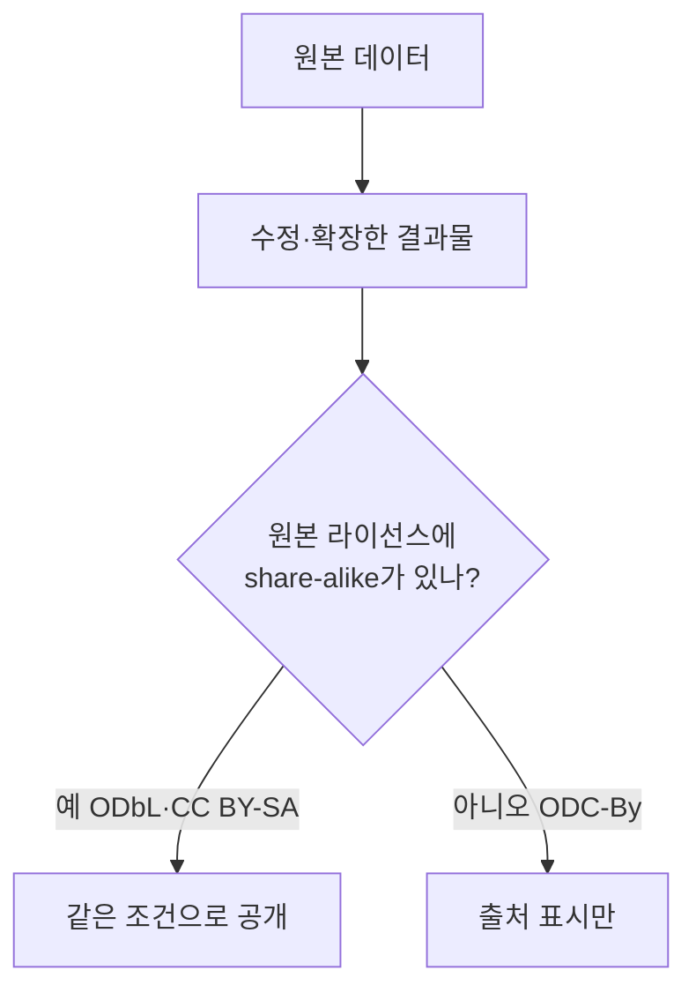
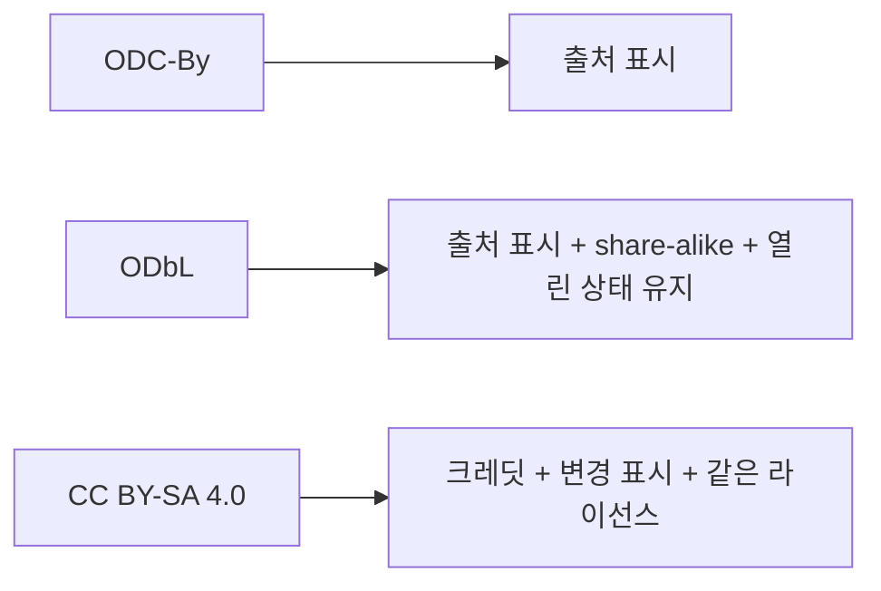

# Share-alike (동일조건변경허락)

> 원본을 가져다 고치거나 이어서 만든 결과물을 공개할 때, **원본과 같은 조건의 라이선스로 공개해야 한다**는 요구. "받은 자유를 같은 조건으로 다시 나눠라"는 규칙이다. (법률 자문이 아니라 공개된 요약 문서의 정리다.)

## 쉽게 말하면
이웃에게 레시피를 받았는데 "이 레시피로 새 요리를 만들면 그 레시피도 똑같이 공개해 달라"는 조건이 붙어 있다. 요리(결과)를 팔아도 되지만 개량한 레시피는 같은 조건으로 나눠야 한다. 반대로 "출처만 밝히라"는 조건만 있으면 개량한 레시피를 비공개로 둬도 된다.

## 자세히
- **ODbL 1.0**(Open Data Commons 요약 페이지, 직접 읽음): 자유는 복사·배포·사용, 작품 생성, 수정·확장. 조건은 ① 출처 표시 ② **share-alike**: 수정한 데이터베이스나 그로부터 만든 작품을 공개 사용하면 그 수정 데이터베이스를 같은 ODbL 조건으로 제공 ③ 열린 상태 유지: DRM 등 기술적 제한을 걸어도 제한 없는 버전을 함께 배포.
- **CC BY-SA 4.0**(Creative Commons 설명 페이지, 직접 읽음): 리믹스·변형·확장물은 원본과 같은 라이선스로 배포. 크레딧 표시, 라이선스 링크, **변경 사실 표시**가 필요하고, 호환되는 것으로 CC가 정한 다른 라이선스를 쓸 수도 있다. 허용된 행위를 막는 추가 제한은 못 건다. 퍼블릭 도메인 자료, 공정이용 같은 예외, 인격권·프라이버시권은 이 라이선스가 다루지 않는다.
- **ODC-By**(같은 사이트 요약): 조건은 출처 표시뿐이고 share-alike 요구가 요약에 없다. 그래서 FineWeb(ODC-By)을 가공한 데이터셋은 같은 조건을 강제당하지 않지만 출처·라이선스 표기는 필요하다([FineWeb 이용 조건](#fineweb-license-terms)).
- **AI 데이터에서 쟁점**: 학습 데이터를 share-alike 라이선스 데이터로 만들 때 학습된 모델이 "파생물"인지는 문서 요약만으로 알 수 없다. 이 판단은 라이선스 전문과 법률 검토가 필요한 영역이다(이 글에서 결론을 내리지 않는다).
- 점검 목록: ① 사용할 데이터의 라이선스 확인 ② share-alike 여부 ③ 우리가 만드는 것이 데이터베이스 파생물인지 단순 이용인지 ④ 공개 범위(내부 사용만이면 "공개 사용" 조건이 걸리지 않을 수 있음, 전문 확인).

## 그림으로 보기

## 예시
| 라이선스 | 파생물 공개 시 |
|---|---|
| ODC-By | 출처 표시 |
| ODbL | 수정 데이터베이스를 ODbL로 제공 |
| CC BY-SA 4.0 | 같은(또는 호환) 라이선스로 배포, 변경 표시 |
- 업무 장면: 교육용 말뭉치를 CC BY-SA 자료와 합쳐 공개 배포할 때, 합친 결과를 같은 조건으로 공개해야 하는지 법무에 먼저 확인한다.

## 헷갈리는 것과 비교
| 개념 | 차이 |
|---|---|
| Share-alike | 파생물에 같은 조건을 요구 |
| 출처 표시만(ODC-By) | 파생물 조건은 자유 |
| [라이선스 요약과 전문](#license-summary-vs-legal-text) | 요약은 법적 효력 없음 |
| [FineWeb 이용 조건](#fineweb-license-terms) | share-alike가 없는 사례 |

## 더 읽을거리
- [ODbL 요약](https://opendatacommons.org/licenses/odbl/summary/) — share-alike와 열린 상태 유지(직접 읽음).
- [CC BY-SA 4.0 설명](https://creativecommons.org/licenses/by-sa/4.0/) — ShareAlike·변경 표시(직접 읽음).
- [ODC-By 요약](https://opendatacommons.org/licenses/by/summary/) — 출처 표시만 요구(직접 읽음).
