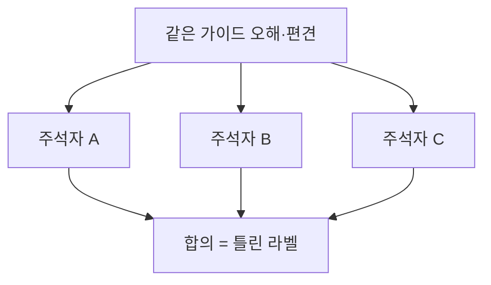

# 주석자 공통 편향

> 주석자 공통 편향은 여러 주석자가 같은 방향으로 틀리거나 같은 습관을 공유해, 합의·다수결이 모두 틀린 라벨에 모이는 문제다. 일치도가 높아도 정확하다는 보장이 없다.

## 쉽게 말하면
같은 학원에서 같은 오답 노트를 외운 학생 다섯 명은 서로 답이 일치하지만, 그 답이 틀렸을 수 있다. 일치한다는 사실은 "같이 배웠다"는 증거일 뿐 "정답이다"의 증거는 아니다.

## 자세히
- **연구 근거(Geva 외 2019, arXiv 1908.07898 초록, EMNLP-IJCNLP 2019)**: 세 NLP 데이터셋 실험에서 소수의 작업자가 대부분의 예시를 만들면 데이터 다양성이 위협받는다. 주석자 ID를 특징으로 넣으면 모델 성능이 오르고, 모델이 가장 많이 작업한 주석자를 알아본다. 학습에 기여하지 않은 주석자의 예시에서는 성능이 종종 낮으므로, 시험 세트 주석자는 학습 세트 주석자와 겹치지 않아야 한다고 권한다. 초록에는 효과 크기 수치가 없다.
- **일치도의 함정(해석)**: 주석자들이 같은 가이드 오해·같은 문화적 선입견·같은 도구 제안(자동 미리 라벨)을 공유하면 불일치율([평가자 간 일치도](#inter-annotator-agreement))은 낮아도 오류는 같은 쪽으로 쏠린다. 이중 검수의 "합의된 오답"이 그 사례다([이중 검수](#double-annotation-review)).
- **탐지(해석)**: ① 주석자별 기여 비율 확인(한 명이 데이터의 큰 몫을 만들었나) ② 주석자 ID를 맞추는 분류기를 시험해 보기 ③ 외부 전문가 소표본 감사 ④ 합의 점수가 높은데 모델이 반대로 강하게 예측하는 샘플 점검([CROWDLAB](#crowdlab)).
- **완화(해석)**: 주석자 다양화, 주석자당 기여 상한, 시험 세트는 다른 주석자가 라벨링, 가이드에 모호 사례 추가.

## 그림으로 보기

## 예시
- 소수 작업자가 70% 문장을 쓴 데이터로 학습한 모델이 새 작업자의 문장에서 성능이 떨어지는 경우(논문의 우려).
- 교육 활용: 같은 조의 학습자와 다른 조의 학습자가 같은 문장을 라벨링한 결과를 비교해 편향을 체험한다.

## 헷갈리는 것과 비교
| 개념 | 차이 |
| --- | --- |
| 공통 편향 | 모두가 같은 방향으로 틀림 |
| 무작위 오류 | 사람마다 다르게 틀려 합의로 줄어듦 |
| [평가자 간 일치도](#inter-annotator-agreement) | 일치만 보고 정확성은 모름 |
| [주석자 배정 공정성](#assignment-fairness) | 배정 구조로 편향 줄이기 |

## 더 읽을거리
- [Are We Modeling the Task or the Annotator? (arXiv 1908.07898)](https://arxiv.org/abs/1908.07898) — 주석자 편향과 주석자 분리 권고
