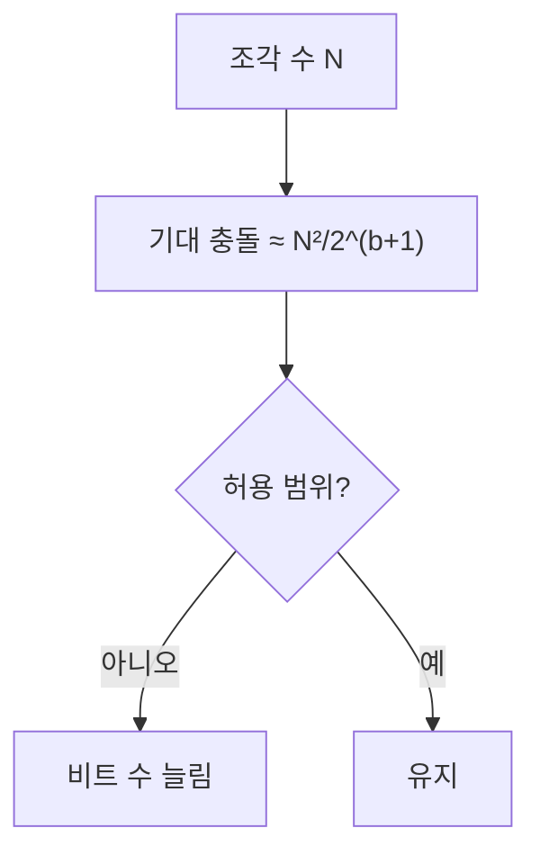

# 섀글 해시

> 문서 조각(섀글) 문자열을 **고정 길이 정수(해시)** 로 바꿔 저장·비교하는 기법. 메모리와 비교 비용을 크게 줄이지만, 서로 다른 조각이 같은 해시를 갖는 **충돌**이 생겨 자카드 값이 약간 부풀 수 있다.

## 쉽게 말하면
긴 책 제목을 매번 비교하지 않고 "도서관 번호"로 바꿔 비교하면 빠르다. 다만 번호 자릿수가 너무 짧으면 서로 다른 책이 같은 번호를 받는 사고가 생긴다.

## 자세히
- **방법**: 각 섀글(예: 단어 3개 튜플)을 해시 함수로 정수로 바꾸고 문서를 **정수 집합**으로 다룬다. 자카드는 정수 집합의 교집합/합집합으로 계산한다([자카드 임계값](#jaccard-threshold-tuning)).
- **메모리 절감(파이썬 직접 확인)**: 단어 3개 튜플 객체 하나가 약 64바이트(문자열 객체 별도), 정수 하나는 28바이트(해시를 64비트 정수로 쓰면 8바이트로 배열에 저장 가능). 수억 개 조각을 다루는 코퍼스에서 정수 해시를 넘파이 배열로 저장하면 문자열 대비 한 자릿수 배 이상 줄어든다(구현에 따라 다름).
- **충돌 확률(생일 역설)과 직접 실험**: N개 서로 다른 조각을 b비트 해시로 바꾸면 충돌 쌍의 기대 개수 ≈ N(N−1)/2 / 2^b. MD5를 b비트로 자른 해시로 실측한 결과:
  | 조각 수 N | 해시 비트 | **실측 충돌 수** | 기대 충돌 쌍 수 |
  |---|---|---|---|
  | 100,000 | 24 | 300 | 298.0 |
  | 100,000 | 32 | 1 | 1.16 |
  | 100,000 | 64 | 0 | ≈0 |
  | 1,000,000 | 24 | 29,073 | 29,802 |
  | 1,000,000 | 32 | 120 | 116.4 |
  | 1,000,000 | 64 | 0 | ≈0 |
  24비트는 100만 조각에서 약 2.9만 건이 충돌(전체의 약 3%). 32비트는 100만 조각에서 약 120건, 64비트는 실질적으로 0이다. 실측과 이론이 잘 맞는다.
- **자카드에 미치는 영향**: 충돌은 서로 다른 조각을 같은 조각으로 만들어 **교집합을 부풀린다.** 충돌 비율이 조각 수에 비해 0.01% 수준(32비트·10만 조각: 1건)이면 자카드 변화는 무시할 수 있고, 3%(24비트·100만)면 값이 체감할 만큼 오른다.
- **선택 가이드(권장)**
  1. 조각 수 N이 10⁶ 이상이면 **64비트** 해시 사용(충돌 사실상 0).
  2. 메모리가 정말 빠듯하면 32비트 + 충돌 기대치 N²/2^33을 계산해 허용 여부 판단.
  3. **암호학적 해시가 필요하지 않다**(속도 위해 xxHash·MurmurHash 같은 비암호 해시도 사용; 이 글에서 실험하지 않음).
  4. 해시 시드·알고리즘을 기록하고 학습-평가 파이프라인에서 동일하게 유지.
  5. 파이썬 내장 `hash()`는 프로세스마다 문자열 해시가 바뀌므로(해시 랜덤화) **저장·재사용용으로 쓰지 않는다**(파이썬 문서의 일반 동작; 이 글에서 재확인하지 않음).
- **MinHash와의 관계**: 해시된 조각 집합에서 최소 해시 값 시그니처로 자카드를 근사하면 더 줄일 수 있다([MinHash](#minhash)).

## 그림으로 보기



## 예시
```python
import hashlib
def h64(s): return int.from_bytes(hashlib.md5(s.encode()).digest()[:8], "big")
hs = {h64(" ".join(words[i:i+3])) for i in range(len(words) - 2)}      # 정수 섀글 집합
# 기대 충돌: N = len(all_shingles); N*(N-1)/2 / 2**64 ≈ 0
```
- 문서 5천만 개의 3-섀글을 64비트 정수로 저장해 중복 후보를 빠르게 비교.

## 헷갈리는 것과 비교
| 항목 | 설명 |
|---|---|
| 해시 충돌 | 서로 다른 조각이 같은 값 |
| 비트 수 | 충돌 확률을 결정 |
| MinHash | 해시 집합에서 시그니처만 저장 |
| 암호학적 해시 | 불필요(속도 위해 비암호 해시 사용 가능) |

## 더 읽을거리
- [Wikipedia: Jaccard index](https://en.wikipedia.org/wiki/Jaccard_index) — 자카드 정의(본문 열어 확인). 충돌 표는 이 글의 직접 실험(MD5 절단).
