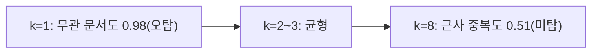
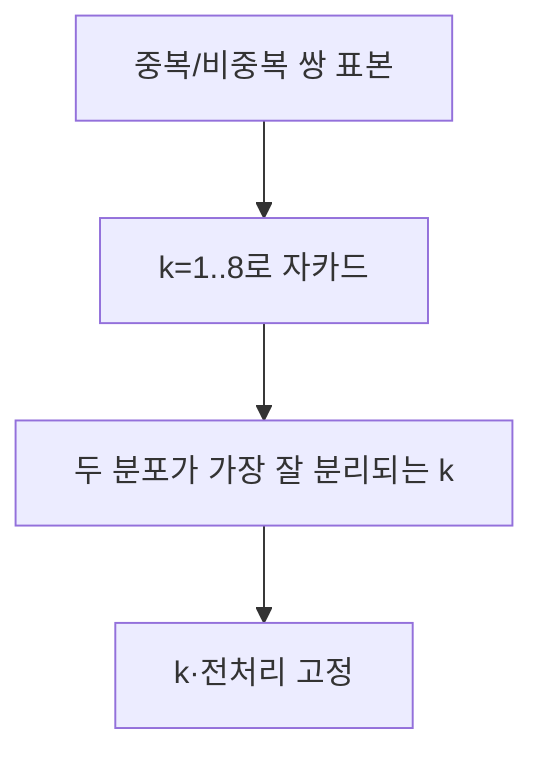

# 섀글 크기 k 고르기

> 문서를 길이 **k의 연속 조각(섀글, n-gram)** 집합으로 바꿔 자카드를 계산할 때, k가 작으면 **다른 문서도 닮아 보이고(오탐)**, 크면 **작은 수정에도 크게 달라 보인다(미탐)**. 문서 길이·언어·어휘에 맞춰 k를 정한다.

## 쉽게 말하면
책의 문장을 한 글자씩 대조하면 모든 책이 비슷해 보이고, 한 문단씩 대조하면 한 글자만 고쳐도 다른 책이 된다. 적당한 길이의 "단어 묶음"으로 비교해야 의미 있는 중복을 잡는다.

## 자세히
- **직접 시뮬레이션(순수 파이썬, 단어 섀글)**: 두 종류의 합성 데이터에서 k별 자카드(각 100쌍 평균)
  | k | 근사 중복(단어 5% 교체, 어휘 3,000) | **무관한** 문서 쌍(정형화된 문서: 어휘 40개 반복) |
  |---|---|---|
  | 1 | 0.910 | **0.983** |
  | 2 | 0.833 | 0.064 |
  | 3 | 0.748 | 0.002 |
  | 5 | 0.649 | 0.000 |
  | 8 | 0.508 | 0.000 |
  **k=1**(단어 집합)이면 어휘가 제한된 정형 문서에서 서로 무관한데도 자카드가 **0.98**로 거의 같아 보인다(오탐). k를 늘리면 무관 쌍은 0으로 떨어지지만 5% 수정한 근사 중복도 0.91 → 0.51로 내려간다(미탐 위험). **k=2~3**이 두 문제의 균형이 맞는 구간이었다(이 합성 데이터에서).
- **원리**: 단어 하나를 바꾸면 그것을 포함한 k개의 섀글이 모두 바뀌므로 k가 클수록 한 수정이 더 많은 조각을 깨뜨린다. 반대로 k가 작으면 서로 다른 문서가 같은 조각을 우연히 공유하기 쉽다(특히 어휘가 작거나 정형화된 문서).
- **언어·단위(일반 경험칙, 검증 필요)**
  | 대상 | 시작 k | 비고 |
  |---|---|---|
  | 긴 영문 문서(단어) | 3~5 | 단어 n-gram |
  | 짧은 문장·제목 | 2~3 | 길이가 짧아 큰 k는 조각이 너무 적음 |
  | 한국어(글자 n-gram) | 3~5자 | 띄어쓰기·조사 변화가 많아 글자 단위가 안정적일 수 있음 |
  | 코드·로그 | 줄 또는 토큰 5~10 | 반복 구조 고려 |
- **조각 수 확인**: 문서 길이 L단어이면 섀글은 L−k+1개. 아주 짧은 문서에서 k가 크면 조각이 몇 개 안 돼 자카드가 불안정.
- **k 정하는 절차(권장)**
  1. 사람이 판정한 **중복/비중복 쌍**을 모은다([자카드 임계값 정하기](#jaccard-threshold-tuning)).
  2. k = 1~8을 바꿔 가며 두 집단의 자카드 분포가 **가장 잘 분리되는** k를 고른다(AUC 또는 정밀도-재현율).
  3. 정형·템플릿 문서가 많은 코퍼스는 **무관 쌍 자카드 분포**를 따로 확인(k가 작으면 높게 나옴).
  4. 선택한 k·전처리를 고정하고 기록.
- **한계**: 위 수치는 무작위 어휘 합성 데이터라 실제 언어의 상관(자주 쓰는 구)은 반영하지 않는다.

## 그림으로 보기



## 예시
```python
def shingles(words, k): return {tuple(words[i:i+k]) for i in range(len(words)-k+1)}
for k in (2, 3, 5):
    J_dup = [jaccard(shingles(a, k), shingles(b, k)) for a, b in dup_pairs]
    J_non = [jaccard(shingles(a, k), shingles(b, k)) for a, b in nondup_pairs]
    print(k, mean(J_dup), mean(J_non))        # 분리가 가장 큰 k 선택
```
- 사내 약관 문서처럼 문장 구조가 정형화된 코퍼스는 k=1~2에서 서로 거의 같아 보이므로 k를 3 이상으로.

## 헷갈리는 것과 비교
| 선택 | 효과 |
|---|---|
| k 작음 | 재현율↑ 오탐↑ |
| k 큼 | 정밀도↑ 미탐↑ |
| 단위(단어/글자) | 언어·토큰화에 따라 |
| [자카드 임계값](#jaccard-threshold-tuning) | k와 함께 정해야 함 |

## 더 읽을거리
- [Wikipedia: Jaccard index](https://en.wikipedia.org/wiki/Jaccard_index) — 자카드 정의(본문 열어 확인). k별 표는 이 글의 직접 시뮬레이션(합성 데이터). 언어별 k 표는 경험칙으로 검증이 필요.
