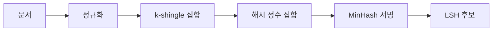
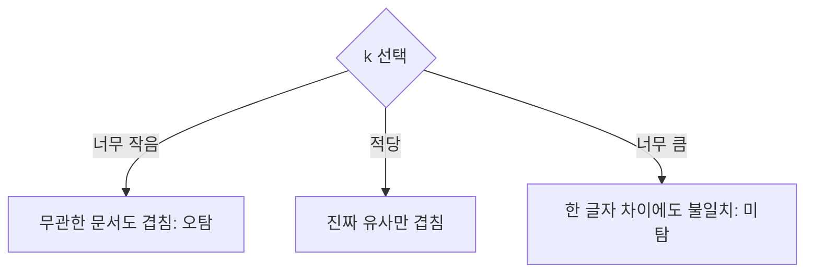

# 섀글링(n-그램 집합)

> 문서를 길이 k의 **연속 조각(k-shingle, n-그램)의 집합**으로 바꾸는 단계다. 문서 비교 문제를 [자카드 유사도](#jaccard-similarity)가 쓰는 "집합 비교" 문제로 바꿔 준다.

## 쉽게 말하면
두 글이 비슷한지 보려고 글을 가위로 같은 길이의 조각으로 촘촘히 잘라 낸다. 한 글자씩 밀며 자르므로 조각이 겹친다. 두 글이 같은 조각을 많이 공유하면 비슷한 글이다. 조각이 너무 짧으면 아무 글끼리도 겹치고, 너무 길면 한 글자만 달라도 다 어긋난다.

## 자세히
- 만드는 법: 글자 기준 k-shingle은 `s[i:i+k]`를 전부 모은 집합, 단어 기준은 연속 k단어 묶음.
- k 고르기: Mining of Massive Datasets 3.2절 "Choosing the Shingle Size"에서 다룬다. 검색으로 본 강의 노트(2차 자료) 요약은 가능한 조각 수를 대략 20^k로 보고, 짧은 문서(이메일)는 k=5, 긴 문서(논문)는 k=9 정도면 안전하다는 경험칙이다. 이 수치는 책 본문이 아닌 노트 기준이라 확인이 필요하다.
- 직접 실행한 예(영어 한 문장에서 단어 하나 변경 fox→leaps): 글자 k=2 자카드 0.84, k=3 0.78, k=5 0.70, k=9 0.52. 단어 단위는 1단어 0.8, 2단어 0.6, 3단어 0.4. k가 커질수록 작은 수정에 민감해진다.
- 조각이 많으면 메모리가 크므로 각 조각을 해시해 32/64비트 정수로 저장한다(충돌은 드물게 허용). 이어서 [MinHash](#minhash-lsh)가 집합 전체를 짧은 서명으로 줄인다.
- 전처리가 결과를 바꾼다: 소문자화, 공백 정규화, 구두점 처리를 먼저 통일한다.

## 그림으로 보기

## 예시
- "data science" → 3-그램 {dat, ata, ta_, a_s, _sc, sci, cie, ien, enc, nce}(10개).
- 한국어는 띄어쓰기 변동이 크므로 글자 단위 3~5-그램이 단어 단위보다 안정적인 경우가 많다(경험칙, 데이터로 확인할 것).

## 헷갈리는 것과 비교
| 개념 | 차이 |
|---|---|
| 섀글링 | 문서→집합 변환 |
| 토큰화(LLM) | 모델 입력용 어휘 분할, 겹치지 않음 |
| 자카드 | 집합 사이의 점수 |
| [MinHash·LSH](#minhash-lsh) | 집합을 압축해 빠르게 비교 |

## 더 읽을거리
- [Mining of Massive Datasets 3장 소개(Cambridge)](https://cambridge.org/core/product/identifier/CBO9781139058452A022/type/BOOK_PART) — 섀글링을 먼저 소개하는 장(목차 확인).
- [CS 강의 슬라이드(UoI)](https://www.cs.uoi.gr/~tsap/teaching/2016-cse012/slides/datamining-lect5.pdf) — 검색 결과로 확인한 2차 자료, k 선택 경험칙 포함.
